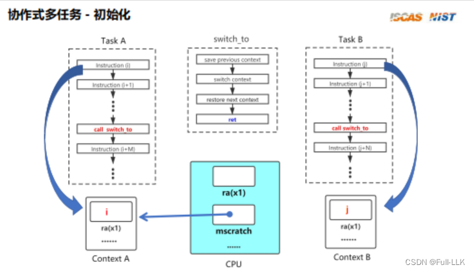
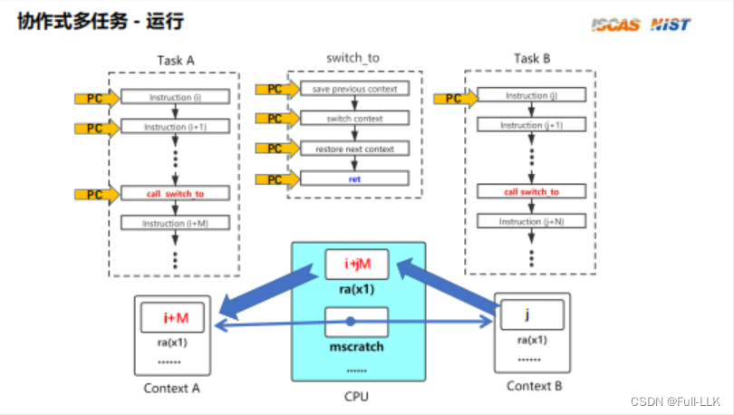
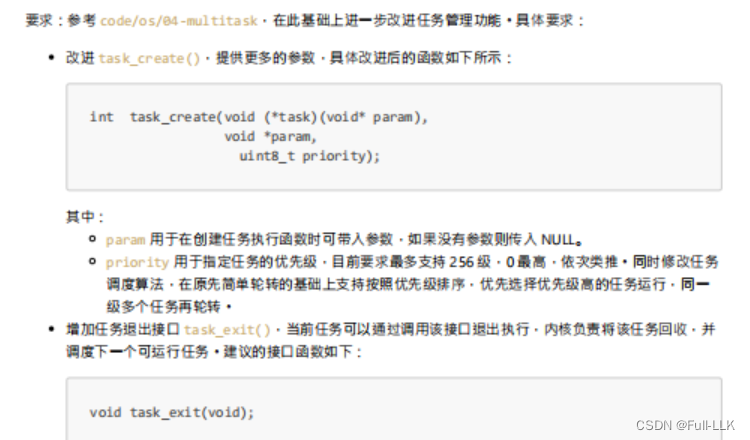
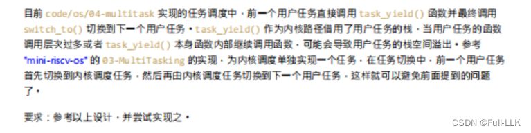


# 任务
可以理解为一段待执行的指令

# 任务上下文
可以理解为执行该任务时对应的 CPU 各寄存器的状态

# 多任务

当核数少于要运行的任务数时，各任务轮流在 CPU 上运行，保证宏观上每个任务看起来都在执行

# 多任务系统分类
协作式多任务：由任务内的代码主动放弃 CPU，切换到下一个任务
抢占式多任务：由操作系统决定何时放弃 CPU，切换到下一个任务

# 协作式多任务

初始化即设置好每个任务的上下文（每个任务的上下文保存在内存中），比如将上下文中的 ra（返回地址）设置为任务的第一条指令

切换到某个任务时（switch_to 函数）

1. 先将当前 CPU 的寄存器状态保存到原任务的上下文中
2. 修改 mscratch 寄存器，使其指向下一个任务的上下文（mscratch 寄存器是一个特殊的控制和状态寄存器（CSR），保存任务上下文的地址）
3. 将下一个任务的上下文加载到当前 CPU 中
4. ret 指令之后，下一个任务开始执行

# 代码实现
主要分为两方面：进程切换和任务设置
进程切换即 switch 函数；任务设置即对任务的管理

**代码链接**
[https://github.com/FULLK/risllkos/tree/main/Fullkenerl4](https://github.com/FULLK/risllkos/tree/main/Fullkenerl4)
##   `asm volatile("csrw mscratch, %0" : : "r" (x));`

这段汇编代码是 RISC-V 架构中使用的一条特殊指令，其作用是将寄存器 `x` 的值写入 `mscratch` 寄存器。

我们来逐步解释这条指令：

1. `asm volatile("csrw mscratch, %0" : : "r" (x));`
   - `asm`：这是内联汇编指令，用于在 C/C++ 代码中直接插入汇编代码。
   - `volatile`：该关键字告诉编译器不要对这条汇编指令做任何优化或重排。
   - `"csrw mscratch, %0"`：这是汇编指令模板，其中：
     - `csrw`：RISC-V 的一条特殊指令，用于将寄存器的值写入控制和状态寄存器（CSR）。
     - `mscratch`：要写入的目标 CSR 寄存器，即前面提到的 `mscratch` 寄存器。
     - `%0`：占位符，用于引用下面的输入操作数。
   - `: : "r" (x)`：这是输入操作数的定义，其中：
     - `"r"`：表示这是一个只读的输入操作数。（即该操作数在执行过程中不会被修改）
     - `(x)`：表示使用寄存器 `x` 的值作为输入。

总之，这条指令的作用是将寄存器 `x` 的值写入 `mscratch` 寄存器。这类操作通常用于在异常、中断或 trap 处理程序中保存和恢复寄存器状态。

##  lw 和 sw
SW 和 LW 是 RISC-V 指令集中两条重要的指令，分别表示 Store Word（存字）和 Load Word（取字）。它们用于在内存和寄存器之间传输数据。

1. SW（Store Word）指令：
   - 其作用是将寄存器中的数据存储到内存的指定地址。
   - 指令格式为 `sw rd, offset(rs1)`，其中 `rd` 是要存储的寄存器，`offset` 是内存地址的偏移量，`rs1` 是基址寄存器。
   - 例如，`sw x10, 8(x11)` 将寄存器 x10 中的数据存储到内存地址 `x11 + 8` 处。

2. LW（Load Word）指令：
   - 其作用是将内存中的数据加载到寄存器中。
   - 指令格式为 `lw rd, offset(rs1)`，其中 `rd` 是存放加载数据的目标寄存器，`offset` 是内存地址的偏移量，`rs1` 是基址寄存器。
   - 例如，`lw x12, 4(x13)` 将内存地址 `x13 + 4` 处的数据加载到寄存器 x12 中。

SW 和 LW 指令是 RISC-V 指令集中最基本、最常用的两条指令。它们使 RISC-V 能够在内存和寄存器之间高效地传输数据，是构建复杂计算系统的基础。

## gp、tp 和 zero 寄存器

1. gp（Global Pointer，全局指针）寄存器：
   - gp 寄存器用于存放全局数据段的基地址。
   - 在大型程序中，全局变量和静态变量通常放在全局数据段中。
   - 通过 gp 寄存器，可以快速访问这些全局变量，而无需计算复杂的地址偏移。
   - gp 寄存器可以减少指令数量，提高程序性能。

2. tp（Thread Pointer，线程指针）寄存器：
   - tp 寄存器用于存放当前线程/任务的局部存储区的基地址。
   - 在多线程/多任务系统中，每个线程/任务都有自己的局部存储区，tp 寄存器用于快速访问这些区域。
   - tp 寄存器可以简化线程/任务切换时的内存访问，提高性能。

3. zero 寄存器：
   - zero 寄存器是一个特殊的寄存器，其值恒为 0。
   - 向 zero 寄存器写入数据相当于丢弃该数据。
   - 从 zero 寄存器读取数据总是返回 0。
   - 在需要 NOP（空操作）指令或清零操作时，zero 寄存器非常有用。

这三个寄存器在 RISC-V 架构中扮演着重要角色，为 RISC-V 系统提供了高效的全局数据访问、线程管理和基本运算支持。

# 待实现


