
# 控制流
控制流：由程序控制的执行流
Trap 分为中断（interrupt）和异常（exception）
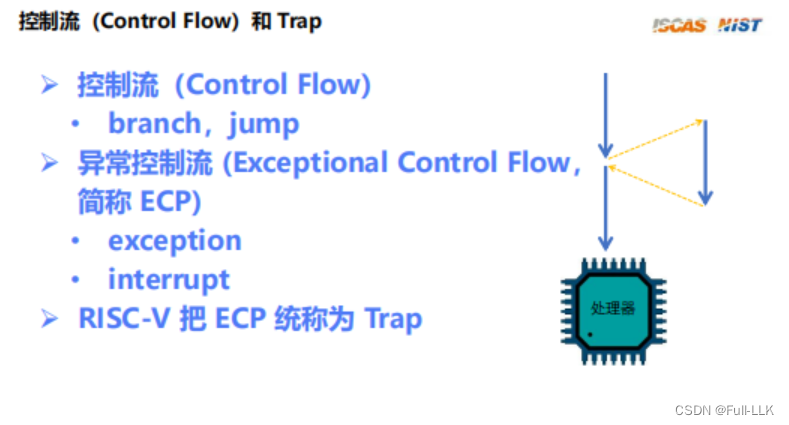
# mtvec
base：存放 trap 入口函数的基地址右移两位后的值，即四字节对齐的地址
WARL：可以写入任意值，但读出的值必须是合法的
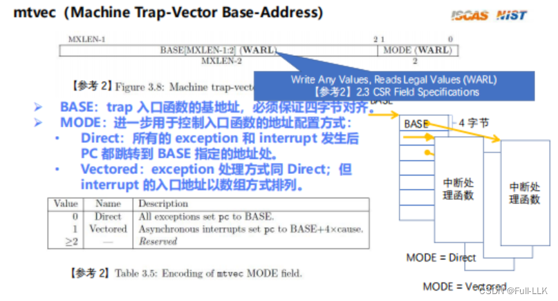
# mepc
异常执行完毕后，恢复原来的执行流，
MXLEN：这是 CPU 的处理长度
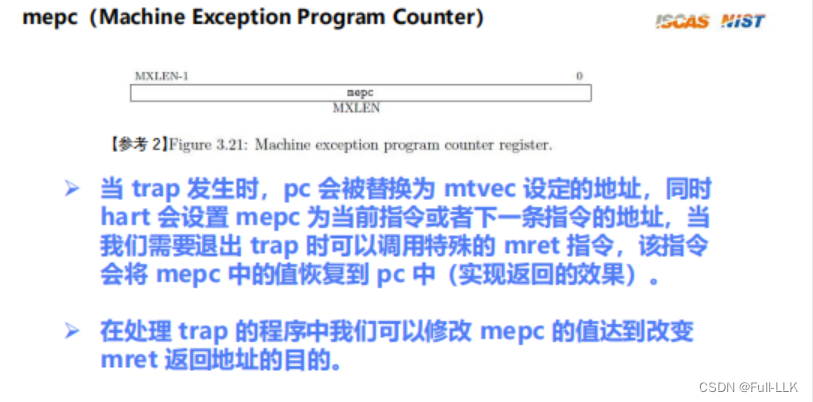
#  mcause
WLRL：读和写这部分都必须使用合法值
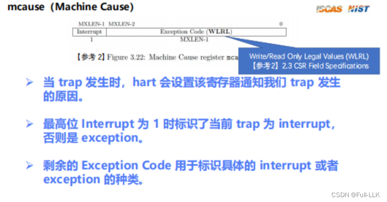

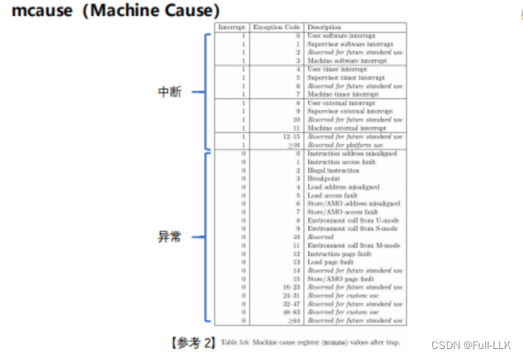

# mtval
对 mcause 的补充
在 RISC-V 架构中，`mtval` 是 Machine Trap Value 寄存器的缩写；它是 RISC-V 架构定义的一部分，用于异常处理机制。

当发生硬件触发的异常时，例如 load 访问错误、store 访问错误、非法指令等，`mtval` 寄存器会被设置为相关的错误值。具体来说：

- 对于 load 或 AMO（原子操作）访问错误，`mtval` 保存引发错误的地址。
- 对于 store 访问错误，`mtval` 同样保存所尝试的非法存储操作的地址。
- 对于与指令相关的异常（如非法指令），`mtval` 存放触发异常的指令的地址。

程序员或操作系统可以通过检查 `mtval` 寄存器的内容来确定异常的具体原因，这对调试和异常处理程序非常重要。在 RISC-V 架构的特权模式中，不同的异常级别（如 Machine、Supervisor、User 等）都有对应的 trap value 寄存器；例如在 Supervisor 模式下，类似的寄存器可能是 `scause` 和 `sbadaddr`。
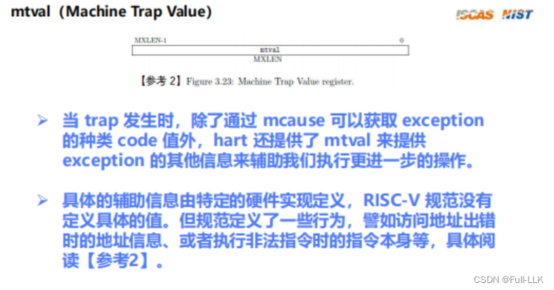

#  mstatus
xPIE 保存 trap 执行前当前的 xIE；trap 结束后再恢复回 xIE
xPP 保存陷入当前特权级 x 之前的特权级值。陷入 M 之前的特权级可以是 M、U 或 S，所以用两位来表示这三种状态。陷入 S 之前的特权级可以是 U 或 S，所以用一位；陷入 U 只能来自 U，所以不需要保存，因为 trap 结束后恢复的和 trap 执行时的一样。
WPRI：读该寄存器时忽略这部分的值；写该寄存器时保留这部分原来的值（不改变它）
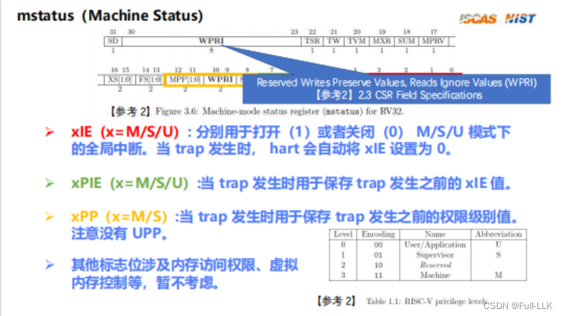
# Trap 初始化
把 mtvec 的地址设置为自己的异常处理程序的入口地址

在 RISC-V 架构中，`mtvec` 是 Machine Trap Vector Base Address Register（机器模式陷阱向量基地址寄存器）的缩写。该寄存器在 RISC-V 处理器中起着核心作用；它决定了发生硬件异常或中断时，处理器应跳转到哪里执行相应的处理代码。

`mtvec` 寄存器的结构通常由两部分组成：
1. **基地址（Base Address）**：存放一个物理地址；发生异常或中断时，处理器跳转到该地址执行异常处理程序的第一条指令。

2. **模式（Mode）**：
   - **直接模式（Direct Mode）**：在该模式下，基地址字段直接指向异常处理程序的入口地址。
   - **向量模式（Vectored Mode）**：在该模式下，基地址字段指向一个固定的向量表，其中每一项对应一种特定的异常类型。发生异常时，处理器根据异常类型从向量表中索引出相应的处理程序地址。

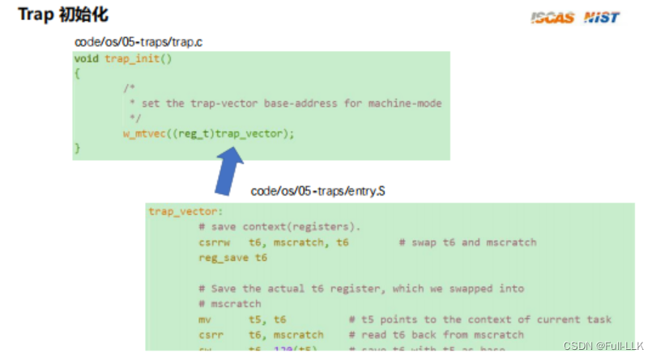
# Trap 上半部（由硬件完成）
1. MIE 复制到 MPIE，MIE 清零
2. 设置 mepc，并将 pc 设置为 mtvec（异常：异常处理程序结束后需要重新执行出错的指令；中断：中断处理完后执行下一条指令）
3. 设置 mcause 和 mtval
4. 设置 MPP，特权级进入 M（无论是什么 trap，都先切换到机器模式）
. 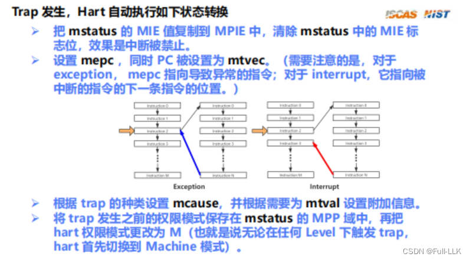
# Trap 下半部（由软件完成）
1. 切换上下文
2. 调用相应的处理函数
3. 恢复上下文
4. mret
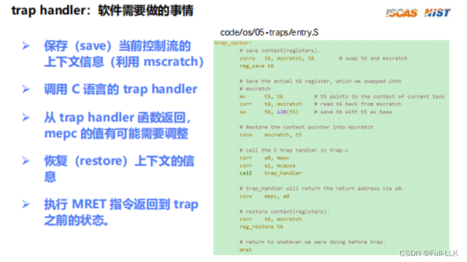

# 从 Trap 返回
1. 恢复特权级
2. 中断恢复，设置 MPP
3. pc 恢复，设置 MPIE
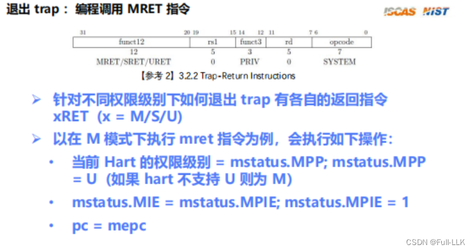

# 为什么 MPP 设为 U、MPIE 设为 1
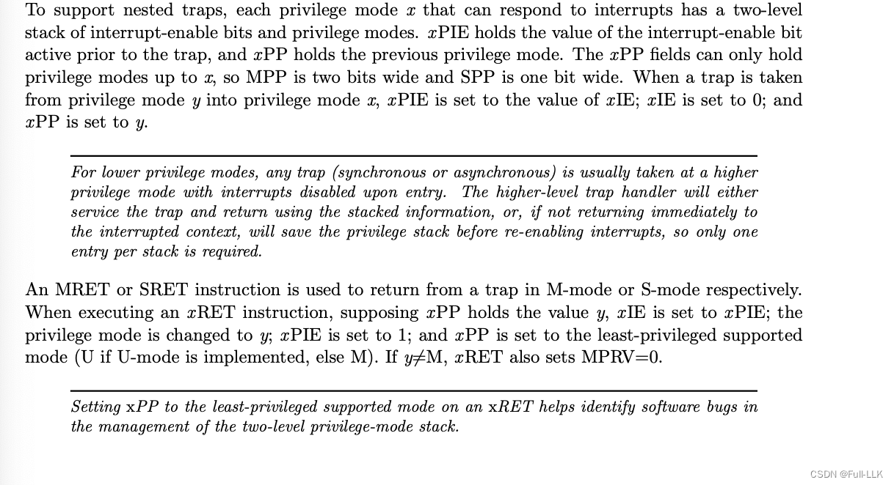

# 代码实现
[https://github.com/FULLK/risllkos/tree/main/Fullkenerl5](https://github.com/FULLK/risllkos/tree/main/Fullkenerl5)

