
# GCC
## GCC 简介
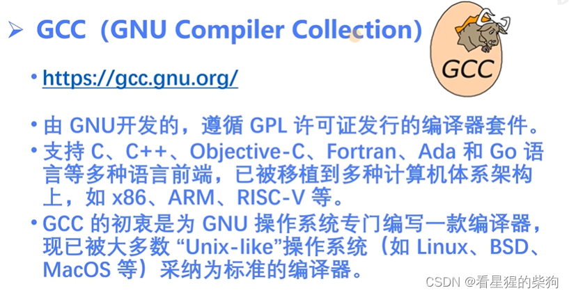
## GCC 命令格式
预处理：把 #define、#include 等以 # 开头的宏转换为标准 C
 编译：C 变成机器指令
 链接：把编译好的指令文件与其他库链接在一起
 调试需要加入调试信息

建议亲手试一试，观察其中的差异
 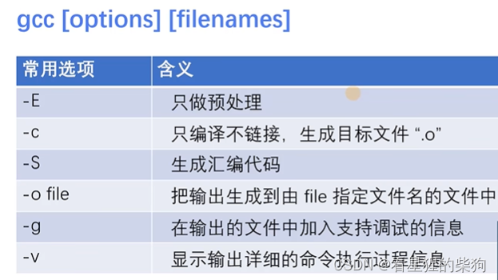
 例如这个程序
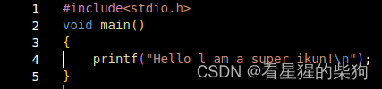
## gcc -E
对该文件进行预处理，并把结果输出到 .E 文件
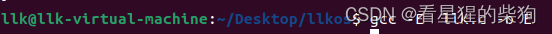
打开 .E 文件
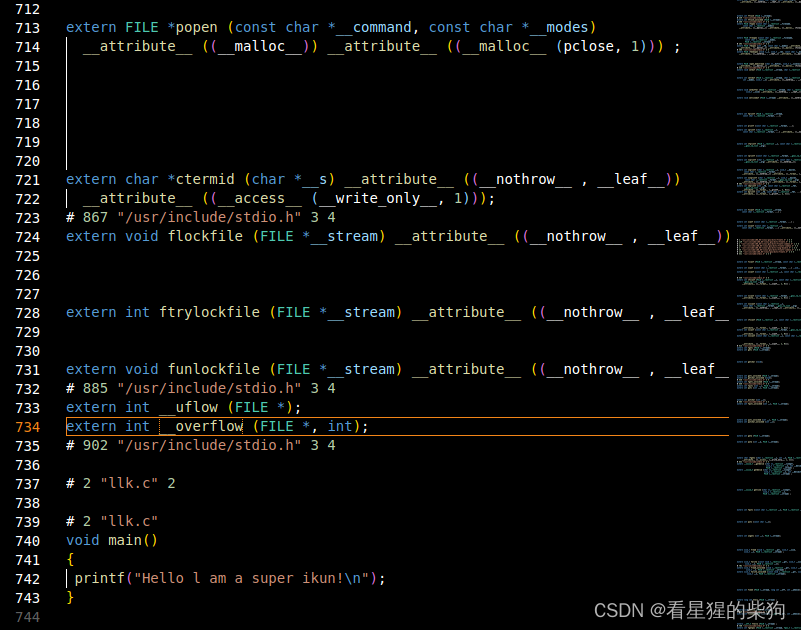
可以看到有很多代码，但最后的 main 函数没有变化。上面的代码就是把 #include<stdio.h> 转换成 C 代码的结果
## gcc -c
生成目标文件，但还没有链接
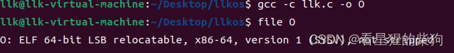
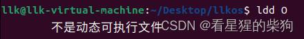
## gcc -S
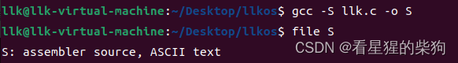
打开 .S 文件查看，是汇编语言
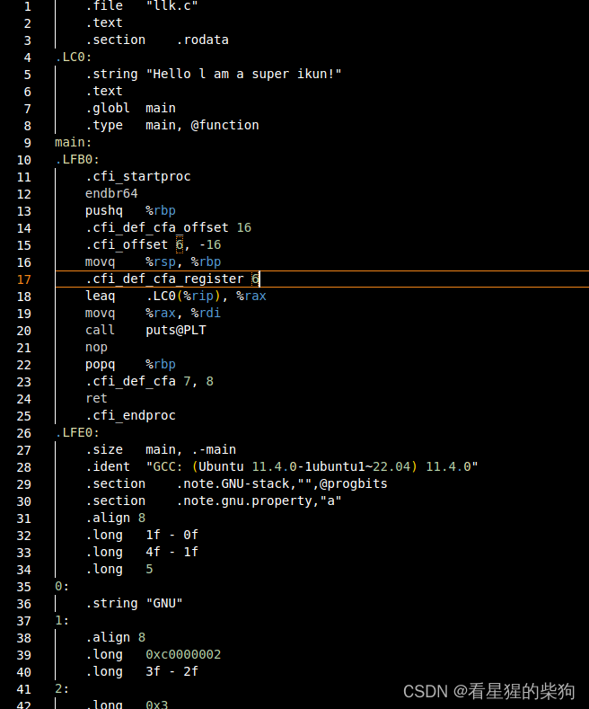
##  gcc -g 
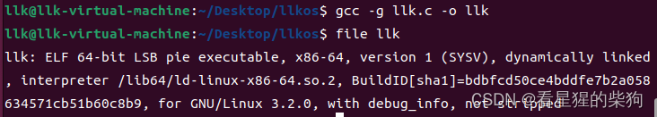
## gcc -v
可以看到一长串相关信息
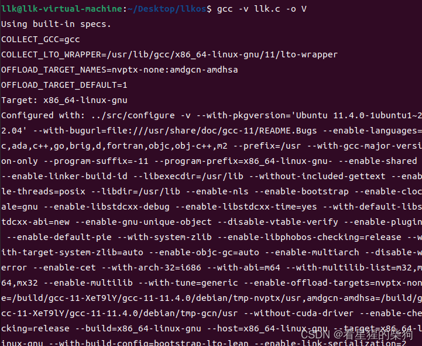


## GCC 的主要执行步骤

> Linux mv（英文全称：move file）命令用来为文件或目录改名，或将文件或目录移入其他位置。

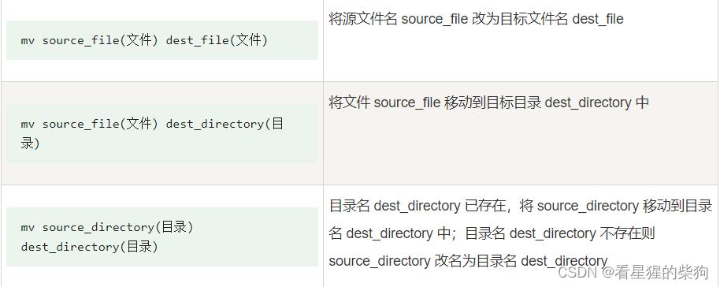
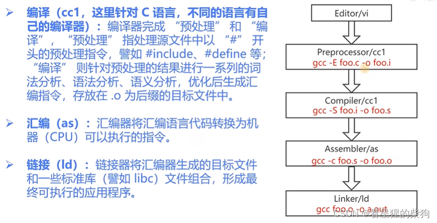

cc1：预处理和编译
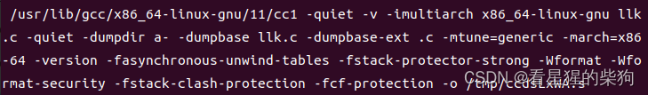
as：生成 .o 文件（机器指令）

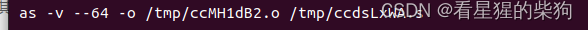
collect 中包含用于链接的 ld
把各种标准库与 .o 文件链接在一起
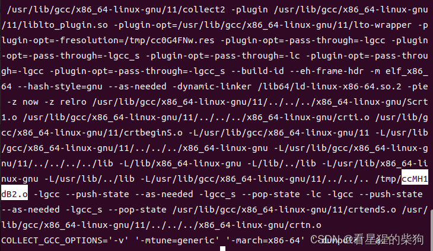

## GCC 涉及的文件类型
小写 s：不包含以 # 开头的代码
大写 S：仍包含以 # 开头的代码
可执行文件默认为 a.out
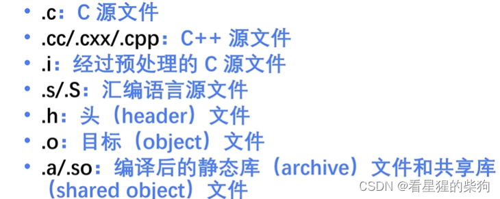
## 处理多个源文件
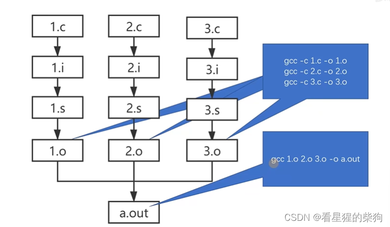
#  ELF
##  ELF 简介
可重定位文件：位置只有经过链接才能确定
核心转储文件：程序崩溃时的相关信息
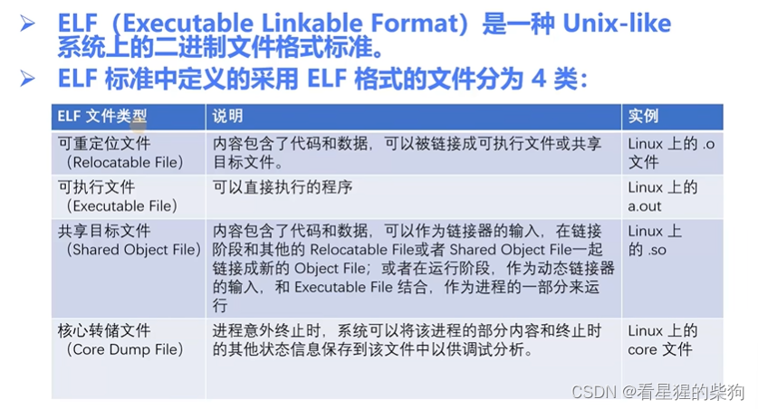
## ELF 文件格式
二进制
ELF Header：ELF 文件的基本信息（如运行在哪种架构上、版本号）
.text：程序的指令
.init：程序初始化的指令
4K 字节对齐
Program Header Table：运行时使用；决定哪些 section 组合成 segment，以及 segment 放在哪里
Section Header Table：section 的相关信息，如用于定位
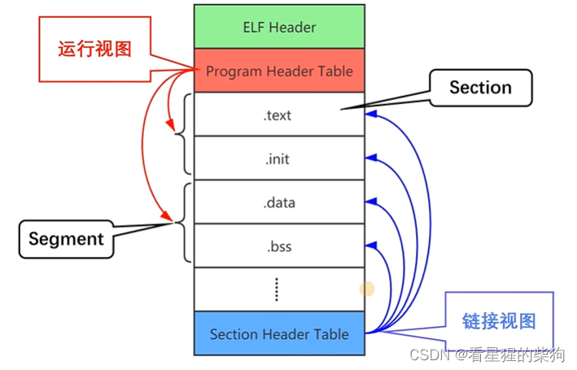
## ELF 文件处理工具：Binutils（binary utility）
ar=tar：生成静态库时需要用到

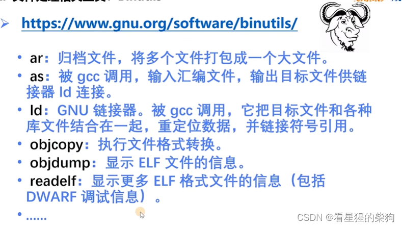
### readlelf -h
查看文件头（ELF header）
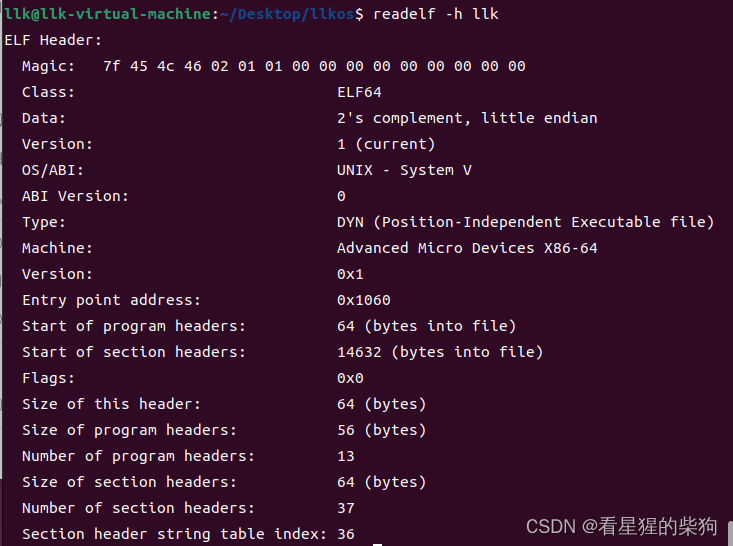

 -  Magic：魔数；用处不大，只是给 ELF 一个特殊标记，以便与其他东西区分

-  Class：文件类型，64 位或 32 位
###  readelf -S 或 readelf  -SW（加 W 显示更宽）
查看 Section Header Table
PROGBITS：表示可执行
RELA：可重定位
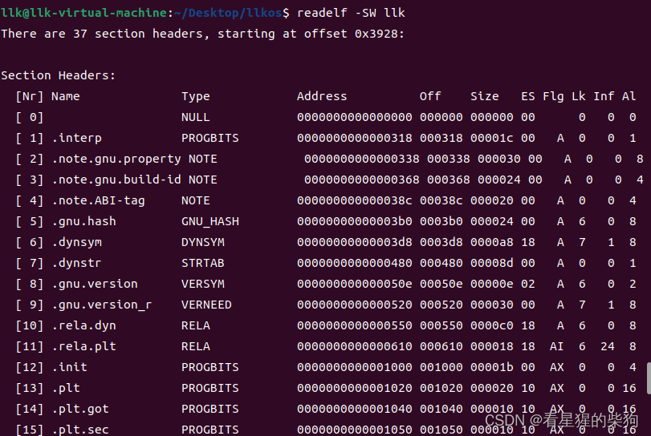

### objdump -S
-S 在反汇编中显示源代码部分

此时反汇编结果中没有源代码部分
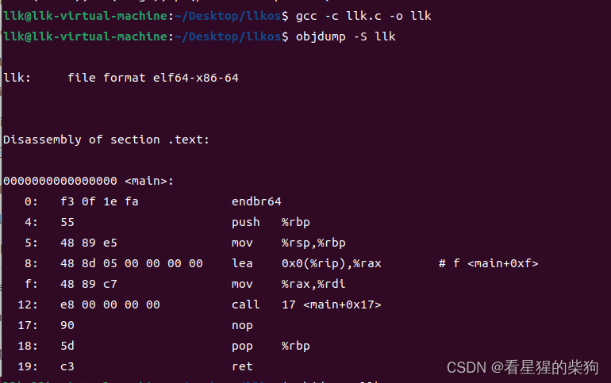
用 -g 编译（生成调试信息）后再反汇编，就会发现源代码和汇编指令一起出现了
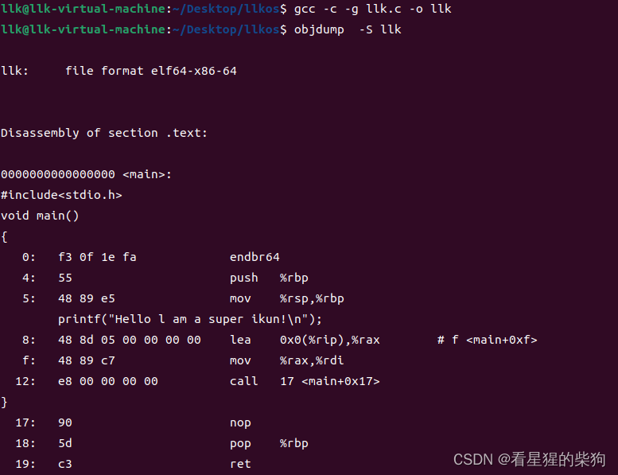

# 练习 3-1
- 使用 gcc 编译代码，并使用 binutils 工具分析生成的目标文件和可执行文件（ELF 格式）。具体要求如下：
- 编写一个简单的打印 "hello world!" 的程序源文件：hello.c
在本机上编译该源文件，生成面向支持 x86_64 指令集架构处理器的目标文件 hello.o。
- 查看 hello.o 的文件头信息。
- 查看 hello.o 的 Section Header Table。
- 对 hello.o 反汇编，查看 hello.c 的 C 源代码与机器指令之间的对应关系。
# 练习 3-2
如下示例 C 代码

```c
#include <stdio.h>
int global_init = 0x11111111;
const int global_const = 0x22222222;
void main()
{
static int static_var = 0x33333333;
static int static_var_uninit;
int auto_var = 0x44444444;
printf("hello world!\n");
return;
}

```
- 编译成可执行文件后，变量 global_init、global_const、static_var、static_var_uninit、auto_var 分别存放在哪些 section 中？
- 字符串 "hello world!\n" 在哪里？尝试用工具查看并验证你的猜测
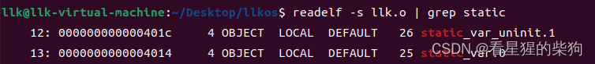
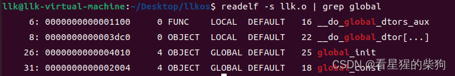
 auto_var 变量和 "hello world!\n" 字符串在栈上，只有程序运行时才存在
 可以根据地址判断它属于哪个 section
 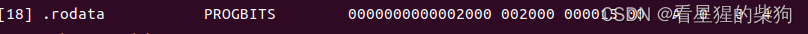
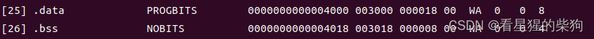

