
# 什么是嵌入式开发
程序运行在开发板上，换句话说，就是运行在硬件上

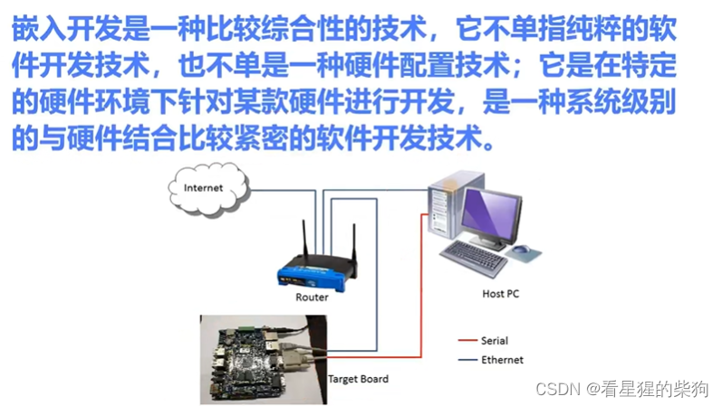
# 交叉编译
简单来说，交叉编译就是生成的程序不在本机上运行，而是在与本机体系结构不同的计算机上运行
build：构建编译器的计算机
host：运行由 build 计算机生成的编译器的计算机
target：编译结果运行的地方
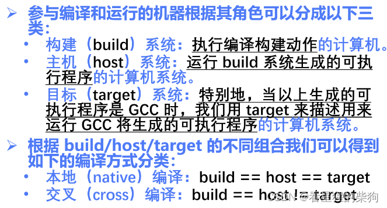

## 看看 GCC 的一些文件夹
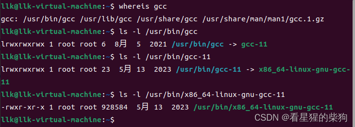
-> 表示符号链接
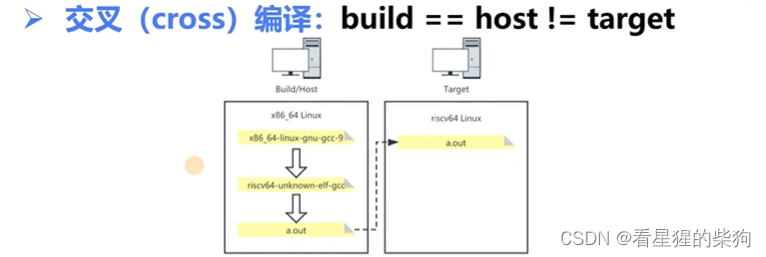

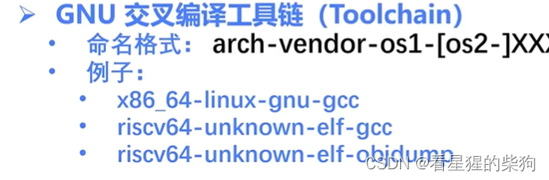
# GDB 调试器
GDB 调试涉及 2 个程序：gdb 程序和被调试的程序。根据这 2 个程序是否运行在同一台计算机上，GDB 的调试模式可以分为 2 种：
本地调试：调试器和被调试程序运行在同一台计算机上
gdb 启动后，首先 fork 一个子进程，被调试程序就在这个单独的子进程中运行，gdb 程序本身也在自己独立的进程中运行。然后这两个进程通过特殊的 ptrace 系统调用建立联系。

远程调试：调试器运行在一台计算机上，而被调试程序运行在另一台计算机上
目标机上有一个 gdbserver 服务，gdb 与 gdbserver 交互，由 gdbserver 代理我们的调试过程。被调试程序运行在目标机上，而调试操作在本机上进行。两台机器通过网络连接

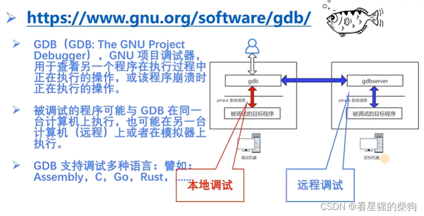
## 相关语法和命令
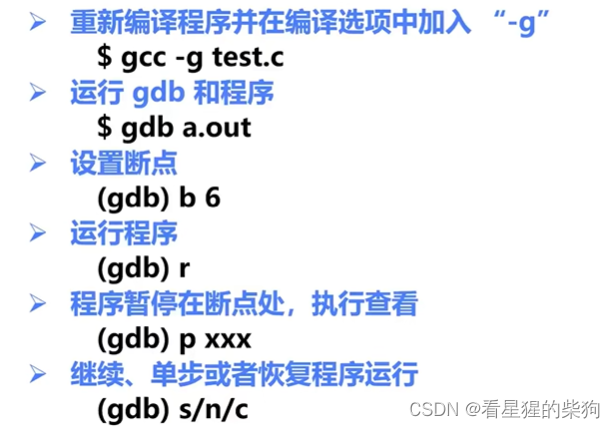

```bash
p <变量名称>
Print的简写，显示指定变量（临时变量或全局变量）的值。

s
执行一行源程序代码，如果此行代码中有函数调用，则进入该函数。相当于其它调试器中的“Step Into (单步跟踪进入)”。
这个命令必须在有源代码调试信息的情况下才可以使用（GCC编译时使用“-g”参数）。

si
si命令类似于s命令，但针对汇编指令。

n
执行一行源程序代码，此行代码中的函数调用也一并执行。相当于其它调试器中的“Step Over (单步跟踪)”。
这个命令必须在有源代码调试信息的情况下才可以使用（GCC编译时使用“-g”参数）。

ni
ni命令类似于n命令，但针对汇编指令。

c
Continue的简写，继续执行被调试程序，直至下一个断点或程序结束。

l
List的简写，列出当前位置之后的10行代码；list line_number: 列出line_number之后的十行代码。

```

# QEMU 模拟器
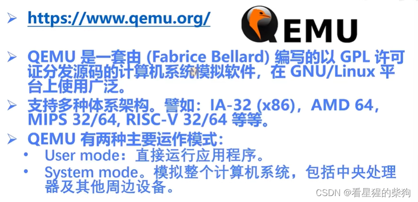
此时它模拟的是用户级环境（类似于操作系统）；llk 运行在用户级
```bash
qemu-riscv32 ./llk  #在qemu提供的环境上运行llk
```
开发操作系统时，需要模拟系统级层面（类似于硬件层面）
#  安装和使用 QEMU
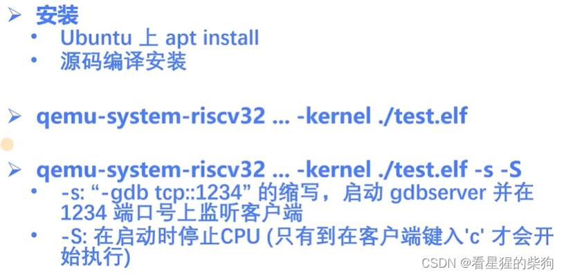

# 项目构建工具 Make
以自动化的方式编译程序
-f 指定 makefile
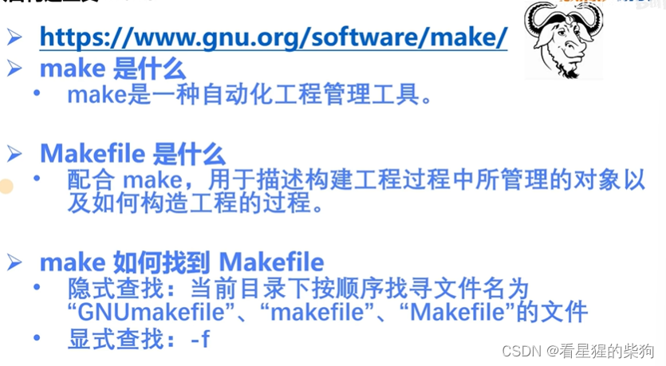
## Makefile 的结构
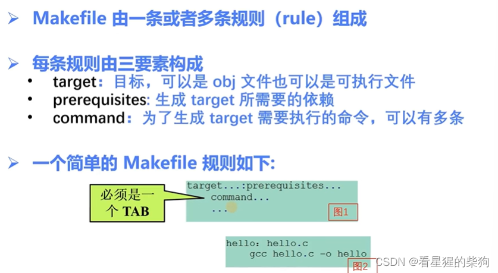
特殊变量 .DEFAULT_GOAL 可以用来告诉 Make：如果命令行上没有指定目标（即直接运行 make 时），要构建哪个（或哪些）目标。否则，Make 就构建它遇到的第一个目标。
.PHONY：伪目标。伪目标并不代表一个真正的文件名，在执行 make 时可以指定这个目标来执行其规则中定义的命令。伪目标有时也称为标签。伪目标用 PHONY 声明。在 PHONY 中声明的目标，其命令总是会被执行
在下图中，意思是无论 clean 是否存在，clean 中的命令都会执行

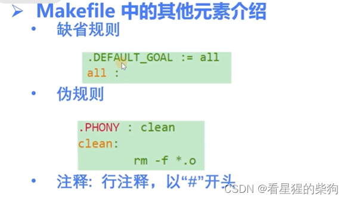

```bash
$(SRCS_ASM:.S=.o) 就是将SRCS_ASH变量里面的.S都替换为.o
```

## 运行 make
基本上就是一层套一层
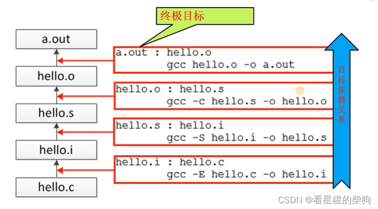


# 练习 4-1
熟悉交叉编译的概念。使用 riscv gcc 编译代码，并使用 binutils 工具分析生成的目标文件和可执行文件（ELF 格式）。具体要求如下：
- 编写一个打印 "hello world!" 的简单程序源文件：hello.c
- 针对支持 rv32ima 指令集架构的处理器，编译源文件生成目标文件 hello.o
- 查看 hello.o 的文件头信息。
- 查看 hello.o 的 Section Header Table。
- 反汇编 hello.o，查看 hello.c 的 C 源代码与机器指令之间的对应关系。

-march=rv32ima：指定生成的 32 位可执行文件可以运行在支持 i 整数指令集、m 乘除法指令集和 a 原子操作指令集的处理器上

-mabi=ilp32：长整型是多少位

```bash
riscv64-unknown-elf-gcc -march=rv32ima -mabi=ilp32 llk.c -o llk
```

```bash
file llk
```

```bash
qemu-riscv32 ./llk  #在qemu提供的环境上运行llk
```

# 练习 4-2
在练习 4-1 的基础上，继续熟悉 qemu/gdb 等工具。具体要求如下：
- 将 hello.c 编译成可调试的可执行文件 a.out
- 先用 qemu-riscv32 运行 a.out。
- 使用 qemu-riscv32 和 gdb 调试 a.out。
# 练习 4-3
- 自学 Makefile 语法，并理解在 riscv-operating-system-mooc 仓库根目录下执行 make 时会发生什么。


```bash
SECTIONS = \
	code/asm \
	code/os \

.DEFAULT_GOAL := all
all :
	@echo "begin compile ALL exercises for assembly samples ......................."
	for dir in $(SECTIONS); do $(MAKE) -C $$dir || exit "$$?"; done
	@echo "compile ALL exercises finished successfully! ......"

.PHONY : clean
clean:
	for dir in $(SECTIONS); do $(MAKE) -C $$dir clean || exit "$$?"; done

.PHONY : slides
slides:
	rm -f ./slides/*.pdf
	soffice --headless --convert-to pdf:writer_pdf_Export --outdir ./slides ./docs/ppts/*.pptx


```
- \ 表示续行。只有在执行 Makefile 对应命令中的 shell 语句时才会进入 shell 环境；每一行命令都是独立的，每一行都在单独的 shell 中运行，因此上一行定义的 shell 变量对下一行无效。当然，用 \ 把行连接起来就可以消除这个限制，使它们成为由同一个 shell 执行的一条命令。图中 SECTIONS 后面的 \ 可以理解为把下面几行与上面一行连接成一行。否则 make 执行时每一行都在单独的 shell 中运行，SECTIONS 就无法成功赋值。加上之后，shell 会把这三行一起执行，于是赋值成功
- for in ; do ; done 循环语句：在 makefile 中，shell 变量需要用两个 $ 来表示变量名，这里对应 dir
- make -C directory 表示进入该目录后再执行 make
- || 表示如果前面的命令执行失败，就执行后面的命令

所以整个 make 大致就是进入 code/asm 和 code/os 目录执行 make；/code/asm 下对应的 makefile 又会进入每个子目录执行 make，/code/os 也是一样

