
# 中断分类
本地中断：软件中断（0-3）和定时器中断（4-7）
全局中断：外部中断（8-10）

这三类中断对应 CPU 上的三个引脚
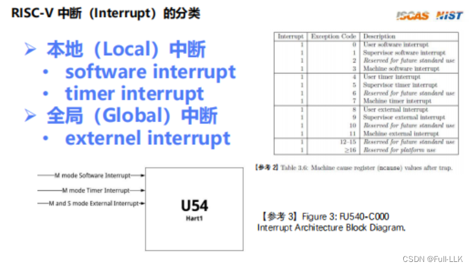
# mie mip
mstatus 中的中断寄存器是全局的，而 mie 中断寄存器处于第二级，相当于一种细化

mie：在某个模式下使能某一类中断
mip：表示在某个模式下某一类中断当前是否正在发生
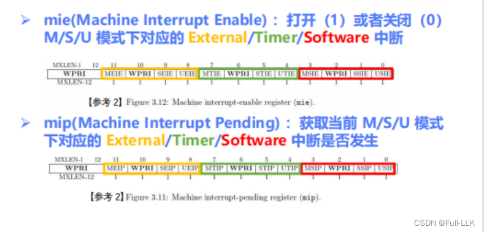
# 中断处理流程
与异常处理流程类似，区别在于 mepc 被设置为保存当前 pc 的下一条指令的地址。因为中断被认为是在当前指令执行完之后才响应的，所以中断处理完毕后，应当返回到前一条指令的下一条指令继续执行。

# 外部中断
外设向 CPU 产生中断，CPU 响应并处理该中断
每个 CPU 只有一个引脚对应外部中断，但外设有很多
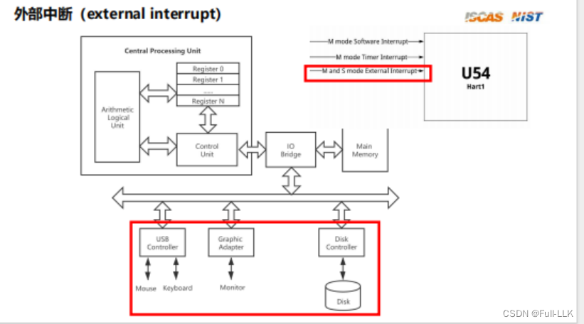
通过 PLIC 中断控制器来管理：外设产生中断源之后，由 PLIC 处理，再交给某个 CPU 来处理
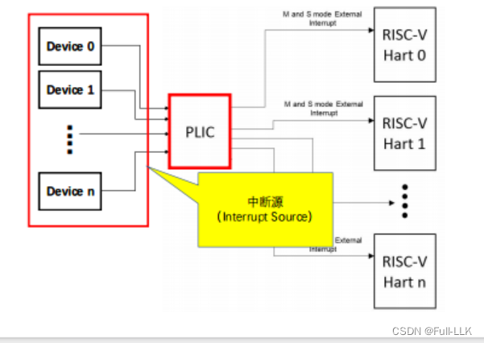
# 中断源
0 没有固定对应的中断源，是保留的
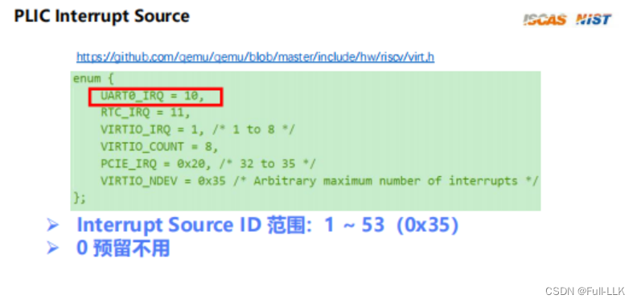
# PLIC
PLIC 本身也是一个外设。CPU 通过将其映射到内存来访问 PLIC，这样访问内存就相当于访问 PLIC 的寄存器
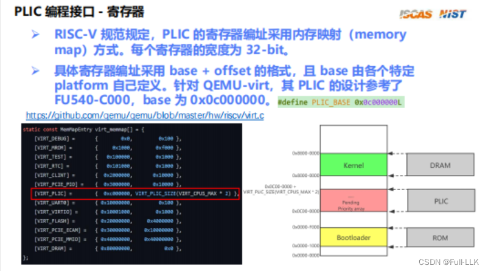

# Priority（优先级）
每个中断源根据其中断源 ID 对应各自的 Priority 寄存器。每个寄存器的取值范围为 0 到 7，其中 0 表示该中断源的最低优先级
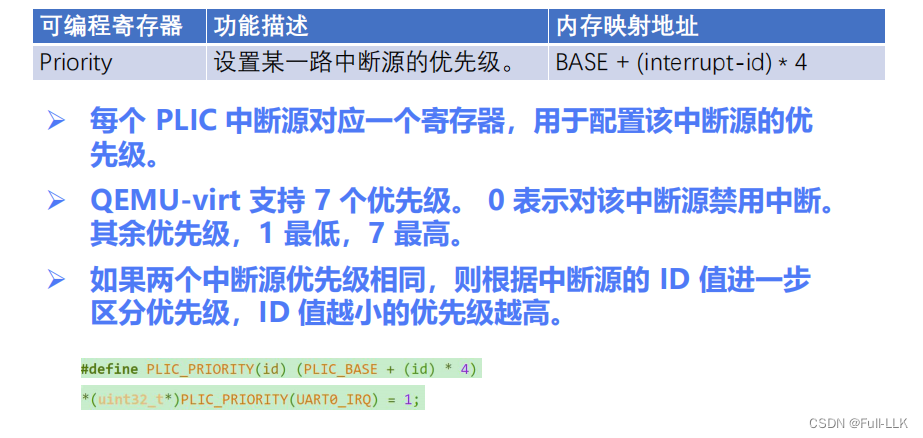
# Pending（挂起）
PLIC 可读可写，用于表示某个中断源是否已经发生。每个 PLIC 有两个这样的寄存器，因为需要 64 位才能表示所有的中断源
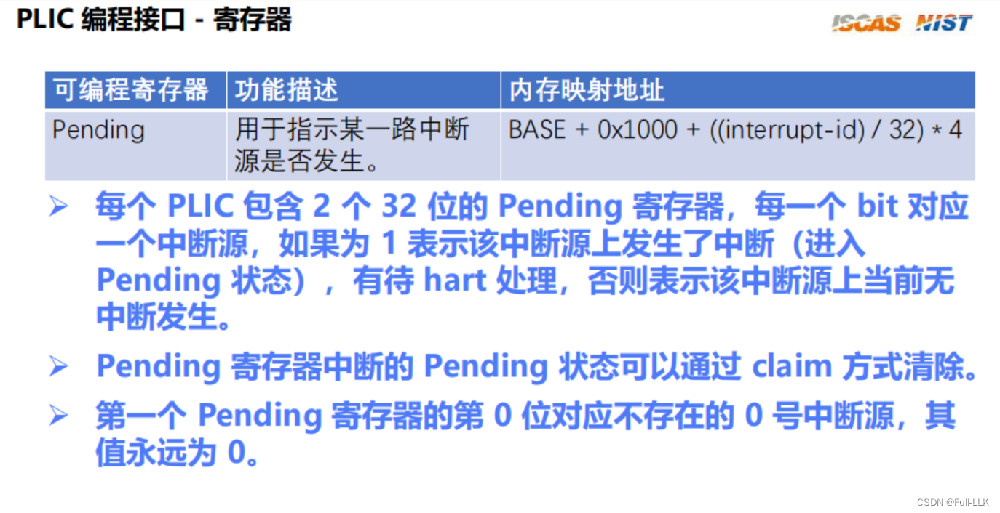
# Enable（使能）
与 hart 对应；同样也有两个，同样是因为需要 64 位才能表示所有的中断源
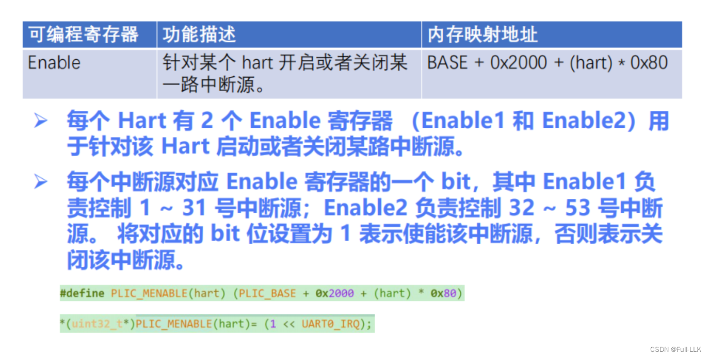
# Threshold
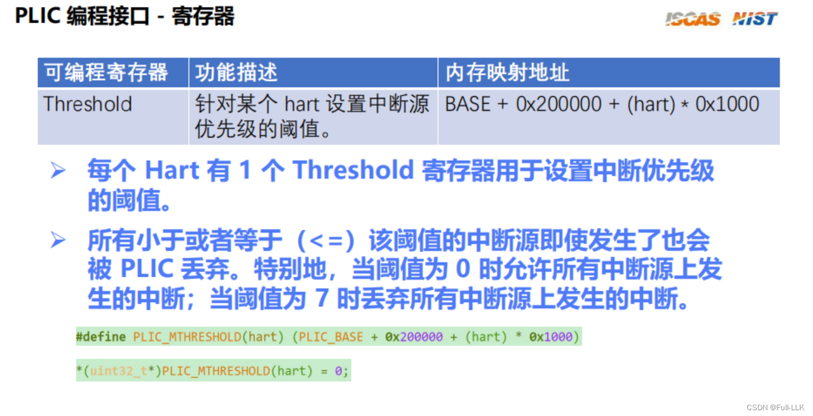
# Claim/Complete
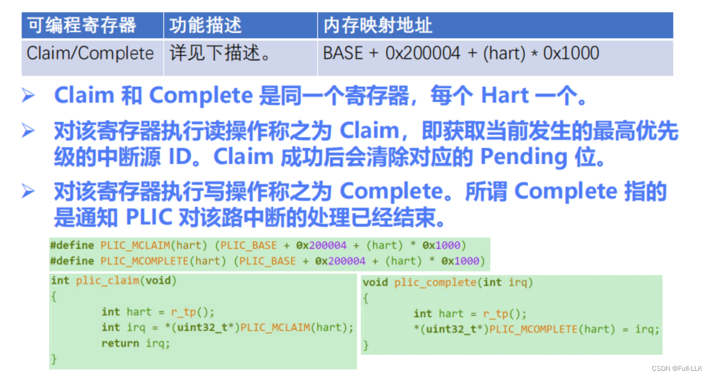
# PLIC 工作流程

 中断源 1 和 2 的优先级分别为 1 和 2。hart0 对所有设备的 Enable 打开，hart1 的则关闭。hart0 的 threshold 设为零
 1. 当中断源 1 和 2 同时发生时，首先在各中断源之间比较中断优先级，优先级高的先进入
2. 此时 hart0 的 Enable 允许进入，而 hart1 不允许
3. 然后，由于 hart0 的 threshold 为零，允许进入
4. 该中断源对应的 pending 位被置为 1，此时将其传递给 CPU，CPU 就知道发生了某个中断
5. 然后通过 Claim 可以得知当前中断源的 ID 号，并清除 pending 位，接着进入中断处理函数
6. 然后执行 complete，通知 PLIC 当前中断已处理完毕，接着处理中断源 1，过程与上述相同
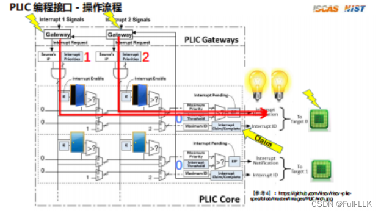


# 设置 uart 寄存器 IER
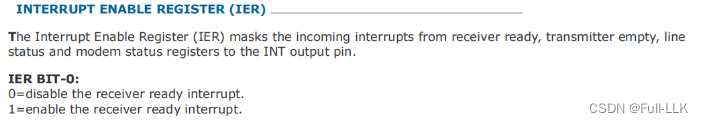

# 设置 uart 寄存器 LSR


# asm volatile("mv %0, tp" : "=r" (x) );
这段代码是 RISC-V 架构上的一条内联汇编语句，用于 C 或 C++ 编程环境中。它的含义如下：

```c
asm volatile("mv %0, tp" : "=r" (x) );
```

1. `asm volatile`：表示这是一条内联汇编指令，并被标记为 `volatile`。这意味着编译器不会优化这段代码；每次都会按字面执行，执行结果可能会影响程序的状态。

2. `"mv %0, tp"`：这是 RISC-V 架构的一条汇编指令。`mv` 是移动指令，用于把源寄存器的值复制到目的寄存器。这里 `tp` 表示线程指针寄存器，`%0` 是占位符，代表输出约束中指定的 C/C++ 变量。

3. `: "=r" (x)`：这是输出约束，描述汇编指令如何与 C/C++ 变量交互。`=r` 表示需要一个寄存器作为输出，该寄存器的值会被赋给变量 `x`。
# 头文件中不能定义函数，否则每次引入都会定义一次

```bash
/usr/lib/riscv64-unknown-elf/bin/ld: plic.o: in function read_mie': /home/llk/Desktop/risllkos/github/Fullkenerl6/trap.h:14: multiple definition of read_mie'; Trap.o:/home/llk/Desktop/risllkos/github/Fullkenerl6/trap.h:14: first defined here /usr/lib/riscv64-unknown-elf/bin/ld: plic.o: in function write_mie': /home/llk/Desktop/risllkos/github/Fullkenerl6/trap.h:19: multiple definition of write_mie'; Trap.o:/home/llk/Desktop/risllkos/github/Fullkenerl6/trap.h:19: first defined here 
```

这个链接错误表明项目中的两个目标文件（`plic.o` 和 `Trap.o`）都在尝试定义相同的函数 `read_mie` 和 `write_mie`，而这些函数定义位于头文件 `/home/llk/Desktop/risllkos/github/Fullkenerl6/trap.h` 的第 14 行和第 19 行。

在 C/C++ 中，不应该直接在头文件中定义函数，而只应声明函数原型。否则，在编译包含该头文件的源文件时，每个源文件都会生成该函数的一份定义，导致链接时出现重复定义错误。

解决方法如下：

1. 将 `read_mie` 和 `write_mie` 函数的定义移到单独的源文件中（如 `trap.c` 或 `trap.s`，取决于它们是 C 函数还是汇编函数）。

2. 在头文件 `trap.h` 中只保留函数声明（原型）：

```c
#ifndef _TRAP_H_
#define _TRAP_H_

// 声明函数，而不是定义
extern uint32_t read_mie(void);
extern void write_mie(uint32_t value);

#endif // _TRAP_H_
```

3. 确保这两个函数的实际实现只在项目中的一个源文件里定义，然后正常编译并链接项目的所有源文件。

4. 如果这些函数是非常底层的汇编函数，并且你确实想把定义放在头文件中，那么需要确保用 `static inline` 关键字声明它们，以避免链接时出现重复定义错误。但要注意，这种做法适用于非常小、适合内联的函数。对于较大的函数或涉及特殊寄存器访问的函数，一般不推荐这样做。


# static inline
在 C 或 C++ 中，如果你在头文件里定义了一个普通（非内联）函数，并在多个源文件（.c 或 .cpp）中包含该头文件，编译器会在每个包含该头文件的源文件中为这个函数生成机器码。当链接器尝试把所有目标文件链接成可执行文件时，会发现同一个函数在多处被定义，从而触发重复定义的链接错误。

但是对于 `static inline` 函数，情况就不同了：

1. **Static**：这里的 `static` 关键字用于限制函数的作用域。对函数而言，这意味着该函数具有“内部链接”，即只在包含它的编译单元（通常是包含该函数定义的源文件）内可见。虽然这里函数是定义在头文件中的，但由于它是 `static` 的，每个包含该头文件的源文件都会得到该函数的一份独立副本。这些副本互不影响，各自在自己的作用域内有效。

2. **Inline**：`inline` 关键字用于请求编译器尝试把函数体像宏一样直接嵌入到每个调用该函数的地方，而不是生成单独的函数调用。这样一来，理论上链接时就不需要处理对该函数的外部引用。

两者结合起来，`static inline` 函数既限制了作用域（每个源文件都被视为独立的作用域），又要求编译器尽可能将其内联。即使编译器由于某种原因无法内联，由于 `static` 的作用，每个源文件中生成的函数副本仍然是独立的，只在各自的编译单元内有效，因此链接时不会出现重复定义错误。

例如：

```c
// trap.h
#ifndef TRAP_H
#define TRAP_H

static inline void handle_trap() {
    // 函数体...
}

#endif // TRAP_H

// file1.c
#include "trap.h"
void some_function() {
    handle_trap(); // 调用
}

// file2.c
#include "trap.h"
void another_function() {
    handle_trap(); // 另一处调用
}
```

在这个例子中，虽然 `handle_trap()` 函数的定义被同时包含进了 `file1.c` 和 `file2.c`，但由于它是 `static inline` 的，每个源文件都有一个独立的内联版本（理想情况下编译器会将其内联；如果不能，每个编译单元也会有一份独立的非内联副本），最终在链接时不会出现重复定义的问题。


# 代码

外设通过 uart 接口连接到 PLIC，PLIC 再连接到 CPU。当外设输入一个字符时，会产生中断，并通过 PLIC 通知 CPU 去处理该中断。
输出则是 CPU 与 uart 直接相连：CPU 把字符传给 uart，uart 再传给外设，因此显示器自然就能显示出来


## 初始化 plic
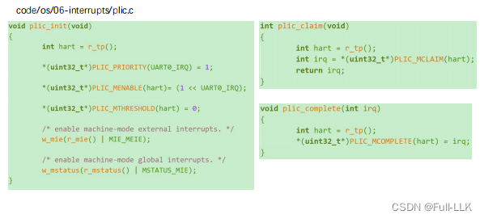


## 中断处理
根据发出的中断进入相应的 uart 中断处理函数
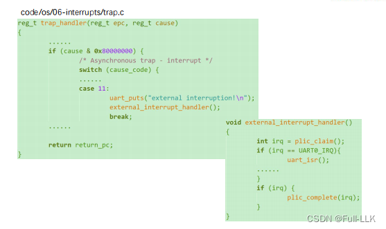

# 代码
[https://github.com/FULLK/risllkos/tree/main/Fullkenerl6](https://github.com/FULLK/risllkos/tree/main/Fullkenerl6)
# 待解决


