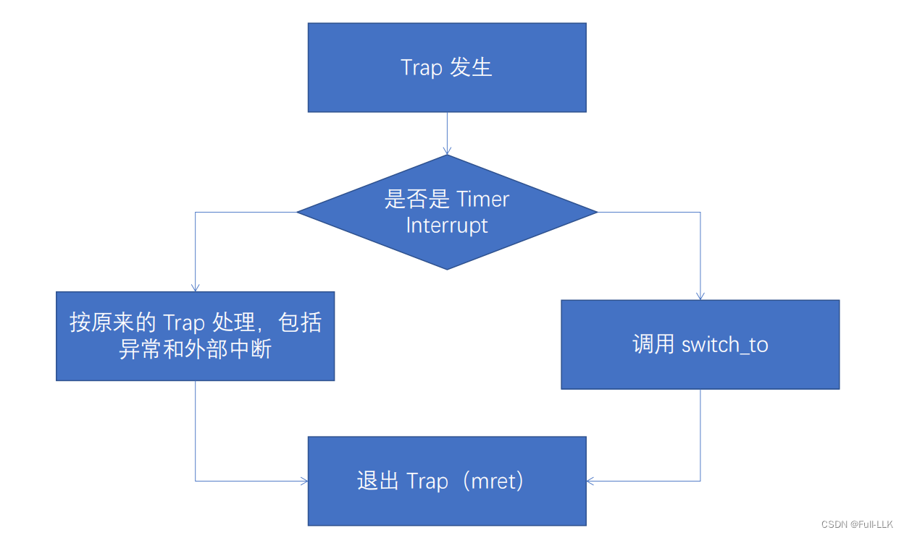
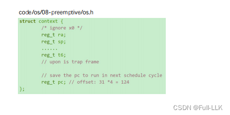
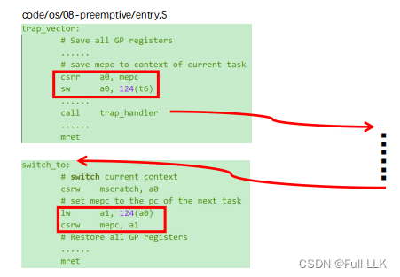
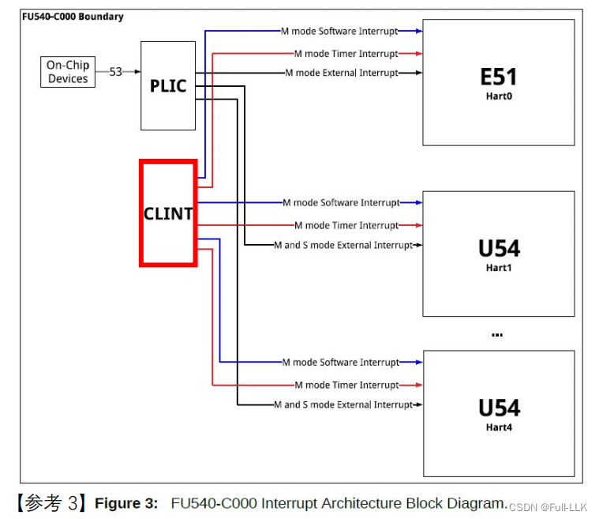
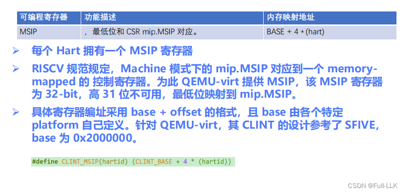
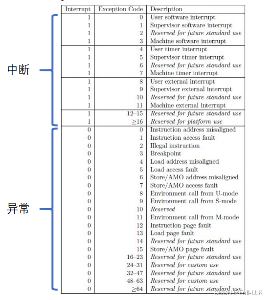
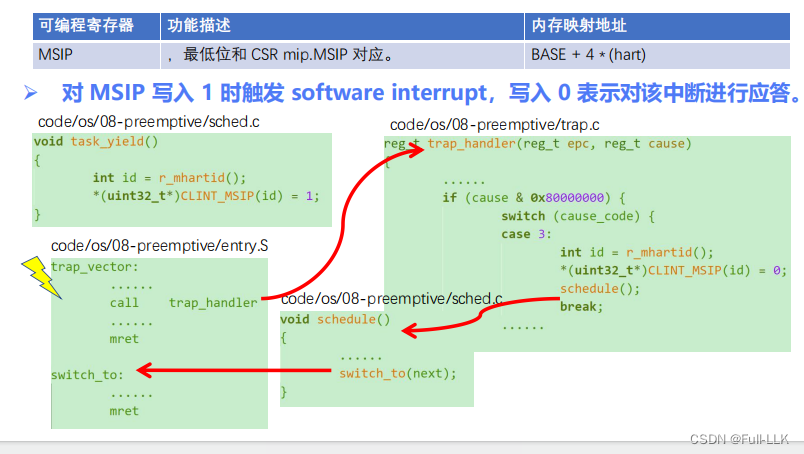
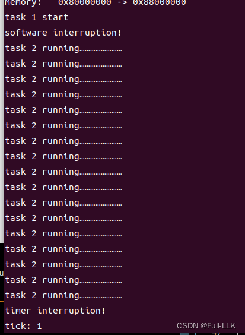


# 抢占式多任务

# 流程
抢占式多任务由定时器中断触发，最终在中断处理函数中切换到下一个进程

# 具体代码流程
在上下文中加入 pc 寄存器

寄存器保存上下文，并调整切换逻辑

将 mepc 存入当前上下文中 pc 寄存器的位置
切换时，把下一个上下文中 pc 位置的寄存器值赋给 mepc

 

# 协作式多任务的兼容（软件中断）
实现主动让出 CPU
 
仍然由 CLINT 实现

# msip 寄存器
  
  RISC-V 规范定义了多种处理器模式，其中 Machine 模式是最高特权模式，用于实现操作系统内核或 hypervisor 等核心功能。在 Machine 模式下，处理器提供了一系列内存映射的控制与状态寄存器（CSR），可以像访问普通内存区域一样直接通过内存地址访问。

`mip` 是 Machine Interrupt Pending 寄存器，是一个 CSR，用于指示当前有哪些中断事件处于挂起状态。其中 `mip.MSIP` 是 Machine Software Interrupt Pending 位，专门用于指示是否有机器级软件中断请求正在等待处理。

在 RISC-V 架构中，当一个 hart（硬件线程）需要向另一个 hart 发送软件中断时，可以通过向对方的 MSIP 位写入 1 来发起中断请求。MSIP 映射到 MSIP 寄存器上的某一位，而该寄存器被映射到内存，即 MSIP 是内存映射的，这意味着可以通过内存访问指令（如 load/store 指令）读写该位，从而触发或清除中断。

具体来说，当 `mip.MSIP = 1` 时，表示有机器级软件中断处于挂起状态；当 `mip.MSIP = 0` 时，表示没有这样的中断挂起。这样，处理器就能在硬件层面支持高效的中断通信与管理。
# 流程
 1. 写 MSIP 触发软件中断，中断号为 3

 2. 进入中断处理函数，之后的上下文切换流程与抢占式多任务相同，只是触发切换的方式不同

# 代码

注意，由于第一次上下文切换直接使用 mret，此时 mret 会执行以下操作
1. 通过 mstatus 的 MPP 恢复当前特权级
2. 通过 mstatus 中的 pmie 恢复 mstatus 中的 pie

所以需要提前对 mstatus 做相应的设置

相关代码说明见代码注释
[https://github.com/FULLK/risllkos/tree/main/Fullkenerl8](https://github.com/FULLK/risllkos/tree/main/Fullkenerl8)

# 结果


