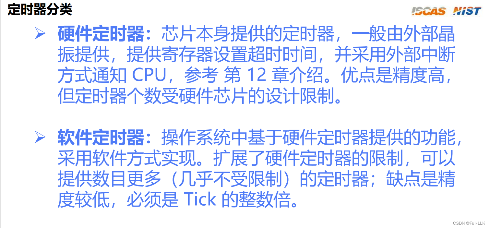
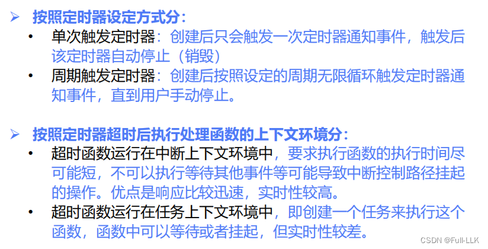
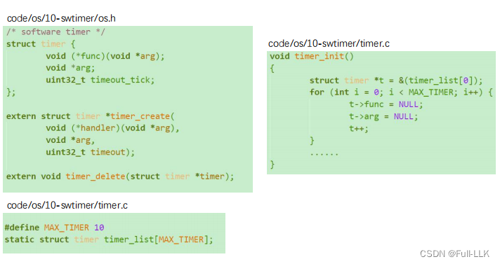
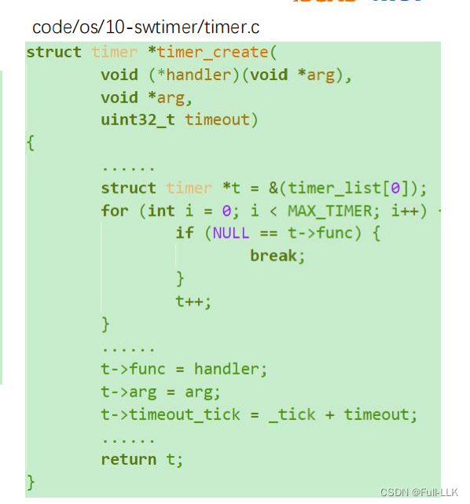
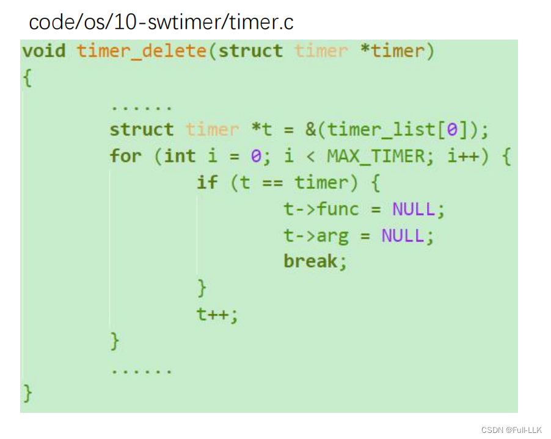
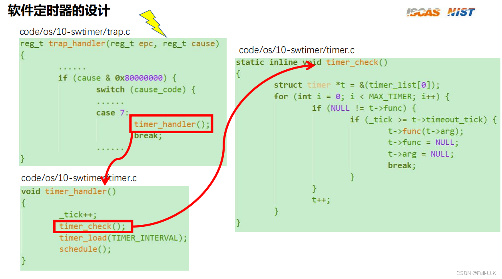
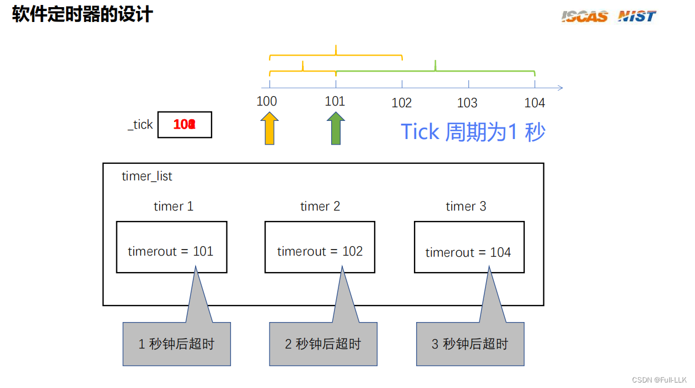
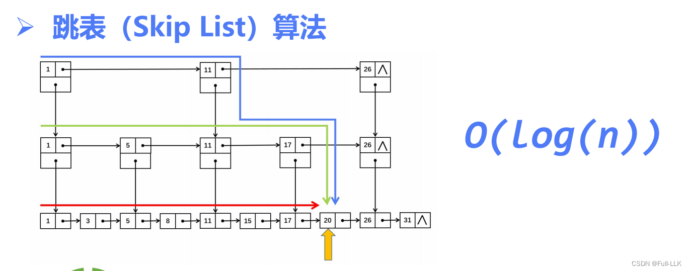


# 定时器分类
硬件定时器：由硬件频率和触发上限的大小决定；只有一个，精度高
软件定时器：基于硬件定时器实现；精度大于等于硬件定时器的精度，但由于是用软件（代码）实现的，可实现的数量没有上限

# 定时器相关分类
一次性（One-shot）：定时器设定在某个特定时刻，到达该时刻后退出，定时器被销毁，不再起作用
周期性（Periodic）：定时器只需设置一次，之后会周期性地触发

超时函数：定时器超时之后执行的函数
中断上下文：超时函数在中断处理中执行；每次时间变化都会触发一次中断，因此每次都自然有机会执行超时函数，实时性很高
任务上下文：超时函数作为一个进程执行；超时后仍需要被调度才能执行，因此实时性较差

# 软件定时器设计
## 初始化
时间结构体包含一个函数指针、调用该函数的参数以及定时的时间
初始化时，把每个时间结构体都置为空

## 创建
找到一个尚未被设置的时间结构体，并给它赋值

## 删除
找到对应的时间结构体，并将其置为空

## 触发流程
发生定时器中断，然后在定时器中断处理函数中，会调用检查是否应触发软件定时器函数的函数；如果与某个软件定时器设定的数值匹配，就调用该软件定时器的处理函数

## 图示
每次硬件定时器中断都会触发一次 tick 变化，然后 timecheck 会比较 timelist 中各个定时器设定的数值，并决定是否触发它们的处理函数

# 优化

- 由于 timecheck 每次都需要循环逐个比较，如果把即将到时的定时器放在前面，就可以减少比较次数，因此按超时时间排序
- 用链表实现空间优化：如果用数组存储软件定时器，可能会浪费一些未使用的空间；使用链表则在需要时才分配空间，从而节省空间

为了进一步减少比较次数，可以使用跳表算法，类似二分查找，从上层向下层逐层比较。
如果目标是 20，先到达 11，发现小于 26，于是进入下一层，发现大于 17，到达 17，发现小于 26，再跳到下一层，再与 20 比较，比较成功

# 代码
创建软件定时器的函数在开头和结尾分别进行加锁和解锁。设想目标是创建一个在当前时刻几秒之后能够按时触发的软件定时器。如果中途发生了定时器中断，那么在定时器只设置了一半时，系统就会去处理中断，而此时也会检查软件定时器。假设该软件定时器设定在当前时刻之后的某个时刻；由于中断会让该时刻加一，而检查时软件定时器尚未设置完成，这个时刻就会被错过，软件定时器要到下一次定时器中断时才会被检查到并成功调用其处理函数

[https://github.com/FULLK/risllkos/tree/main/Fullkenerl10](https://github.com/FULLK/risllkos/tree/main/Fullkenerl10)

