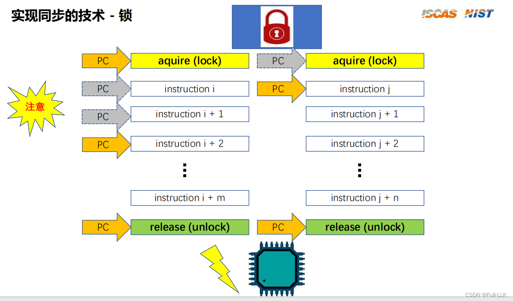
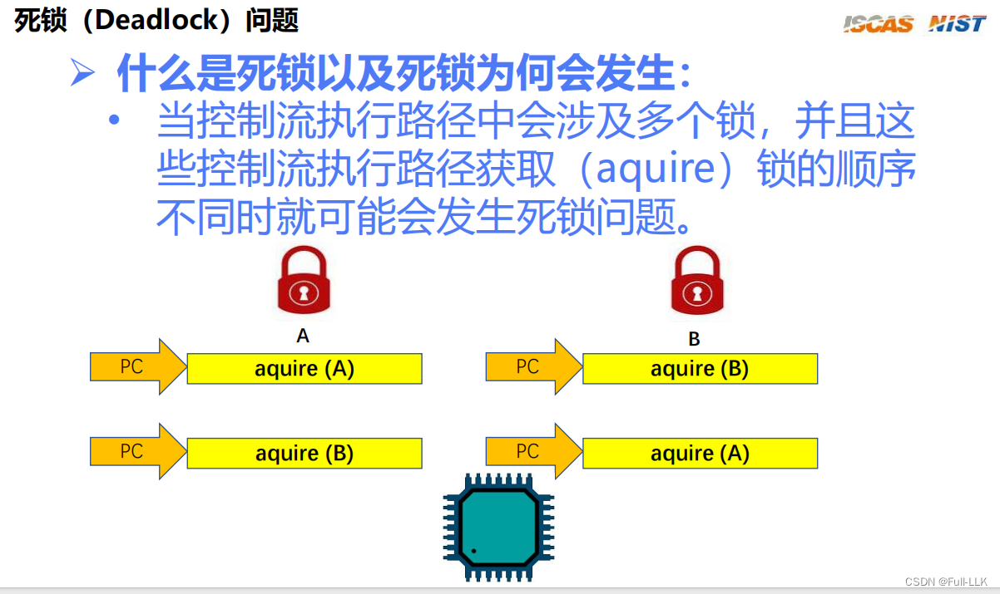
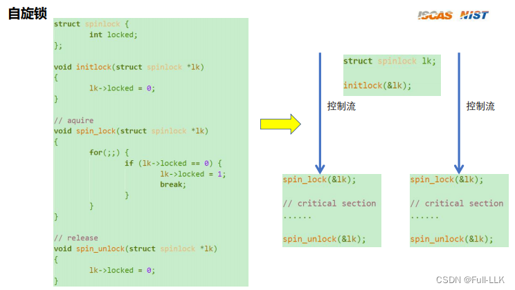
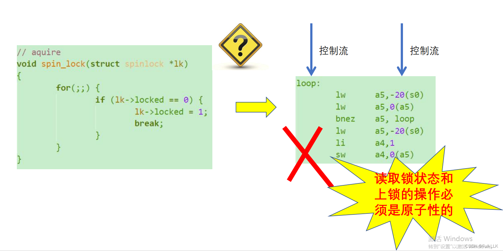
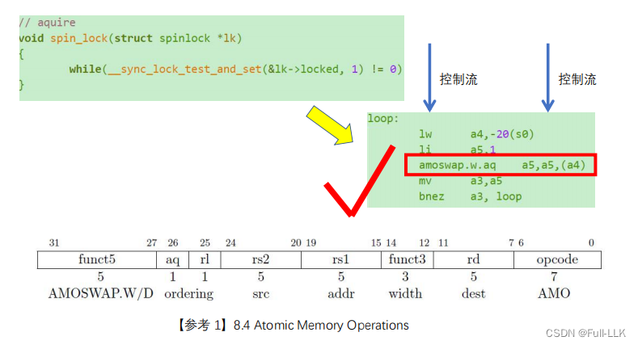
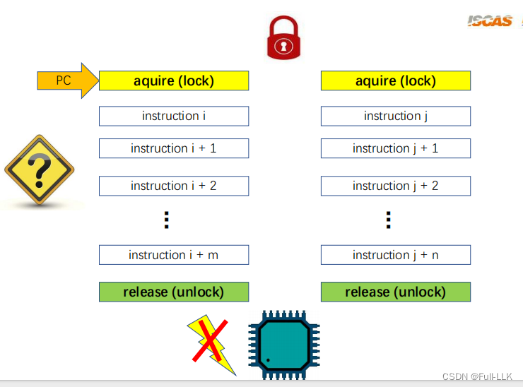
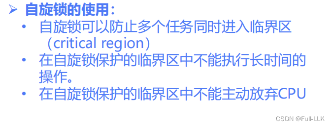
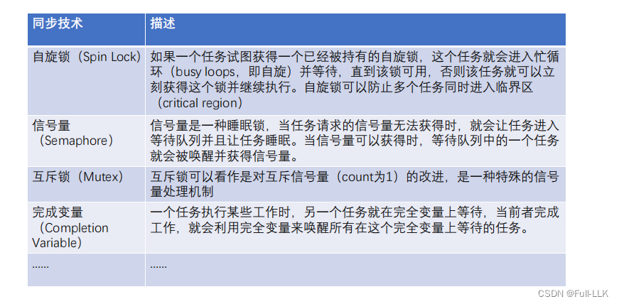




# 并发与同步
控制流：可以理解为一个任务或进程

中断也可以理解为切换到另一个任务（中断处理程序），所以宏观上认为它们是同时执行的

同步：可以理解为要求一个任务的某个操作与另一个任务的某个操作之间有一定的先后顺序

# 临界区与锁


在并发执行中，当一个进程访问临界区时，除非访问结束，否则其他进程（即使切换到了该进程）也无法进入临界区，即被阻塞。否则会影响该进程对临界区资源的使用。

> 临界区是指多线程环境中一次只允许一个线程访问的代码段或资源区域。为了保证对临界区的安全访问，避免多个线程同时访问导致数据不一致或其他竞争条件，我们需要采取同步措施来保护临界区


# 锁
- 当一个线程试图获取被另一个线程持有的可睡眠锁时，如果锁不可用，该线程会被操作系统挂起并放入等待队列，从而停止执行（进入睡眠状态）。一旦持有锁的线程释放了锁，操作系统会选择一个合适的线程唤醒，并授予它锁的所有权。这样，该线程就可以继续执行受保护的代码段。
- 对于不可睡眠的锁，在试图获取锁时，如果锁已被占用，当前线程不会被挂起，而是原地自旋，不断检查锁是否已被释放。这种方式避免了线程上下文切换的开销，但可能导致线程消耗大量 CPU 资源，尤其是在锁被长时间持有的情况下。


上锁会导致另一个同样想上锁的进程阻塞并一直循环，直到锁最终被释放

# 死锁
访问多个临界区可能涉及多把锁

当 A 执行并获取了锁 A，然后 B 执行并获取了锁 B，接着 A 去获取锁 B，B 去获取锁 A
这就会导致阻塞。也就是说，再次切换到 A 准备获取锁 B，然后切换到 B 获取锁 A，都会被阻塞。两者都卡住了

# 解决死锁
除了这三点之外，还可以实现一次性获取多把锁，中间不被打断。这样就能解决

调整获取锁的顺序，因为上例中请求锁的顺序不一致也是导致死锁的原因
为了防止持有一把锁时又去请求其他锁，尽量确保在请求一把锁之前，之前请求的所有锁都已释放

# 自旋锁
-  初始化锁
- 在不同控制流访问临界区的前后执行上锁和解锁


# 原子性问题
中断的粒度是汇编指令级别的

也就是说，上锁操作可能还没完成就发生了中断并跳转到另一个控制流，导致另一个控制流发现此时锁并未上锁，结果两者都进入了临界区（第一个执行了汇编并进入了 if，但还没设置 locked，导致第二个此时也进入 if 并上锁）

# 原子操作的实现
amoswap.w.aq 把 locked 的值存入寄存器，同时把 locked 的值更新为寄存器的值，即 1。它不能被中断

这里值的修改是一气呵成的，这样就不会出现锁还没来得及更新就切换到另一个进程、使其也认为没有上锁的情况。（也可以理解为让值的更新发生在判断是否进入临界区之前）

如果不是原子的，那么假设把更新值和保存原值分成几部分来实现，就可能出现死锁或者两者都进入临界区的结果

可以发现，只有执行这条指令的执行流会上锁；其他的不会，即使是即将执行到这条指令的执行流

## amoswap.w.aq
在 RISC-V 架构中，amoswap.w.aq 指令是原子内存操作指令之一，主要用于并发环境下的原子读-改-写内存操作。这条指令的名字由几个关键词组合而成：

- **amo**：Atomic Memory Operation（原子内存操作），表示该指令在执行过程中是不可分割的，即使在多线程或多处理器环境下也能保证操作的原子性。
- **swap**：表示该指令执行交换操作，即把寄存器中的值与某个内存位置的内容进行交换。
- **w**：表示操作的数据宽度为 32 位（字大小）。
- **aq**：是原子性限定符（Atomicity Qualifier）的一部分。RISC-V 架构使用 aq 和 rl 两个原子顺序标记配合实现内存顺序模型。其中，aq（Acquire）确保该指令的执行不会与之前的内存操作重排序，并且在该指令执行后能够观察到其他核心的写操作。

amoswap.w.aq 指令的具体功能如下：

- 它同时读取某个内存位置（通过指定的地址）的原值，并把一个寄存器中的值写入该内存位置。
- 最后，该指令把读到的内存原值存入另一个指定的寄存器。

这一系列操作作为单个原子步骤完成，这对于维护数据一致性至关重要，尤其是在多个线程并发访问共享内存区域时。

例如，在 amoswap.w.aq rs2, rs1, (ra) 指令格式中：
- rs1 是要写入内存的新值所在的源寄存器。
- rs2 是保存内存原值的目的寄存器。
- ra 是包含要操作的内存地址的寄存器。


1. **aq（Acquire）**：
   - 当执行带有“aq”标记的指令时，它起到“获取”内存屏障的作用，确保该指令之前的内存读写操作都已完成，并且这些操作对后续操作（包括本核和其他核）可见。
   - 也就是说，amoswap.w.aq 指令不仅本身是原子的，还能保证执行该指令之后，任何对共享变量的读操作都能看到该指令之前发生的所有写操作的效果，有效防止了指令重排序。

2. **rl（Release）**：
   - 相应地，带有“rl”标记的指令表示它是一个“释放”内存屏障，确保该指令执行时，它及其之前的所有内存操作都已完成，并且该指令之后的写操作在下一条带“aq”标记的指令执行之前，对其他核心都是不可见的。
   - 也就是说，amoswap.w.rl 指令写入共享内存后，其他核心只有在执行了自己的“aq”指令之后，才能看到这次写入的结果。


## 示例

假设有两个核心 Core A 和 Core B，它们共享一块内存区域，Core A 正在修改变量 `shared_var`，而 Core B 需要读取 `shared_var` 的最新值。如果不加控制，可能出现以下情况：

1. Core A 先修改了 `shared_var` 的值，但由于缓存一致性等因素，这次修改还没有刷新到主存；
2. 此时 Core B 读取 `shared_var`；由于没有内存顺序保证，它可能读到旧值，而不是 Core A 刚刚修改的新值。

为了确保 Core B 能看到 Core A 的写操作，我们可以使用带 `aq` 标记的原子指令。例如在 RISC-V 架构中，如果我们有一条 amoswap.w.aq 指令：

```assembly
amoswap.w.aq t1, t2, (a0)
```

这条指令原子地把寄存器 `t2` 的值写入地址 `a0` 所指向的内存位置，并把该内存位置的原值返回到 `t1`。更重要的是，这里的 `aq` 标记确保在执行这个原子操作之前，所有内存操作都已完成并对外部核心可见，也就是说，Core B 在执行 amoswap.w.aq 指令之前，一定能观察到 Core A 之前对这块共享内存的写入。


# 另一种方法
上锁可以理解为直接关中断，这样相应的进程一旦上锁，逻辑就无法被切换，执行流会一直执行下去

# 自旋锁的注意事项
上锁必须是原子操作
不能长时间执行，否则其他进程会占用大量 CPU 时间却什么都不做
不能主动放弃 CPU，否则在不解锁的情况下，其他进程永远无法访问临界区


# 代码

[https://github.com/FULLK/risllkos/tree/main/Fullkenerl9](https://github.com/FULLK/risllkos/tree/main/Fullkenerl9)

# 其他同步技术

在操作系统和多线程编程中，完成变量是一种同步原语，主要用于实现线程或进程之间的同步，特别是在一个任务完成特定工作后通知另一个任务的场景中。它的核心作用是简化并发环境中的协作过程。

具体来说，完成变量的主要功能包括：

1. **任务标记**：一个任务完成某个操作后，可以设置一个完成变量（或增加其计数），表示某个关键阶段已经结束。

2. **阻塞与唤醒**：其他任务可以在这个完成变量上等待；当它们检测到变量被设置或等待计数达到预期值时，就会被自动唤醒并恢复执行。这样，一个任务就可以安全地等待前一个任务完成工作后，再开始执行下一阶段。

3. **替代信号量**：在某些情况下，完成变量可以作为信号量的轻量级替代品，尤其是只需要一次性通知而不需要多次信号控制的时候。与传统信号量相比，完成变量通常更容易理解和使用，因为它直接与某个特定操作是否完成相关联。

例如，在 Linux 内核中，完成变量（`completion`）是一个内置的数据结构和 API，允许内核线程或其他并发实体之间进行同步。一个典型的用例是：当内核线程发起 I/O 操作时，它可以挂起自己并在完成变量上等待，直到 I/O 完成；设备驱动或其他相关部分会触发这个完成变量来唤醒等待的线程。

