
# UART
用嵌入式开发的说法，qemu 模拟的就是那块开发板（硬件）
在电脑上使用 qemu 时，可以把 qemu 看作模拟了那块开发板，并且开发板已经连接到你的电脑上（我们指定的内核也运行在那块板子上，连接和数据传输遵循 UART 的形式：板子的 UART 接口连接到电脑的 UART 接口，从而把数据传到电脑上，再由电脑显示出来）
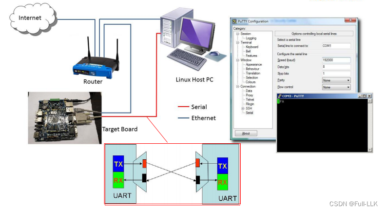

UART（Universal Asynchronous Receiver/Transmitter，通用异步收发器）是一种广泛用于串行通信的硬件通信协议。UART 通信协议允许设备通过串口相互通信。该协议不需要时钟信号来同步数据的发送和接收，因此被称为“异步”通信。
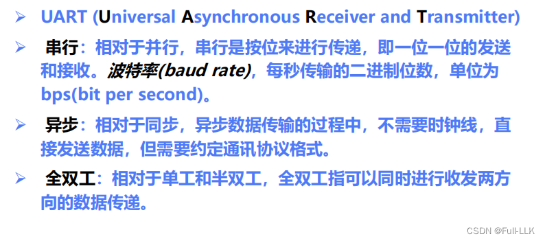

在 UART 通信中，数据以串行形式传输，即一次传输一位。两个设备之间的通信通常涉及两根线：一根用于发送数据（TX），另一根用于接收数据（RX）
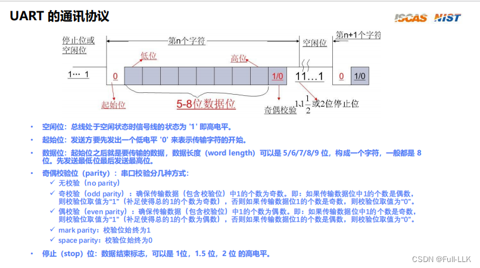
实际上，连接的是接口，数据按照接口规定的形式传输
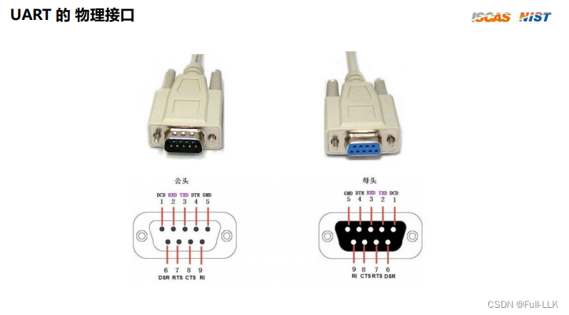
#  NS16550A
NS16550A 的编程接口指的是软件如何与这个 UART 芯片进行交互。通俗地讲，可以把 NS16550A 想象成一个有许多小格子（寄存器）的邮箱，每个格子都有特定的功能。程序员通过向这些格子写入数据或从中读取数据，来控制 UART 的行为或获取它的状态。
相当于电脑中有一块内存区域用来与 UART 设备通信（就像一个中转站，同时用于配置中转的形式）

接口，顾名思义，就是两个设备连接的地方。这个地方涉及数据的交换和传输，因此自然要规定双方如何交换和传输数据，以及交换和传输相关的缓冲区

把接口的寄存器映射到内存地址上，这样就可以通过访问地址来访问接口的寄存器
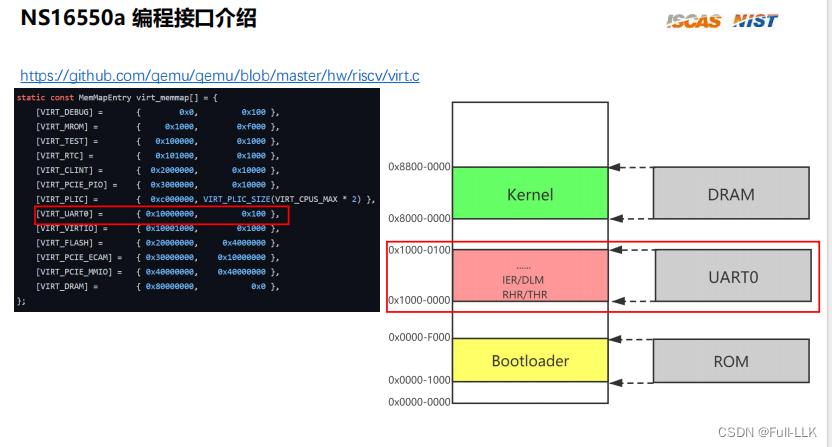
# 规格说明
NS16550A 接口有八个相关的寄存器，但存在复用。例如 000 表示第零个寄存器，它有两种模式，读模式下只有一个用途（接收保持寄存器），而写模式下有两个功能

有些寄存器只在相应的模式下才有作用

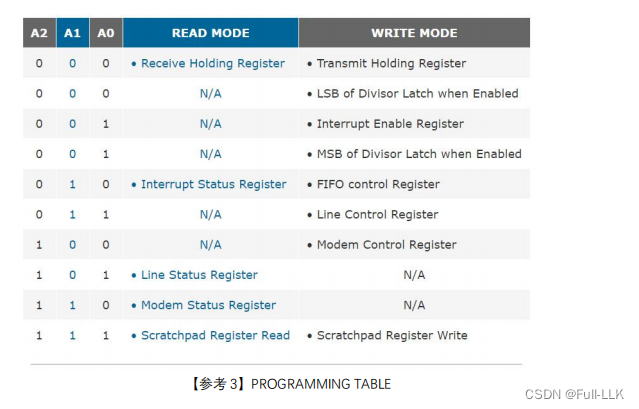
一个 UART 寄存器是八位的
相关寄存器的名称以及每一位的含义如下
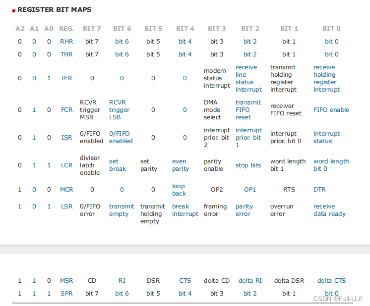

**初始化**
第一是关闭中断
第二是设置波特率
第三是设置校验位
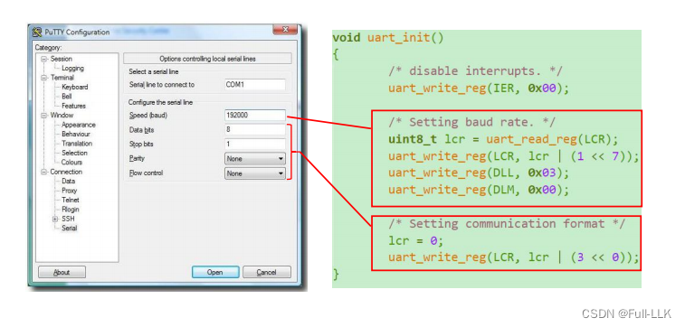
对应寄存器的功能
IER 
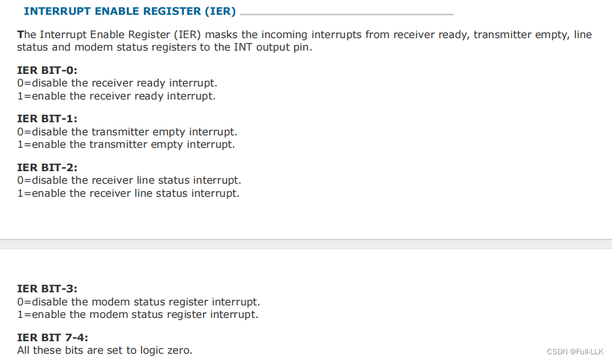
LCR
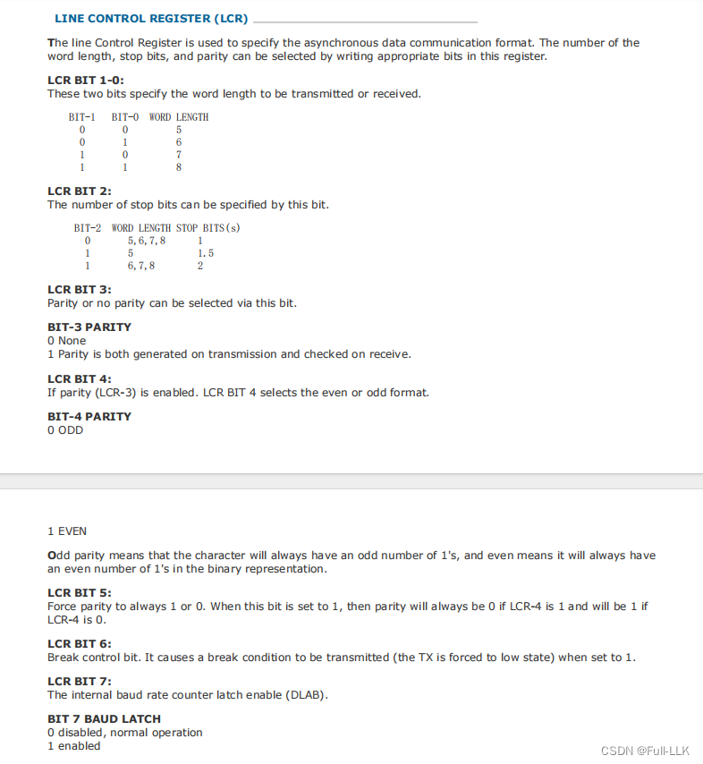

DLL：Divisor Latch 的 LSB（写模式）
DLM：Divisor Latch 的 MSB（写模式）

当 LCR 的第 7 位置为 1 时，设备认为开始设置波特率。波特率由 DLL 和 DLM 共同构成的 16 位值以及输入频率决定，如下所示
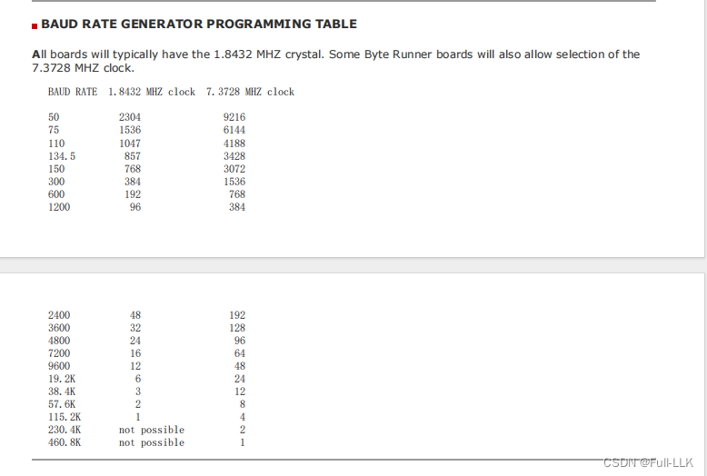
第 7 位置为 0 之后，设备就知道波特率设置完成，并通过单独的寄存器保存波特率

> 写 DLL 和 DLM 是写内存；io 设备应该有单独的寄存器保存波特率，DLL 和 DLM 中的波特率一旦设置好，io 设备就会自动保存（群里大佬的回复）

# 目标
	 * - number of the word length: 8 bits
	 * - number of stop bits：1 bit when word length is 8 bits
	 * - no parity
	 * - no break control
	 * - disabled baud latch

# 发送数据
先把数据写入 THR，然后发送出去

轮询：不断检查寄存器是否空闲（数据是否已经发送出去）
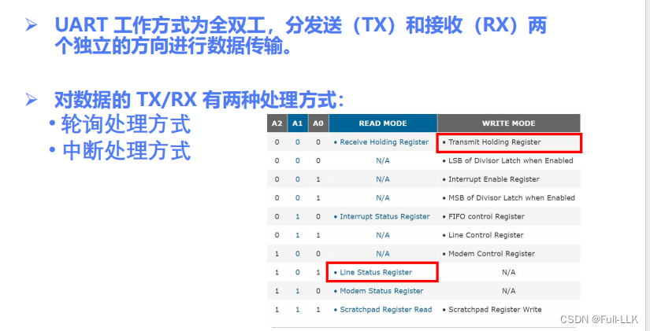

THR 保存要发送的数据，一个字符；LSR 的第 5 位保存 THR 中的数据是否已发送出去的信号
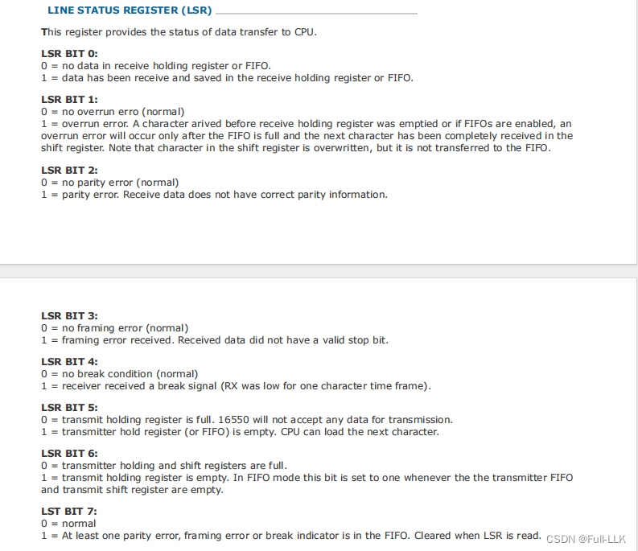
不断检查 LSR 寄存器的第 5 位，如果为 1，就跳出循环并传输数据

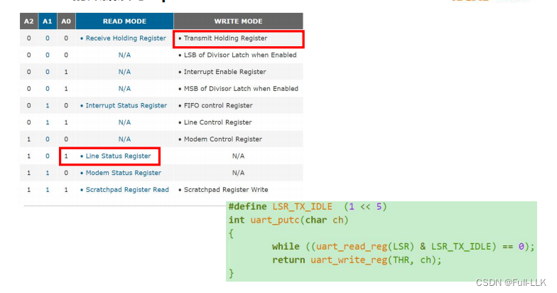

# 代码
## extern
extern 关键字用于声明在别处定义的变量或函数。也就是说，这个声明告诉编译器该名字对应的实体是存在的，但它的定义可能在程序的另一个文件中。这类声明通常出现在头文件（.h 文件）中，或者使用多个源文件（.c 文件）的项目中。

编译链接时，每个 C 文件先被编译成目标文件，然后再链接。如果想在编译时使用其他文件中的函数，就需要用 extern 声明，到链接时才会具体解析

[https://github.com/FULLK/risllkos/tree/main/Fullkenerl2](https://github.com/FULLK/risllkos/tree/main/Fullkenerl2)

