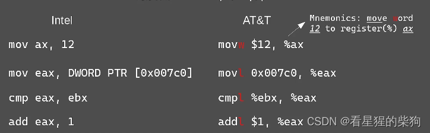
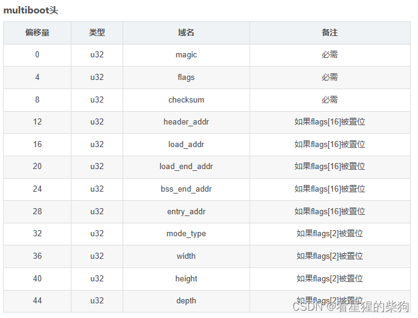
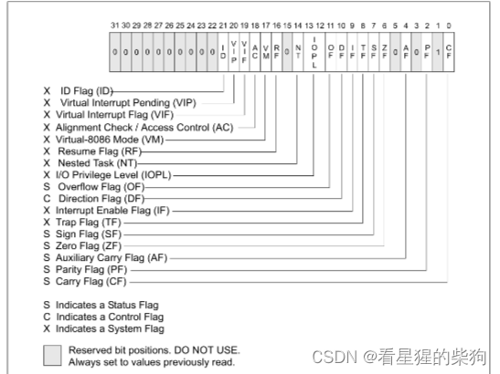


# 汇编中 src 和 dest 不能同时是内存
# X86 汇编语言风格对比：AT&T 与 Intel
## 指令后缀
AT&T 指令带有后缀
```bash
b w  l  q 
8 16 32 64
```
Intel 没有
## 立即数
AT&T 的立即数前面加 $ 符号
Intel 没有
## 指针

> dword — double word（双字）— 即四个字节
ptr — pointer 的缩写
[] 中的数据是一个地址值，这个地址指向双字数据
例如，mov eax, dword ptr [12345678] 是把内存地址 12345678 处的双字（32 位）数据赋给 eax
 
Intel 用 size PTR [地址值] 表示该地址处的内容
AT&T 则直接使用地址值
## 寄存器
AT&T 在寄存器前加 % 符号

# Multiboot
> A20 地址线：
IBM 最初的微型计算机使用的 CPU 是 Intel 8088，它只有 20 根地址线，只能访问 1M 的地址空间。CPU 以段+偏移的方式寻址内存，也就是说可寻址的最高地址是 0xFFFF:0xFFFF，即 0x10FFEF（0xFFFF0+0xFFFF）。超过 0x100000（1MB）的地址默认会回绕到 0x0FFEF，这就是所谓的地址回绕。当时有些程序依赖这种地址回绕机制，但不久之后 IBM 推出了 AT 机，使用 24 根地址线的 Intel 80286 CPU，最大可寻址 16MB，并且与 8088 一样具有实模式，因此超过 1MB 的地址不会再发生回绕。为了实现完全兼容，IBM 开发了一个开关来启用或禁用 0x100000 这一位地址，这个信号开关就是 A20。如果它为 0，则第 20 位及更高的地址位被清零，从而实现兼容。当我们从实模式切换到保护模式时，需要能够访问和使用 1MB 以上的物理内存，因此必须开启 A20 地址线。所以，A20 地址线的存在是为了向后兼容而解决地址回绕问题。

GRUB：把内核加载到内存，开启 A20 地址线，并进入保护模式。

需要 multiboot 头的原因：
OS 镜像是一种可执行文件格式，但可执行文件格式多得惊人。要加载 OS 镜像，引导程序就得理解所有的可执行文件格式，所以 OS 镜像中总会包含一个 multiboot 头 
 

magic：必须是 0x1BADB002
flags：第 0 位 — 内核是否需要按页（4KB）边界对齐
           第 1 位 — 内核是否需要内存映射表
           第 2 位 — 内核的显示模式
checksum：必须是 -(magic+flags）

# Multiboot 加载内核之后
  %EAX=0x2BADBOO2 表示内核已被加载
  %EBX=引导程序信息表的物理地址
  %CS %DS %ES %FS %GS %SS =0x0 — 段寄存器全为 0
  A20：已开启
  %CR0=（%CR0&0x7FFFFFFF）|0x1  ：相当于最高位清零、最低位置一。PE=1 PG=0
  %EFLAGS=%EFLAGS&0xFFFEFEFF IF=0 VM=0

>   CR0 是系统中的控制寄存器，第 0 位是保护允许位 PE（Protedted Enable），用于启动保护模式。如果 PE 置 1，则开启保护模式；如果 PE=0，则 CPU 运行在实模式。PG 控制是否开启分页，0 表示不开启

> EFLAGS 寄存器（标志寄存器）
> IF（中断允许标志）：IF=0 表示关中断；VM（虚拟 8086 模式） 



