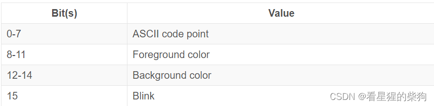
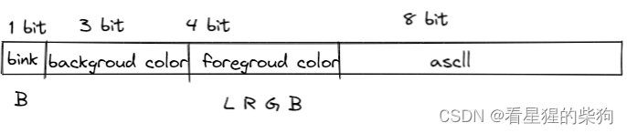


# VGA（Video Graphics Array）
> VGA（Video Graphics Array）是 IBM 于 1987 年随 PS/2 一起推出的一种视频传输标准，具有分辨率高、显示速度快、颜色丰富等优点，在彩色显示器领域得到了广泛应用
## VGA 文本模式
VGA 文本模式是向屏幕打印字符的一种简单方式

> 要在 VGA 字符模式下向屏幕打印字符，必须把字符写入硬件提供的 VGA 文本缓冲区。通常，VGA 文本缓冲区是一个二维数组，其内容会实时渲染到屏幕上。这个数组的元素被称为字符单元，它使用如下格式描述屏幕上的一个字符：




> 文本缓冲区的最小单位：一个字（两个字节）

> 文本缓冲区起始地址：0xB8000（物理地址）

> 缓冲区大小：2 x 高 x 宽，以字符为单位


# ld 链接器
> ld（Linker）是负责把目标文件和库文件链接成可执行文件或共享库的程序。在编译过程中，编译器先把源代码编译成目标文件，然后由 ld 把这些目标文件链接成可执行文件或共享库。

或者说：

> 链接过程就是把各个 .o 文件链接成一个文件。链接脚本描述了链接器如何把这些输入（.o）文件映射成一个输出文件，并指定输出文件的内存布局。几乎所有的链接脚本都在做这些事情。
# Makefile 语法
## 一般形式


##  语法
= 表示无论何时使用该变量，引用它的变量都会随着该变量的改变而改变。
```bash
HELLO = world
HELLO_WORLD = $(HELLO) world!

# This echoes "world world!"
echo $(HELLO_WORLD)

HELLO = hello

# This echoes "hello world!"
echo $(HELLO_WORLD)
```
:= 表示引用它的变量的值在定义时就已确定，取决于当时对应变量的值
```bash
HELLO = world
HELLO_WORLD := $(HELLO) world!

# This echoes "world world!"
echo $(HELLO_WORLD)

HELLO = hello

# Still echoes "world world!"
echo $(HELLO_WORLD)

HELLO_WORLD := $(HELLO) world!

# This echoes "hello world!"
echo $(HELLO_WORLD)
```
?= 表示：如果该变量之前已经定义并赋值过，则跳过本次定义/赋值；否则执行本次赋值

CURDIR 是 Makefile 的内置变量，自动设置为当前目录

在 Makefile 中，include 关键字可以包含其他 Makefile，和 C 语言的 #include 很像，被包含的文件会原样放在当前文件的 include 位置。

mkinc 是自定义的名字

我们在 Makefile 中调用其他 Makefile 文件，形成 Makefile 的层次结构。

要把上层 make 进程的 Makefile 中的变量传递给子 make 进程，必须显式声明。

在 GNU make 中，实现这一功能的指令是 export。用 export 声明变量后，该变量及其值会被加入当前工作环境变量中，之后 make 执行的所有规则都可以使用这个变量。

 预定义变量 CC：i686-elf-gcc
 预定义变量 LD：ld
 预定义变量 AR：i686-elf-ar
 
在一条规则中，如果有多个目标，make 会针对每个目标独立执行该规则的命令。$@ 是一个自动变量，其内容是每次独立执行命令时对应目标的名字。

分号是分隔符，反斜杠是续行符。当 if 语句块或 for 语句必须写在一行时，必须用分号作为分隔符；如果中间需要换行，则使用反斜杠 \。另外要注意，if 语句后面的左中括号 [ 两边必须有空格；双等号“==”表示相等，单等号“=”既可以表示相等也可以表示赋值——区别在于：比较时，比较符号两边有空格；赋值时，等号两边没有空格

## 源代码

