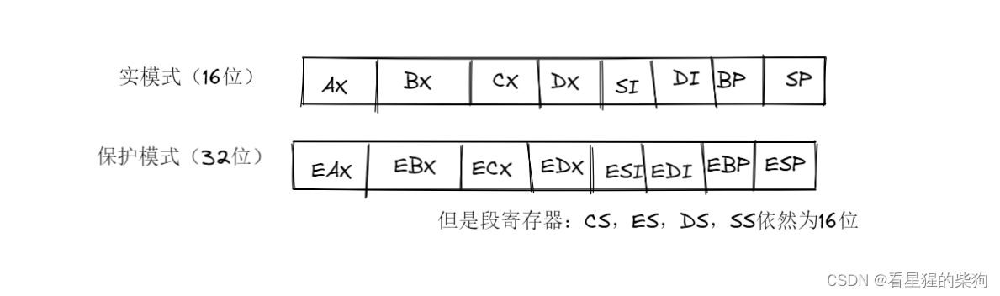


# 保护模式
## x86
  X86 架构是一种计算机语言指令集，指 Intel 通用计算机系列的标准编号缩写，也标识一套通用的计算机指令集合
  
  x86 是 Intel 通用计算机系列的标准编号缩写，也标识一套通用的计算机指令集合。这个 x 与处理器没有任何关系，它是对所有“*86”系统的一种简单、宽泛的定义，例如 i386、586、奔腾（Pentium）。由于早期 Intel 的 CPU 编号都是 8086、80286 这样（都含有 86），而且整个系列的 CPU 都是指令兼容的，所以用 X86 来标识所使用的指令集合。如今的奔腾、P2、P4、赛扬系列都支持 X86 指令系统，所以都属于 X86 家族。
  
X86 指令集是美国 Intel 公司为其第一块 16 位 CPU（i8086）专门开发的。美国 IBM 公司 1981 年推出的世界第一台 PC 机中的 CPU——i8088（i8086 的简化版）使用的也是 X86 指令，同时电脑中为提高浮点数据处理能力而增加的 X87 系列数学协处理器则另外使用 X87 指令；后来就将 X86 指令集和 X87 指令集统称为 X86 指令集。虽然随着 CPU 技术的不断发展，Intel 陆续研制出更新型的 i80386、i80486 直到今天的 Pentium 4（以下简称 P4）系列，但为了保证电脑能继续运行以往开发的各类应用程序，以保护和继承丰富的软件资源，Intel 公司所生产的所有 CPU 仍然继续使用 X86 指令集，所以它的 CPU 仍属于 X86 系列。

BIOS 是英文“Basic Input Output System”的缩写
##  寄存器

## 虚拟 8086 模式
虚拟 8086 模式又称虚拟实模式，它允许在保护模式操作系统的控制下执行实模式程序。
## 保护的是什么
保护各个进程所占用的内存部分的安全
## 内存映射
CPU 根据内存映射的规则来控制内存访问
内存中的不同区域可以称为段
为了方便 CPU 管理内存，可以把内存中的各个区域登记到一张表（全局描述符表）中。这样 CPU 就可以通过全局描述符表（GDT）获知该段的一些相关信息

## 进入保护模式 - 第一部分
从实模式切换到保护模式
只需将 CR0 寄存器中的 PE 标志位置 1 即可进入保护模式
汇编指令为：

```c
move eax,cr0
or eax,1
mov cr0,eax
```
## 进入保护模式 - 第二部分
 上面三条语句之后必须紧跟一条 JMP 或 CALL 指令，否则会出现一些错误
  因为 cr0 寄存器的 PE 标志位改为 1 之后，后续已经以流水线方式按 32 位形式执行的 16 位指令会导致错误，所以此时需要一条跳转指令让 CPU 重置一次

