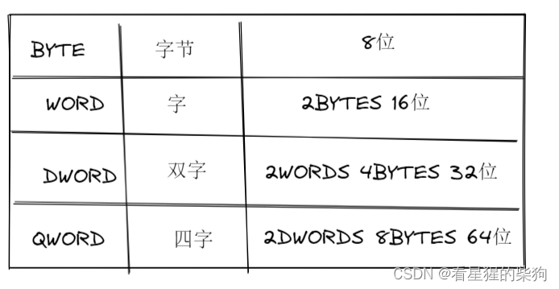
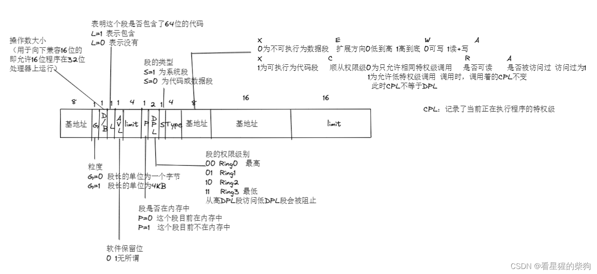
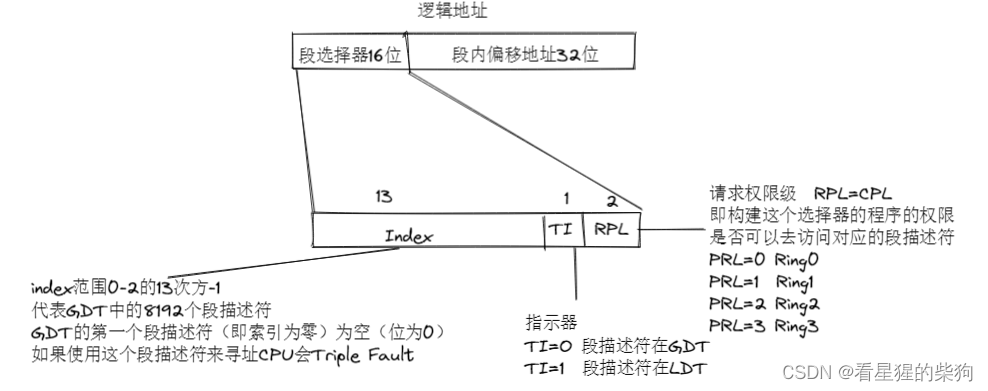


# 分段
## 分布
在 32 位模式下，内存被划分为一个一个的段
离散分布，即它们不一定紧挨在一起
## 寻址
32 位：段选择子 + 段内偏移
16 位：段起始地址*16 + 段内偏移

> 为什么要 ×16？因为 8086 CPU 的地址总线是 20 位，而寄存器是 16 位，最多只能寻址 64KB，无法寻址 1M 内存。于是 Intel 设计了这种寻址方式：先缩小 4 位变成 16 位放入段寄存器，使用时再扩展回 20 位。这也导致了段的起始地址必须是 16 的倍数这一限制

区别：32 位模式下寻址不需要左移四位来得到段的起始地址
           32 位模式可以自行定义段的位置和长度
## 全局描述符表（GDT）
全局描述符表是一块内存空间，最大 64KB（1KB=1024B），可以理解为一个数组，每个元素都是一个段描述符
全局描述符表的地址指针存放在一个叫 GDTR 的特殊寄存器中
GDTR 是一个 48 位寄存器。全局描述符的地址指针也是 48 位

## 段描述符
 段描述符记录了该段的特征
 每个段描述符占八个字节，分为高 32 位和低 32 位
 
 
 基址和长度是拆开存放的
 
 1GB=1024MB
 1MB（兆字节）= 1024KB（千字节）
 1KB=1024B（字节） 
 1Byte（字节）=8bit（位）
  
 
 段描述符的组成

逻辑地址的组成

CS、ES、SS、DS 这四个寄存器在 32 位模式下仍然是 16 位寄存器

> 段选择子：在 32 位汇编中，16 位段寄存器（CS、DS、ES、SS、FS、GS）不再存放段基址，而是存放段选择子

实模式下存放的是段地址
保护模式下存放的是段选择子
保护模式还额外附送了两个段寄存器：FS 和 GS
 CS 和 SS 指向正确类型的段

