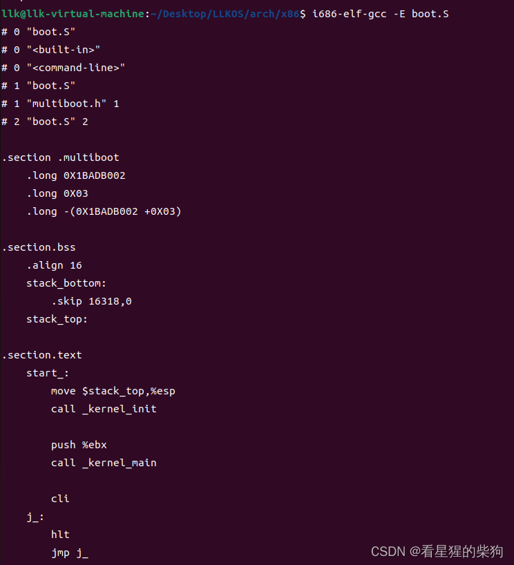
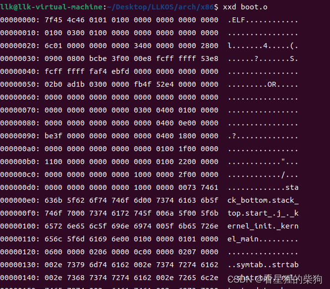


# GNU assembler
GNU 汇编器将汇编代码翻译成机器码
汇编指令是 CPU 机器指令的助记符，经过汇编后会变成由 1 和 0 组成、可被 CPU 读取和执行的机器码。
> 汇编源程序用于系统最基本的初始化，比如初始化栈指针、设置页表、操作 ARM 协处理器等；初始化完成后就可以跳转到 C 代码执行。
# 文件格式
文件后缀为小写 s：汇编代码
文件后缀为大写 S：需要预处理的汇编代码
# 汇编语法
.long：定义四个字节的数据

.section：定义一个段

CLI 汇编指令是 Clear Interupt 的缩写，用于禁止中断；CLI 生效后，所有外部中断都被屏蔽，保证当前运行的代码不被打断，起到保护代码运行的作用

hlt 指令使程序停止运行，处理器进入暂停状态，不执行任何操作，不影响标志位。当 RESET 线上有复位信号、CPU 响应非屏蔽中断、CPU 响应可屏蔽中断这三种情况之一发生时，CPU 脱离暂停状态，执行 HLT 的下一条指令。
  如果在 hlt 指令之前执行了 cli，可屏蔽中断就无法唤醒 CPU
# 相关命令

```bash
i686-elf-gcc -E *.S文件 ：停止在预处理阶段后，不会运行编译器，结果是预处理后的源码，会发送到标准输出（显示在命令行上）

i686-elf-gcc -c *.S文件 ：可以生成目标文件 即*.0文件，因为此时函数还没有链接，所以没问题

-o指定生成文件名

xxd 目标文件即*.o文件：显示目标文件十六进制形式，按地址顺序显示字节内容
```
# 源代码
## boot.S

```c
#include "multiboot.h"

.section .multiboot
    .long MB_MAGIC 
    .long MB_ALIGNED_4K_MEM_MAP
    .long CHECKSUM(MB_ALIGNED_4K_MEM_MAP)

.section .bss  /*栈的起始地址是十六字节对齐*/
    .align 16
    stack_bottom:
        .skip 16318,0
    stack_top:

.section .text
    start_:
        movl $stack_top,%esp /*栈顶赋值*/
        call _kernel_init

        push %ebx /*bool*/
        call _kernel_main

        cli  /*禁止所有中断*/
    j_:
        hlt   /*停止状态*/
        jmp j_ /*死循环，直到断电*/
```

## multiboot.h
```c
#define MB_MAGIC 0X1BADB002
#define MB_ALIGNED_4K_MEM_MAP 0X03  //即flag前两位为1
#define CHECKSUM(flags)  -(MB_MAGIC+flags) 
```
##  
# 结果



