
# 参考资料
[https://showlinkroom.me/2017/08/21/C-%E9%80%86%E5%90%91%E5%88%86%E6%9E%90/](https://showlinkroom.me/2017/08/21/C-%E9%80%86%E5%90%91%E5%88%86%E6%9E%90/)
[https://www.cnblogs.com/bonelee/p/17299985.html](https://www.cnblogs.com/bonelee/p/17299985.html)
[https://xz.aliyun.com/t/5242?time__1311=n4%2BxnD07itGQ%3DD54AKDsA3xCuU%3DwQNY4D&alichlgref=https%3A%2F%2Fxz.aliyun.com%2Fu%2F15779#toc-3](https://xz.aliyun.com/t/5242?time__1311=n4%2bxnD07itGQ=D54AKDsA3xCuU=wQNY4D&alichlgref=https://xz.aliyun.com/u/15779#toc-3)
# 虚函数
在 C++ 中，虚函数是一种特殊的成员函数，它允许派生类重写或覆盖基类中定义的函数，从而实现多态。虚函数的关键特性和用途可以总结如下：

1. **声明与定义**：
   声明虚函数时，需要在基类的成员函数声明前加上 `virtual` 关键字。例如：
   ```cpp
   class Base {
   public:
       virtual void someFunction() {
           // 基类的实现
       }
   };
   ```
   派生类可以选择覆盖或不覆盖该函数；如果覆盖，就在派生类中提供新的实现：
   ```cpp
   class Derived : public Base {
   public:
       void someFunction() override {
           // 派生类的实现
       }
   };
   ```

2. **虚函数表（VTable）**：
   实现虚函数的机制通常涉及虚函数表（vtable）。每个含有虚函数的类都有一个 vtable，其中存放该类所有虚函数的地址。每个对象都有一个指向对应类 vtable 的指针（称为 vptr）。通过基类指针或引用调用虚函数时，程序根据对象的 vptr 找到正确的 vtable，并调用实际对象类型的函数实现。

3. **纯虚函数与抽象类**：
   如果基类中的某个虚函数没有实现，并在声明中用 `= 0` 初始化，该函数就称为纯虚函数。含有纯虚函数的类不能被实例化，只能作为基类被继承，这样的类称为抽象类。


#  使用虚函数的类结构
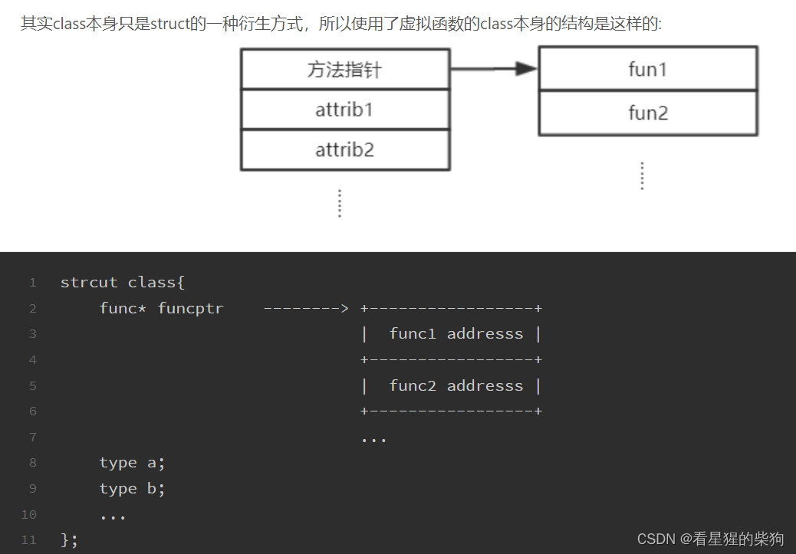
# 相关实现

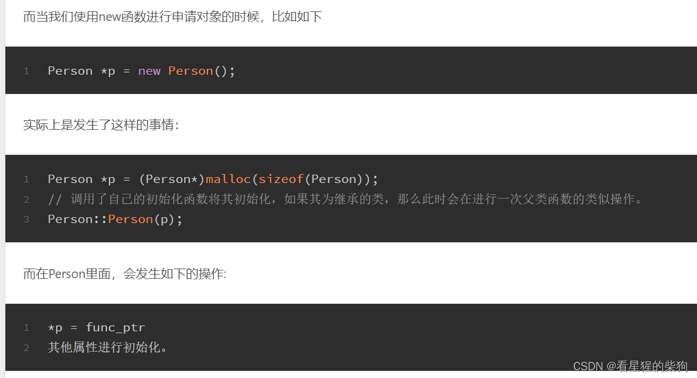
- new 的本质其实是 malloc + 构造函数
- delete 的本质是析构函数 + free
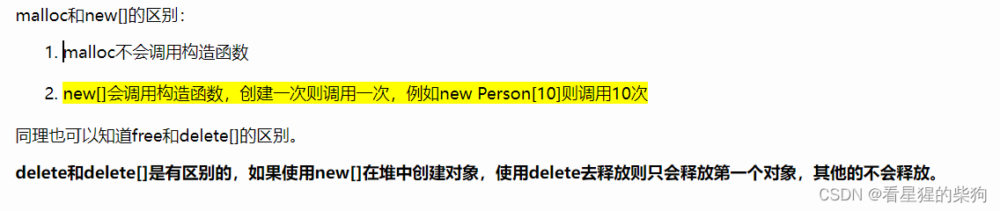

# 源码

```cpp
#include <iostream>
#include <string>

using namespace std;

class Person
{

public:
    Person() {
        age = 0;
        name = "";
    };
    ~Person() {

    };
    virtual void setName(string name) = 0;
    virtual void setAge(int age) = 0;
protected:
    int age;
    string name;

};

class Student :public Person {

public:
    Student() {
        age = 17;
    }
    void setName(string name) {
        this->name = name;
    }
    string getName() {
        return this->name;
    }
    void setAge(int age) {
        if (age > 30 || age < 6) {
            cout << "not suitable for school!" << endl;
            return;
        }
        this->age = age;
    }
    int getAge() {
        return this->age;
    }
};

int main() {
    Student* stu = new Student();
    stu->setName("Link");
    stu->setAge(18);
    cout << stu->getName() << " with age " << stu->getAge() << endl;
    return 0;
}
```
# IDA 反编译

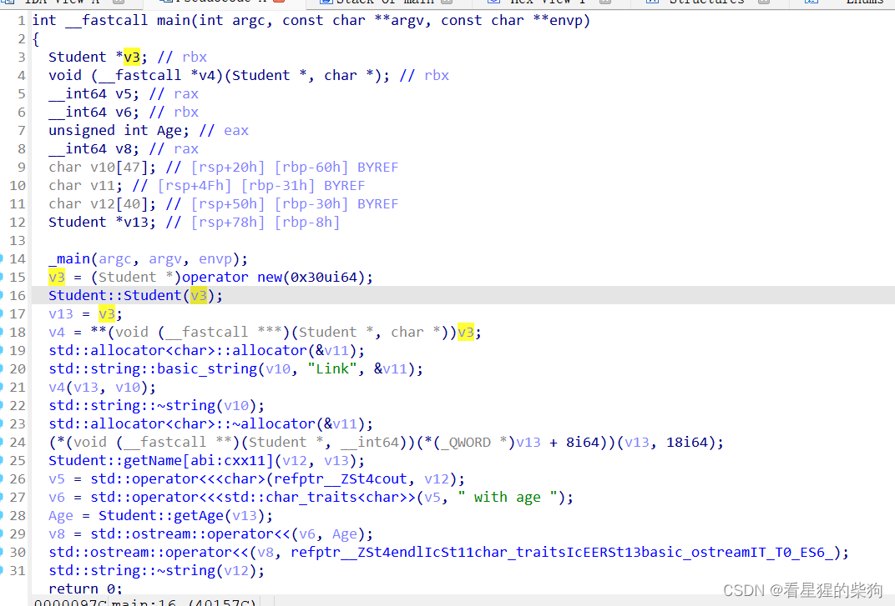
子类构造函数
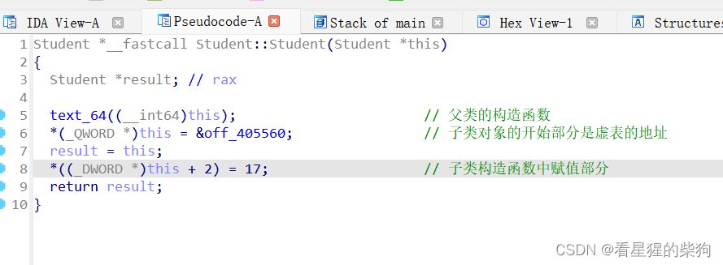
基类构造函数
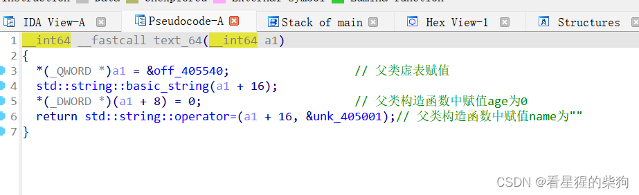
# 子类虚表与基类虚表
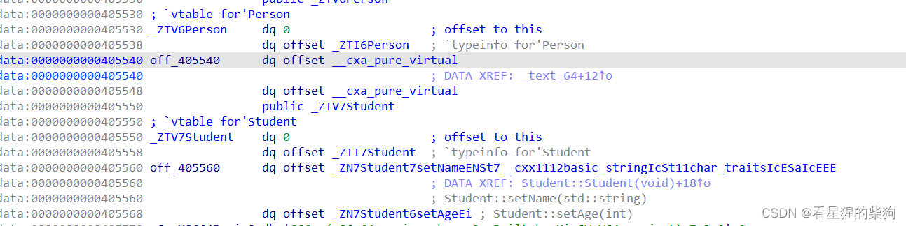
含有纯虚函数的抽象类的虚表中填的是 `__cxa_pure_virtual`——有多少个纯虚函数就有多少个 `__cxa_pure_virtual`。Student 类的虚表中分别是它所实现的虚函数，虚表上方是该类 typeinfo 的地址
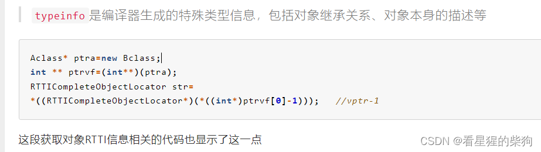

- RTTI（Run-Time Type Information，运行时类型信息）是 C++ 的一项特性，允许程序在运行时识别对象的类型。
- `typeid` 运算符和 `dynamic_cast` 都是基于 RTTI 实现的。
- 每个含有虚函数的类的实例在内存中都有一个隐藏指针（称为 vptr，虚函数指针），指向该类的虚函数表（vtable）。这个 vptr 在对象创建时由编译器自动初始化。
- RTTI 信息通常与 vtable 一起管理，可能包括类型描述信息和继承链信息。

1. `Aclass* ptra = new Bclass;`：这一行创建了一个指向 `Bclass` 实例的指针，但该指针被声明为 `Aclass*` 类型。由于 `Bclass` 是 `Aclass` 的子类（此处假设如此），这是一次向上转型，这是多态的基础。

2. `int ** ptrvf = (int**)(ptra);`：这里执行了一次不安全的类型转换，把 `Aclass` 指针强转为 `int**`。这样转换通常是为了直接访问虚函数指针（vptr），因为在许多系统上 vptr 是对象内存布局的第一个元素，可以被当作指向指针的指针。但要注意，这种做法非常危险且不规范，违反了类型安全原则。

3. `*((int*)ptrvf[0]-1)`：这部分是为了找到 RTTI 信息的位置。`ptrvf[0]` 访问第一个虚函数（按指针计数），减 1 则试图访问 vptr 之前的位置，预期那里存放着指向 RTTI 相关数据的指针。这一步同样非常危险，依赖于特定编译器和平台的实现细节。

4. `*((RTTICompleteObjectLocator*)(...))`：这里进一步把找到的地址强转为 `RTTICompleteObjectLocator` 指针并解引用。`RTTICompleteObjectLocator` 是一个内部使用的结构体（并非标准的公开接口），存放对象类型的完整信息，例如类的类型描述符以及到类型名字符串的偏移。


# 函数调用
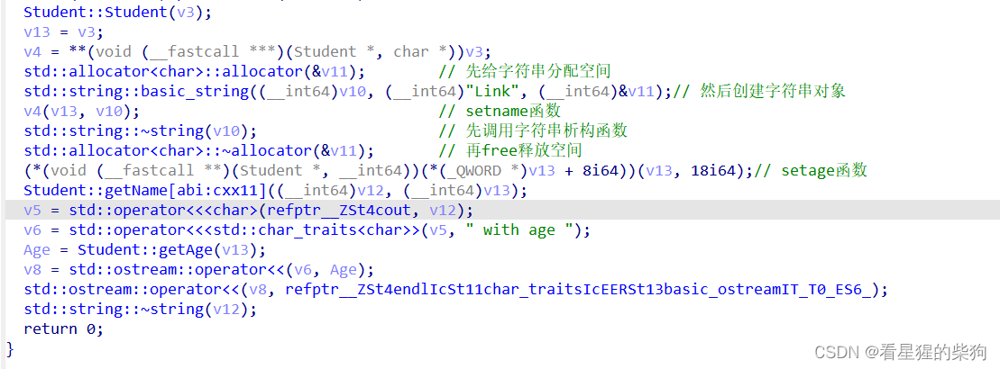
对于虚函数
1. 先从对象的前八个字节取得虚表地址
2. 通过虚表地址和对应偏移得到函数地址
3. 调用函数
对于非虚函数
4. 直接调用 text 段中实现的函数

# 菱形继承

```cpp
#include<stdio.h>
#include<stdlib.h>

//间接基类
class A {
public:
    virtual void function() {
        printf("A virtual function\n");
    }
    int a;
};

//直接基类
class B :virtual public A { //虚继承
public:
    virtual void func() {
        printf("B virtual func()\n");
    }
    int b;
};

//直接基类
class C :virtual public A { //虚继承
public:
    virtual void func() {
        printf("C virtual func()");
    }
    int c;
};

//派生类
class D :public B, public C {
public:
    virtual void function() {
        printf("D virtual function()");
    }
    int d;
};


int main(int argc, char** argv) {
    A* A_ptr = (A*)new D();
    A_ptr->function();

    return 0;
}
```
B 和 C 继承自 A；D 继承自 B 和 C

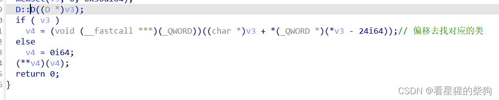虚表地址减 24 处的内容为 32；把它加到起始地址上，对应的 V4 就是 A 的对象在 D 中的内存位置。offset vbase 应该是到虚基类的偏移，即相对于 A 的偏移
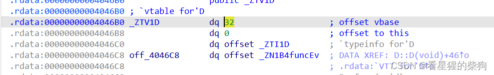
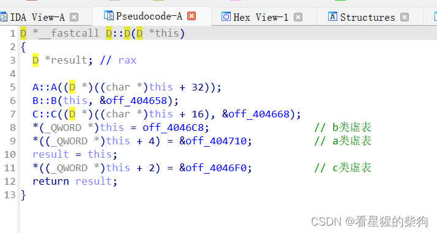
给该对象空间内各个父类对象的前八个字节赋值时，所用的地址是本对象虚表中不同父类虚函数所对应的地址
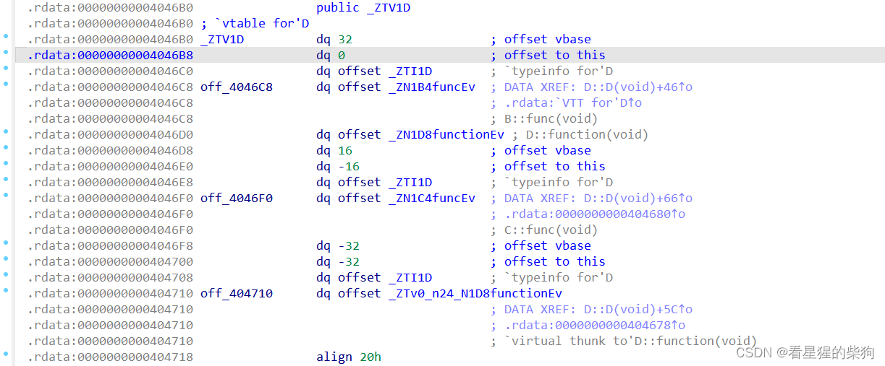

此时对应的虚表地址，所以**两次取值得到 D::function 的地址，参数是对象本身
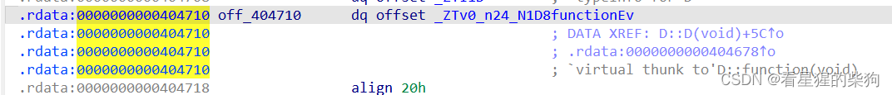

