
# 抽象类、虚函数与纯虚函数


### 抽象类

抽象类是一种不能直接实例化的类；它的作用是作为基类，为派生类提供统一的接口。抽象类可以包含具体方法（即有实现的方法）和抽象方法（即没有实现的方法）。抽象类通常用来定义接口规范，强制继承它的子类实现某些方法。

在 C++ 中，只要一个类包含至少一个纯虚函数，它就是抽象类。抽象类不允许被实例化，也就是说不能直接创建抽象类的对象。

### 纯虚函数

纯虚函数是在基类中声明、但在基类中没有具体实现的虚函数；它留给派生类去实现。纯虚函数的声明语法是在函数声明后面加上 `= 0`，例如：

```cpp
virtual void func() = 0;
```

包含纯虚函数的类称为抽象类。派生类必须实现所有的纯虚函数，否则该派生类也会变成抽象类。

### 虚函数

虚函数是一种特殊的成员函数，它允许基类中的函数在派生类中被重写，从而实现动态多态。当通过基类指针或引用调用虚函数时，实际调用的是指针或引用所指向的具体对象所属类的那个版本的函数。

虚函数的声明不需要 `= 0`，例如：

```cpp
virtual void func();
```

使用虚函数的主要目的是实现多态，使基类指针或引用能够调用派生类中的函数，从而在运行时决定调用哪个函数，提高程序的灵活性和可扩展性。

### 总结

- **抽象类**：不能直接实例化；至少包含一个纯虚函数；为派生类提供接口规范。
- **纯虚函数**：没有具体实现的虚函数；强制派生类实现它；使一个类成为抽象类。
- **虚函数**：可以在派生类中被重写，以实现动态多态，使得通过基类指针或引用调用时，能根据对象的实际类型执行相应的函数。
#  C++ 虚函数与继承的补充说明 [https://wsxk.github.io/c++reverse/](https://wsxk.github.io/c++reverse/)
# 带虚函数的析构与构造
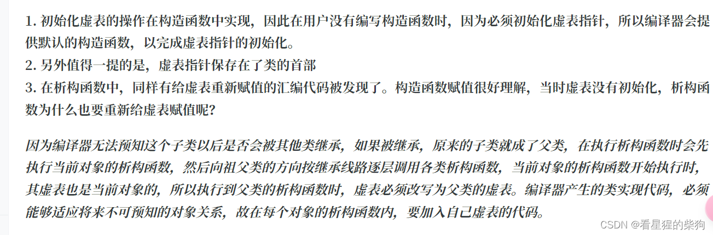

##  调用析构函数时切换虚表的原因（构造函数同理）

>在子类构造函数中，首先调用的是父类构造函数。父类构造函数首先会把子类对象中的虚表填充为父类虚表的地址。在父类构造函数内部，如果存在虚函数调用，那么就能成功调用父类的函数，而不是子类的函数。

```cpp
class Base {
public:
    Base() { initTable(); }
    virtual ~Base() {
        std::cout << "Before sayHello in Base destructor" << std::endl;
        sayHello(); // 假设这里有个逻辑错误，实际上不应直接调用虚函数
        std::cout << "After sayHello in Base destructor" << std::endl;
    }
    virtual void sayHello() { std::cout << "Hello from Base" << std::endl; }

private:
    void initTable() { /* 假设这里有初始化虚表的操作 */ }
};

class Derived : public Base {
public:
    Derived() { initTable(); }
    ~Derived() override { std::cout << "Derived destructor" << std::endl; }
    void sayHello() override { std::cout << "Hello from Derived" << std::endl; }

private:
    void initTable() { /* 初始化包含 Derived 版本 sayHello 的虚表 */ }
};
```

现在，如果我们创建一个 `Derived` 对象，并通过基类指针删除它，会发生什么？

```cpp
int main() {
    Base* ptr = new Derived();
    delete ptr;
    return 0;
}
```

### 预期行为

- 首先，调用 `Derived` 的析构函数，清理 `Derived` 特有的资源。
- 接下来，控制权转到 `Base` 的析构函数，因为在 `Derived` 被销毁之后，基类部分仍需要被销毁。

### 问题所在

在 `Base` 的析构函数中，假设存在一个逻辑错误，直接调用了 `sayHello()`。如果虚表没有被切换，按照对象原本的类型（即 `Derived`），将会调用 `Derived` 版本的 `sayHello()`，这与我们的预期相矛盾——在销毁 `Base` 部分时，应当只表现出 `Base` 的行为。

### 解决方案：临时切换虚表

为了确保在执行 `Base` 的析构函数时，即使发生虚函数调用，也能体现出 `Base` 的行为，编译器会在进入 `Base` 的析构函数之前，把对象的虚表指针临时切换为 `Base` 类的虚表。这样，当 `Base` 的析构函数内部调用 `sayHello()` 时，调用的是 `Base` 版本的 `sayHello()`，而不是 `Derived` 版本，从而保证了行为的正确性。

#  全局变量构造函数和析构函数的执行

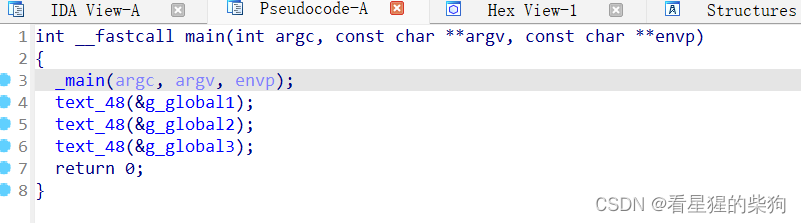

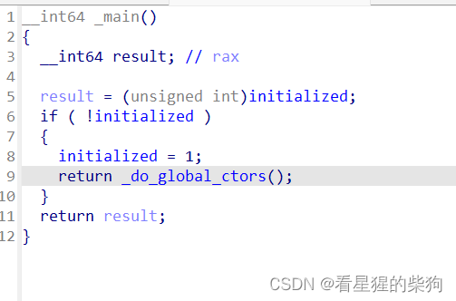

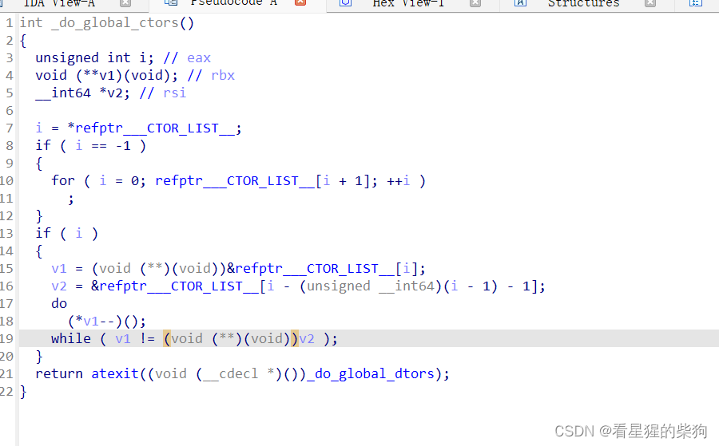


这段代码是 C++ 程序编译后，在启动和关闭阶段处理全局构造函数和析构函数的一个简化示例。它通常由编译器自动生成，用于管理全局对象的构造和析构顺序。这里涉及几个关键概念和变量，下面逐一说明，并给出一个概念性的示例帮助理解。

### 关键概念与变量说明

- `_do_global_ctors`：这个函数负责调用全局对象的构造函数。它在程序启动时由编译器/链接器自动调用。
- `_do_global_dtors`：对应的函数，负责调用全局对象的析构函数，在程序结束时调用。
- `refptr___CTOR_LIST__`：这是一个指向编译器维护的全局构造函数指针数组的指针。数组的每个元素都是一个指向某个全局对象构造函数的函数指针。
- `refptr___DTOR_LIST__`：类似地，它指向一个析构函数指针数组，但这段代码没有直接展示它。
- `eax`、`ebx`、`rsi`：这些是 x86-64 架构下的寄存器名称，用于存储临时变量或指针。

### 函数流程

1. **初始化检查**：首先检查 `refptr___CTOR_LIST__[0]`（即 `i`）是否等于 -1。这个值通常表示构造函数列表未初始化或为空。如果是 -1，则跳过后续的构造函数调用步骤。
   
2. **遍历构造函数列表**：如果构造函数列表非空，计算列表的实际长度（即构造函数的数量），然后用双指针技巧（一个指针前移，另一个保持不动，直到第一个指针到达末尾）依次调用每个构造函数。

3. **注册析构函数**：最后，使用 `atexit` 函数注册 `_do_global_dtors`，确保程序正常退出时调用全局对象的析构函数。

### 示例说明

假设我们有以下两个全局对象，各自有自己的构造函数和析构函数：

```cpp
class ObjA {
public:
    ObjA() { std::cout << "ObjA constructed" << std::endl; }
    ~ObjA() { std::cout << "ObjA destructed" << std::endl; }
};

class ObjB {
public:
    ObjB() { std::cout << "ObjB constructed" << std::endl; }
    ~ObjB() { std::cout << "ObjB destructed" << std::endl; }
};

ObjA globalA;
ObjB globalB;
```

程序启动时，`_do_global_ctors` 被调用，按编译器决定的顺序依次调用 `ObjA` 和 `ObjB` 的构造函数。输出可能是：

```
ObjA constructed
ObjB constructed
```

当程序正常结束时，`_do_global_dtors` 被调用，按相反的顺序调用析构函数。输出可能是：

```
ObjB destructed
ObjA destructed
```

通过这种方式，C++ 保证了全局对象的构造和析构是有序进行的，即使对象之间存在依赖关系。


# 继承

在构造函数中：
构造顺序：先构造父类，再按声明顺序构造初始化列表中指定的成员对象和成员，最后执行自身的构造函数代码
析构顺序：先调用自身的析构函数，再调用成员对象的析构函数，最后调用父类的析构函数


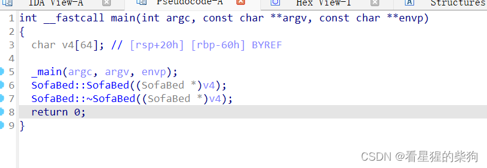
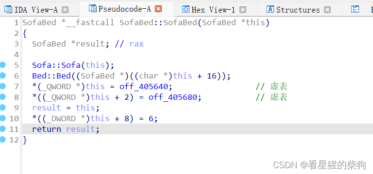
按照继承关系的顺序，先调用父类 Sofa 的构造函数。在调用另一个父类 Bed 时，并不是直接把对象的起始地址作为 this 指针传入，而是把地址向后调整父类 Sofa 的长度，用调整后的地址值作为 this 指针传入；只有这样才调用父类 Bed 的构造函数。因为有两个父类，子类在继承时也继承了它们各自的虚表指针，所以子类拥有两个虚表指针。可以看出，在多继承中，子类中虚表指针的数量取决于所继承父类的数量，父类有几个，虚表指针就有几个。
在进行多态操作时，会把指针向前或向后移动，使其指向那个位置。

# 继承抽象类

```cpp
// C++ 源码
#include <stdio.h>
class AbstractBase {
public:
AbstractBase() {
printf("AbstractBase()");
}
virtual void show() = 0; //定义纯虚函数
};
class VirtualChild : public AbstractBase { //定义继承抽象类的子类
public:
virtual void show() { //实现纯虚函数
printf("抽象类分析\n");
}
};
int main(int argc, char* argv[]) {
VirtualChild obj;
obj.show();
return 0;
}
```

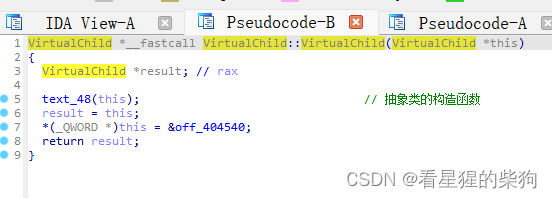
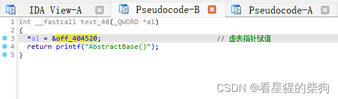
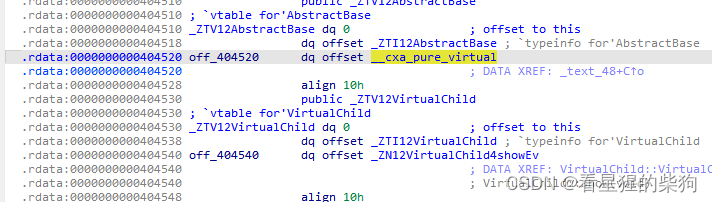
可以发现，虚表中函数指针所指向的位置并没有具体实现。
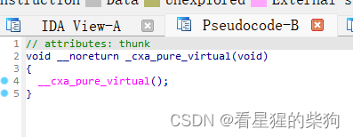
而子类虚表函数指针所指向的位置则有具体实现。
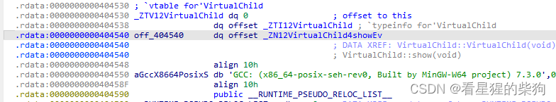
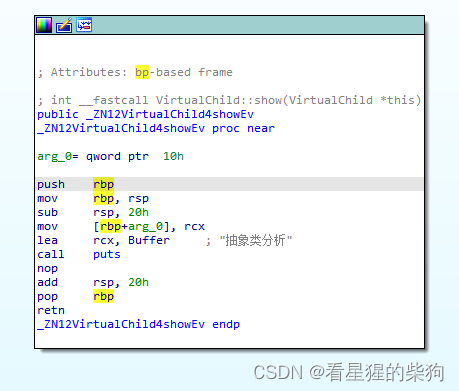
#  虚继承

### 基本设定

假设我们有以下四个类：

1. **Vehicle**：一个基类，有一个成员变量 `color` 表示颜色。
   
   ```cpp
   class Vehicle {
   public:
       std::string color;
       Vehicle(std::string c) : color(c) {}
   };
   ```

2. **Car** 和 **Motorcycle**：两个继承自 `Vehicle` 的类，没有新增成员，直接继承。
   
   ```cpp
   class Car : public Vehicle {
   public:
       Car(std::string c) : Vehicle(c) {}
   };

   class Motorcycle : public Vehicle {
   public:
       Motorcycle(std::string c) : Vehicle(c) {}
   };
   ```

3. **ConvertibleCar**：一种特殊的车，它同时也是一种摩托车（想象一个非常科幻的场景），直接继承自 `Car` 和 `Motorcycle`。

   如果不使用虚继承，按照常规方式继承，`ConvertibleCar` 将拥有两个 `color` 成员，分别来自 `Car` 和 `Motorcycle`。

### 不使用虚继承时的问题

```cpp
class ConvertibleCar : public Car, public Motorcycle {
public:
    ConvertibleCar(std::string c) : Car(c), Motorcycle(c) {}
    
    // 这里访问color就会有二义性，因为不清楚是Car的color还是Motorcycle的color
    // std::cout << color; // 错误，编译时会报错
};
```

### 使用虚继承解决问题

为了让 `ConvertibleCar` 只有一个 `color` 成员，我们需要让 `Car` 和 `Motorcycle` 虚继承自 `Vehicle`。

```cpp
class Car : virtual public Vehicle { ... };
class Motorcycle : virtual public Vehicle { ... };

class ConvertibleCar : public Car, public Motorcycle {
public:
    ConvertibleCar(std::string c) : Car(c), Motorcycle(c) {}
    
    // 现在访问color是明确的，因为只有一个实例
    std::cout << color; // 正确，输出ConvertibleCar的颜色
};
```

通过虚继承，`ConvertibleCar` 实例只有一份共享的 `Vehicle` 基类部分，从而避免了数据冗余和访问歧义的问题。

# 虚基类偏移表（vbtable）
下面通过一个具体的例子来解释虚基类偏移表（vbtable）的概念。假设我们有如下的类结构：

```cpp
class Vehicle {
public:
    int wheels;
    virtual void drive() { std::cout << "Driving a vehicle." << std::endl; }
};

class Car : virtual public Vehicle {
public:
    int doors;
    virtual void drive() override { std::cout << "Driving a car." << std::endl; }
    virtual void honk() { std::cout << "Honking the horn." << std::endl; }
};

class Truck : virtual public Vehicle {
public:
    int payloadCapacity;
    virtual void drive() override { std::cout << "Driving a truck." << std::endl; }
    virtual void loadCargo() { std::cout << "Loading cargo." << std::endl; }
};

class SUV : public Car, public Truck {
public:
    int seatingCapacity;
    virtual void drive() override { std::cout << "Driving an SUV." << std::endl; }
};
```

在这个例子中，`Vehicle` 是一个虚基类，被 `Car` 和 `Truck` 这两个类虚继承。然后，`SUV` 类同时继承自 `Car` 和 `Truck`，形成了菱形继承结构。

### 内存布局与虚基类偏移表

在 `SUV` 类的对象中，内存布局会包含：

1. **虚函数指针（vptr）**：对于 `SUV`、`Car`、`Truck` 以及从 `Vehicle` 继承来的虚函数，每个含有虚函数的类都有一个指向自己虚函数表的 vptr。

2. **虚基类指针（vbptr）**：由于 `Vehicle` 是被虚继承的，`SUV` 对象会有一个指向虚基类偏移表（vbtable）的 vbptr。

3. **数据成员**：`SUV`、`Car`、`Truck` 和 `Vehicle` 的数据成员按各自的顺序存储。

### 虚基类偏移表的作用

虚基类偏移表（vbtable）中的条目记录的是从 `SUV` 对象起始地址到 `Vehicle` 子对象实际起始地址之间的偏移量。当需要访问 `Vehicle` 类的某个成员（例如 `wheels`）时，编译器会按以下步骤进行：

1. **获取 vbptr**：首先通过 `SUV` 对象中的 vbptr 找到虚基类偏移表。

2. **计算偏移量**：从虚基类偏移表中读取 `Vehicle` 子对象相对于 vbptr 的偏移量。

3. **访问成员**：用这个偏移量加上 vbptr 的地址，就能得到 `Vehicle` 子对象的起始地址，从而正确地访问 `wheels` 成员。

### 访问示例

如果我们想访问一个 `SUV` 对象的 `wheels` 成员，尽管它是直接继承自 `Car` 和 `Truck`，编译器实际上会通过 vbptr 和 vbtable 找到正确的 `Vehicle` 实例，然后计算出 `wheels` 的地址并访问它。

通过这种方式，虚基类偏移表确保了在复杂继承结构中对虚基类成员的访问是准确的，避免了多继承导致同一个基类数据重复的问题。

