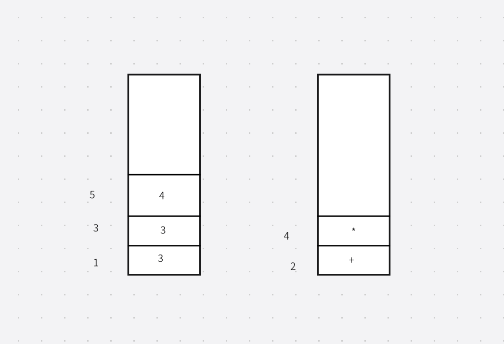


# 参考资料
[https://lotabout.me/2015/write-a-C-interpreter-1/](https://lotabout.me/2015/write-a-C-interpreter-1/)
[https://github.com/archeryue/cpc](https://github.com/archeryue/cpc)
[https://www.bilibili.com/video/BV1Kf4y1V783/?vd_source=a1be939c65919194c77b8a6a36c14a6e](https://www.bilibili.com/video/BV1Kf4y1V783/?vd_source=a1be939c65919194c77b8a6a36c14a6e)

# 整体框架
工业级编译器分为前端和后端

前端（parser）：源代码 -> 中间代码（IR 或虚拟机指令）
- 词法分析（tokenize）：告诉计算机每个单词的含义，把源码拆分成许多 token  
- 语法分析：解析语句，然后生成中间代码或抽象语法树

后端：中间代码 -> 目标代码
- optimizer（最难也最核心的部分）：中间代码 -> 中间代码  
- codegenerate：中间代码 -> 最终目标代码（对于物理架构会翻译成对应的 X86 架构等；对于虚拟机则翻译成字节码） LLVM 会根据目标平台把 IR 字节码翻译成最终的目标代码
 

# 设计
- 前端和后端合二为一，没有中间优化阶段；直接生成中间代码，由解释器（自定义 VM）执行
- 词法分析和语法分析同时进行，边解析边生成字节码（变量声明必须放在开头）

计算基于寄存器和栈顶进行
- register：pc/sp/bp/ax
- memory：code/data（静态变量/字面量）/stack
- 指令集：save&load（内存<->寄存器）/ 算术指令（算术、位运算、逻辑运算）/ 跳转（无条件、有条件、比较）/ native call（IO：printf、orw / 动态内存分配：malloc/free/memset）


PC 是程序计数器。它保存着一个内存地址，该地址中存放着下一条要执行的计算机指令
SP 是指针寄存器，始终指向当前栈顶。注意由于栈位于高地址并向低地址方向增长，所以压栈时 SP 的值会减小
BP 是基址指针。它同样用来指向栈上的某些位置，在调用函数时会用到
AX 是通用寄存器。在我们的虚拟机中，它用于存放一条指令执行完后的结果
# 虚拟机指令集
- save/load：imm / lea / lc / li /sc / si /push
- arithmetic：add /sub / mul /div /mod /or /xor /and / shc /shr
- branch jumps：jmp/jz / jnz /call /nvar /darg / re
- native call：orw / close / printf / malloc /free / memset /exit /memcmp

```cpp
 while (1) {
        cycle++; op = *pc++; // read instruction
        // load & save
        if (op == IMM)          ax = *pc++;                     // load immediate(or global addr)
        else if (op == LEA)     ax = (int)(bp + *pc++);         // load local addr
        else if (op == LC)      ax = *(char*)ax;                // load char
        else if (op == LI)      ax = *(int*)ax;                 // load int
        else if (op == SC)      *(char*)*sp++ = ax;             // save char to stack
        else if (op == SI)      *(int*)*sp++ = ax;              // save int to stack
        else if (op == PUSH)    *--sp = ax;                     // push ax to stack
        // jump
        else if (op == JMP)     pc = (int*)*pc;                 // jump
        else if (op == JZ)      pc = ax ? pc + 1 : (int*)*pc;   // jump if ax == 0
        else if (op == JNZ)     pc = ax ? (int*)*pc : pc + 1;   // jump if ax != 0
        // arithmetic
        else if (op == OR)      ax = *sp++ |  ax;
        else if (op == XOR)     ax = *sp++ ^  ax;
        else if (op == AND)     ax = *sp++ &  ax;
        else if (op == EQ)      ax = *sp++ == ax;
        else if (op == NE)      ax = *sp++ != ax;
        else if (op == LT)      ax = *sp++ <  ax;
        else if (op == LE)      ax = *sp++ <= ax;
        else if (op == GT)      ax = *sp++ >  ax;
        else if (op == GE)      ax = *sp++ >= ax;
        else if (op == SHL)     ax = *sp++ << ax;
        else if (op == SHR)     ax = *sp++ >> ax;
        else if (op == ADD)     ax = *sp++ +  ax;
        else if (op == SUB)     ax = *sp++ -  ax;
        else if (op == MUL)     ax = *sp++ *  ax;
        else if (op == DIV)     ax = *sp++ /  ax;
        else if (op == MOD)     ax = *sp++ %  ax;
        // some complicate instructions for function call
        // call function: push pc + 1 to stack & pc jump to func addr(pc point to)
        else if (op == CALL)    {*--sp = (int)(pc+1); pc = (int*)*pc;}
        // new stack frame for vars: save bp, bp -> caller stack, stack add frame
        else if (op == NVAR)    {*--sp = (int)bp; bp = sp; sp = sp - *pc++;}
        // delete stack frame for args: same as x86 : add esp, <size>
        else if (op == DARG)    sp = sp + *pc++;
        // return caller: retore stack, retore old bp, pc point to caller code addr(store by CALL) 
        else if (op == RET)     {sp = bp; bp = (int*)*sp++; pc = (int*)*sp++;}        
        // end for call function.
        // native call
        else if (op == OPEN)    {ax = open((char*)sp[1], sp[0]);}
        else if (op == CLOS)    {ax = close(*sp);}
        else if (op == READ)    {ax = read(sp[2], (char*)sp[1], *sp);}
        else if (op == PRTF)    {tmp = sp + pc[1] - 1; ax = printf((char*)tmp[0], tmp[-1], tmp[-2], tmp[-3], tmp[-4], tmp[-5]);}
        else if (op == MALC)    {ax = (int)malloc(*sp);}
        else if (op == FREE)    {free((void*)*sp);}
        else if (op == MSET)    {ax = (int)memset((char*)sp[2], sp[1], *sp);}
        else if (op == MCMP)    {ax = memcmp((char*)sp[2], (char*)sp[1], *sp);}
        else if (op == EXIT)    {printf("exit(%lld)\n", *sp); return *sp;}
        else {printf("unkown instruction: %lld, cycle: %lld\n", op, cycle); return -1;}
    }
```


# 分配空间
先把文件读入已分配的空间

然后分配代码段、数据段、栈段和符号表

```c
int init_vm() {
    // allocate memory for virtual machine
    if (!(code = code_dump = malloc(MAX_SIZE))) {
        printf("could not malloc(%lld) for code segment\n", MAX_SIZE);
        return -1;
    }
    if (!(data = malloc(MAX_SIZE))) {
        printf("could not malloc(%lld) for data segment\n", MAX_SIZE);
        return -1;
    }
    if (!(stack = malloc(MAX_SIZE))) {
        printf("could not malloc(%lld) for stack segment\n", MAX_SIZE);
        return -1;
    }
    if (!(symbol_table = malloc(MAX_SIZE / 16))) {
        printf("could not malloc(%lld) for symbol_table\n", MAX_SIZE / 16);
        return -1;
    }
    memset(code, 0, MAX_SIZE);
    memset(data, 0, MAX_SIZE);
    memset(stack, 0, MAX_SIZE);
    memset(symbol_table, 0, MAX_SIZE / 16);
    return 0;
}
```

# 词法分析
词法分析函数根据扫描到的字符来判断类型

symbol_ptr 是符号表指针

- 如果一个 token 由字母或数字组成，就把它放入符号表。这里会遍历符号表，检查是否已存在相同的符号；如果存在，就直接返回那个符号；如果不存在，就插入它，返回的 token 为 ID 类型

```cpp
  // add new symbol
            symbol_ptr[Name] = (int)ch_ptr;  // 字符串的地址
            symbol_ptr[Hash] = token;     // 这里的token是之前计算的哈希值
            token = symbol_ptr[Token] = Id;  // 这里ID是一个枚举值，代表该符号的token是个ID（标识符）
```
- 纯数字会根据其进制进行解析，返回的 token 为数字类型
- 字符和字符串：这里 char 被当作 num 类型处理；此外，字符串中可能包含转义字符，这里也会处理

```cpp
  // handle string & char
        else if (token == '"' || token == '\'') {  // 单引号和双引号
            ch_ptr = data;
            while (*src != 0 && *src != token) {   // 解析知道遇到单引号或者双引号
                if ((token_val = *src++) == '\\') {  //遇到斜杠
                    // only support escape char '\n'    
                    if ((token_val = *src++) == 'n') token_val = '\n';   // 当转义字符
                }
                // store string to data segment
                if (token == '"') *data++ = token_val;  // 如果是字符串 将字符存进data段里
            }
            src++;
            if (token == '"') token_val = (int)ch_ptr;   // 结束字符是双引号 token_val是字符起始地址
            // single char is Num
            else token = Num;  // char 当Num返回
            return;
        }
```
- 注释标记与除号
```cpp
 else if (token == '/') {  // 是除号
            if (*src == '/') {    // 当前字符也是除号
                // skip comments
                while (*src != 0 && *src != '\n') src++;  // 认为是注释跳过注释内容
            } else {     // 一个除
                // divide
                token = Div;  // token返回除号类型
                return;
            }
        }
```
- 运算符：除了一些直接返回的符号外，大多数符号都需要返回其对应的运算类型

```cpp
 // handle all kinds of operators, copy from c4.
  else if (token == '=') {if (*src == '=') {src++; token = Eq;} else token = Assign; return;}
        else if (token == '+') {if (*src == '+') {src++; token = Inc;} else token = Add; return;}
        else if (token == '-') {if (*src == '-') {src++; token = Dec;} else token = Sub; return;}
        else if (token == '!') {if (*src == '=') {src++; token = Ne;} return;}
        else if (token == '<') {if (*src == '=') {src++; token = Le;} else if (*src == '<') {src++; token = Shl;} else token = Lt; return;}
        else if (token == '>') {if (*src == '=') {src++; token = Ge;} else if (*src == '>') {src++; token = Shr;} else token = Gt; return;}
        else if (token == '|') {if (*src == '|') {src++; token = Lor;} else token = Or; return;}
        else if (token == '&') {if (*src == '&') {src++; token = Land;} else token = And; return;}
        else if (token == '^') {token = Xor; return;}
        else if (token == '%') {token = Mod; return;}
        else if (token == '*') {token = Mul; return;}
        else if (token == '[') {token = Brak; return;}
        else if (token == '?') {token = Cond; return;}
        else if (token == '~' || token == ';' || token == '{' || token == '}' || token == '(' || token == ')' || token == ']' || token == ',' || token == ':') return;
   
```

```c
void tokenize() {
    char* ch_ptr;
    while((token = *src++)) {
        if (token == '\n') line++;
        // skip marco
        else if (token == '#') while (*src != 0 && *src != '\n') src++;
        // handle symbol
        else if ((token >= 'a' && token <= 'z') || (token >= 'A' && token <= 'Z') || (token == '_')) {
            ch_ptr = src - 1;
            while ((*src >= 'a' && *src <= 'z') || (*src >= 'A' && *src <= 'Z')
                    || (*src >= '0' && *src <= '9') || (*src == '_'))
                // use token store hash value
                token = token * 147 + *src++;
            // keep hash
            token = (token << 6) + (src - ch_ptr);
            symbol_ptr = symbol_table;
            // search same symbol in table
            while(symbol_ptr[Token]) {
                if (token == symbol_ptr[Hash] && !memcmp((char*)symbol_ptr[Name], ch_ptr, src - ch_ptr)) {
                    token = symbol_ptr[Token];
                    return;
                }
                symbol_ptr = symbol_ptr + SymSize;
            }
            // add new symbol
            symbol_ptr[Name] = (int)ch_ptr;
            symbol_ptr[Hash] = token;
            token = symbol_ptr[Token] = Id;
            return;
        }
        // handle number
        else if (token >= '0' && token <= '9') {
            // DEC, ch_ptr with 1 - 9
            if ((token_val = token - '0'))
                while (*src >= '0' && *src <= '9') token_val = token_val * 10 + *src++ - '0';
            //HEX, ch_ptr with 0x
            else if (*src == 'x' || *src == 'X')
                while ((token = *++src) && ((token >= '0' && token <= '9') || (token >= 'a' && token <= 'f')
                        || (token >= 'A' && token <= 'F')))
                    // COOL!
                    token_val = token_val * 16 + (token & 0xF) + (token >= 'A' ? 9 : 0);
                // a?ascll?? 97 mod 16 =1 ? 0xf ? 1  + (token >= 'A' ? 9 : 0)
            // OCT, start with 0
            else while (*src >= '0' && *src <= '7') token_val = token_val * 8 + *src++ - '0';
            token = Num;
            return;
        }
        // handle string & char
        else if (token == '"' || token == '\'') {
            ch_ptr = data;
            while (*src != 0 && *src != token) {
                if ((token_val = *src++) == '\\') {
                    // only support escape char '\n'
                    if ((token_val = *src++) == 'n') token_val = '\n';
                }
                // store string to data segment
                if (token == '"') *data++ = token_val;
            }
            src++;
            if (token == '"') token_val = (int)ch_ptr; 
            // single char is Num
            else token = Num;
            return;
        }
        // handle comments or divide
        else if (token == '/') {
            if (*src == '/') {
                // skip comments
                while (*src != 0 && *src != '\n') src++;
            } else {
                // divide
                token = Div;
                return;
            }
        }
        // handle all kinds of operators, copy from c4.
        else if (token == '=') {if (*src == '=') {src++; token = Eq;} else token = Assign; return;}
        else if (token == '+') {if (*src == '+') {src++; token = Inc;} else token = Add; return;}
        else if (token == '-') {if (*src == '-') {src++; token = Dec;} else token = Sub; return;}
        else if (token == '!') {if (*src == '=') {src++; token = Ne;} return;}
        else if (token == '<') {if (*src == '=') {src++; token = Le;} else if (*src == '<') {src++; token = Shl;} else token = Lt; return;}
        else if (token == '>') {if (*src == '=') {src++; token = Ge;} else if (*src == '>') {src++; token = Shr;} else token = Gt; return;}
        else if (token == '|') {if (*src == '|') {src++; token = Lor;} else token = Or; return;}
        else if (token == '&') {if (*src == '&') {src++; token = Land;} else token = And; return;}
        else if (token == '^') {token = Xor; return;}
        else if (token == '%') {token = Mod; return;}
        else if (token == '*') {token = Mul; return;}
        else if (token == '[') {token = Brak; return;}
        else if (token == '?') {token = Cond; return;}
        else if (token == '~' || token == ';' || token == '{' || token == '}' || token == '(' || token == ')' || token == ']' || token == ',' || token == ':') return;
    }
}
```

- 首先，一些关键字会被放入符号表；这些符号的 Token 被设置为对应关键字枚举值的值，也就是对应的关键字类型
从 OPEN 开始的关键字放入符号表后，Class（类别）、type（返回值）、value（对应关键字枚举值）也会被设置；这里的 Token 是 ID 类型的枚举值

```c
void keyword() {
    int i;
    src = "char int enum if else return sizeof while "
        "open read close printf malloc free memset memcmp exit void main";
    // add keywords to symbol table
    i = Char; while (i <= While) {tokenize(); symbol_ptr[Token] = i++;}
    // add Native CALL to symbol table
    i = OPEN; while (i <= EXIT) {
        tokenize();
        symbol_ptr[Class] = Sys;
        symbol_ptr[Type] = INT;
        symbol_ptr[Value] = i++;
    }
    tokenize(); symbol_ptr[Token] = Char; // handle void type 
    tokenize(); main_ptr = symbol_ptr; // keep track of main
    src = src_dump;    //复制过来的地址
}
```
- 

```cpp
    else if (tmp_ptr[Class] == Num) {
            *++code = IMM; *++code = tmp_ptr[Value]; type = INT;
        }
```

# 语法分析

语法（Syntax）：单词 -> 句子
语义（Semantics）：所表达的含义
语法规则（Grammar）：语法的集合

```bash

- program=var_define | fun_define
- var_define=enum_define | vari_define
   vari_define=type [*] Id [ ,] [*] ld ;
   enum_define= enum  ld  { ld=1, ld=2,……};
- fun_define = type ld  (param) { statment }
  1. param=  type [*] Id [ ,] type [*] ld ;
  2. statement= if_statment|while_statment|return_statement|empty_statement|normal_statement
  3. normal_statement= expression;
 
```
用递归下降的方式逐层分解，一直到表达式；表达式通过优先级爬升来处理

这里语法分析和词法分析实际上是一起进行的：先做词法分析，再做语法分析
- 这里 parser 首先解析声明语句，也就是 `enum_define | vari_define| fun_define` 这三种，先解析 token 得知类型（Enum 还是 Char 和 Int）

- Enum 的形式是 `Enum { }  或  Enum ID { }   `
```cpp
assert是判断当前token是不是某个类型，然后解析下一个token

 if (token == Enum) {
            assert(Enum);
            if (token != '{') assert(Id); // skip enum name
            assert('{'); parse_enum(); assert('}');
        } 
 //这里是{}里面的值，一般是{ID=1，ID=2，ID……}类似这种形式
void parse_enum() {
    int i;
    i = 0; // enum index
    while (token != '}') {
        check_new_id();
        assert(Id);  //ID
        // handle custom enum index
        if (token == Assign) { assert(Assign); assert(Num); i = token_val;}  // =num
        symbol_ptr[Class] = Num; 
        symbol_ptr[Type] = INT;
        symbol_ptr[Value] = i++;  // num  后面的是要+1
        if (token == ',') tokenize();  //解析ID
    }
}
```
- INT /Char  ID ; 或者 INT /Char  ID ( )  { }
```cpp
 else if (token == Int || token == Char) {    
            base_type = parse_base_type();  // 确保当前的token是基本类型，然后同时会解析下一个token
            // parse var or func definition
            while (token != ';' && token != '}') {
                // parse pointer's star
                type = base_type;
                while (token == Mul) {assert(Mul); type = type + PTR;}  // INT/Char *
                check_new_id();  // ID是新的,不能一个变量名声明两次
                assert(Id);   
                symbol_ptr[Type] = type; 
                if (token == '(') {   //函数
                    // function
                    symbol_ptr[Class] = Fun;
                    symbol_ptr[Value] = (int)(code + 1); //设置等会要转换的字节码要存储的函数起始地址
                    assert('('); parse_param(); assert(')'); assert('{');
                    parse_fun();
                } else {    //变量
                    // variable
                    symbol_ptr[Class] = Glo;
                    symbol_ptr[Value] = (int)data;  //当前变量的值在data上的位置，还没初始化
                    data = data + 8; // keep 64 bits for each var
                }
                // handle int a,b,c;
                if (token == ',') assert(',');     
            }
        }  
        
int ibp;
void parse_param() {
    int type, i;
    i = 0;
    while (token != ')') {
        type = parse_base_type();   // 解析type
        // parse pointer's star
        while (token == Mul) {assert(Mul); type = type + PTR;}  // 多重指针
        check_local_id();  //当前解析的token是ID并且它的type不是局部的
        assert(Id); 
        hide_global();  //设置重名的Class  Type  Value到全局去
        symbol_ptr[Class] = Loc;
        symbol_ptr[Type] = type;
        symbol_ptr[Value] = i++; //第几个参数
        if (token == ',') assert(',');
    }
    ibp = ++i;
}

void hide_global() {
    symbol_ptr[GClass] = symbol_ptr[Class];
    symbol_ptr[GType] = symbol_ptr[Type];
    symbol_ptr[GValue] = symbol_ptr[Value];
}


```
- 解析函数体。先解析变量声明，接着是分配栈帧的语句，然后解析语句，最后加一个 ret，再把符号表中 Class 为 Loc 的项恢复回去（因为该函数已经解析完了）

```cpp

void parse_fun() {
    int type, i;
    i = ibp; // bp handle by NVAR itself.
    // local variables must be declare in advance 
    while (token == Char || token == Int) {
        type = parse_base_type();
        while (token != ';') {
            // parse pointer's star
            while (token == Mul) {assert(Mul); type = type + PTR;}
            check_local_id(); assert(Id);
            hide_global();
            symbol_ptr[Class] = Loc;
            symbol_ptr[Type] = type;
            symbol_ptr[Value] = ++i;
            if (token == ',') assert(',');
        }
        assert(';');
    }
    // new stack frame for vars
    *++code = NVAR;
    // stack frame size
    *++code = i - ibp;  
    while (token != '}') parse_stmt();  //解析所有的语句
    if (*code != RET) *++code = RET; // void function  void没有ret，此时设置个ret
    // recover global variables
    symbol_ptr = symbol_table;
    while (symbol_ptr[Token]) 
    {
        if (symbol_ptr[Class] == Loc) recover_global();
        symbol_ptr = symbol_ptr + SymSize;
    }
}


void recover_global() {
    symbol_ptr[Class] = symbol_ptr[GClass];
    symbol_ptr[Type] = symbol_ptr[GType];
    symbol_ptr[Value] = symbol_ptr[GValue];
}
```
- 解析语句：有 if、while、return、{}、;，以及赋值表达式语句，这些会被转换成对应的字节码
- 对于 if 语句，如果 () 内的条件表达式求值为 0，就跳转到 else 部分；否则执行 true 部分

```cpp

void parse_stmt() {
    int* a;
    int* b;
    if (token == If) {    //if 语句
        assert(If); assert('('); parse_expr(Assign); assert(')');
        *++code = JZ; b = ++code; // JZ to false
        parse_stmt(); // parse true stmt
        if (token == Else) {
            assert(Else);
            *b = (int)(code + 3); // write back false point
            *++code = JMP; b = ++code; // JMP to endif
            parse_stmt(); // parse false stmt
        }
        *b = (int)(code + 1); // write back endif point
    }
    else if (token == While) {  // while 语句
        assert(While);
        a = code + 1; // write loop point
        assert('('); parse_expr(Assign); assert(')');
        *++code = JZ; b = ++code; // JZ to endloop
        parse_stmt();
        *++code = JMP; *++code = (int)a; // JMP to loop point
        *b = (int)(code + 1); // write back endloop point
    }
    else if (token == Return) {   //return 语句
        assert(Return);
        if (token != ';') parse_expr(Assign);
        assert(';');
        *++code = RET;
    }
    else if (token == '{') {   // {  { } 语句
        assert('{');
        while (token != '}') parse_stmt(Assign);
        assert('}');
    } 
    else if (token == ';') assert(';');    // ； 空语句  
    else { 
            parse_expr(Assign); assert(';');   // 赋值语句当作表达式 而不是语句
         }
}
```


# 递归下降
[手把手教你构建 C 语言编译器（4）- 递归下降](https://lotabout.me/2016/write-a-C-interpreter-4/)

```bash
<expr> ::= <expr> + <term>
         | <expr> - <term>
         | <term>

<term> ::= <term> * <factor>
         | <term> / <factor>
         | <factor>

<factor> ::= ( <expr> )
           | Num
```
上面就是用递归下降的方法解析表达式
# 表达式
- statement（语句）：要做什么——if、while、return  
- expression（表达式）：求值——2+3、4*5

```bash
赋值语句是有个返回值，看作表达式
if (（a=3）!=0) {  }
```


一元运算符

```c
1. ++ --  a++优先级小于++a和其他三种
2. + -    正负号
3. ~ ！
4. & *
5. （）  最高

另外四个相等 谁靠近就是谁优先。在变量左边，谁更近
```

一元运算符的优先级高于二元运算符

二元运算符

```c
7. =             低
8. ？ || &&
9.   | & ^
10. == > < >= <= << >>
11. + - 
12. * / %
13. [ ]            高
```
# 优先级爬升
分别压入操作数和运算符，但当出现优先级低于当前栈顶运算符的运算符时，就用对应的操作数对当前栈顶运算符求值
```bash
3+3*4-5
```

此时压入运算符栈的是 - 号，但它的优先级低于 *，所以先计算 3*4 的结果并压入数据栈，然后再把 - 号压入运算符栈

优先级爬升是指入栈的运算符需要不断往上爬，每当遇到比当前栈顶优先级更低的运算符时，就不断对相关运算符进行求值，直到栈顶运算符的优先级小于或等于待入栈的运算符为止
优先级

```bash
*++a++=i == 0？2+3：4*5
```
这里先解析 ++a，然后解析 *++a，再解析 a++……我就不详细演示了，按照对应的优先级往上爬就行了
- 解析表达式：`precd` 表示当前解析的最大优先级。解析按优先级顺序进行；一元运算符仍然正常解析（除了 a++），但二元运算符只有在优先级大于当前 precd 时才会被解析（a++ 的优先级被算在 () 之下的那个级别）
```cpp

int type; // pass type in recursive parse expr
// type 是全局变量
// tmp_type是局部变量 ，每次递归都变新的
void parse_expr(int precd) {
    int tmp_type, i;
    int* tmp_ptr;
    // const number
    if (token == Num) {
        tokenize();
        *++code = IMM;
        *++code = token_val;
        type = INT;
    } 
    // const string
    else if (token == '"') {
        *++code = IMM;
        *++code = token_val; // string addr
        assert('"'); while (token == '"') assert('"'); // handle multi-row
        data = (char*)((int)data + 8 & -8); // add \0 for string & align 8
        type = PTR;
    }
    else if (token == Sizeof) {
        tokenize(); assert('(');
        type = parse_base_type();
        while (token == Mul) {assert(Mul); type = type + PTR;}
        assert(')');
        *++code = IMM;
        *++code = (type == CHAR) ? 1 : 8; 
        type = INT;
    }
    // handle identifer: variable or function all
    else if (token == Id) {
        tokenize();
        tmp_ptr = symbol_ptr; // for recursive parse
        // function call
        if (token == '(') {  // 函数调用
            assert('(');
            i = 0; // number of args
            while (token != ')') {
                parse_expr(Assign);  //参数值
                *++code = PUSH; i++;    // push进栈
                if (token == ',') assert(',');
            } assert(')');
            // native call
            if (tmp_ptr[Class] == Sys) *++code = tmp_ptr[Value]; //系统调用 直接就是对应函数得字节码
            // fun call
            else if (tmp_ptr[Class] == Fun) {*++code = CALL; *++code = tmp_ptr[Value];}
            // 否则就是call 函数地址
            else {printf("line %lld: invalid function call\n", line); exit(-1);}
            // delete stack frame for args
            if (i > 0) {*++code = DARG; *++code = i;} // 最后释放会参数空间
            type = tmp_ptr[Type];
        }
        // handle enum value
        else if (tmp_ptr[Class] == Num) {   //枚举值 往AX存变量值 当字面量处理
            *++code = IMM; *++code = tmp_ptr[Value]; type = INT;
        }
        // handle variables
        else {
            // local var, calculate addr base ibp
            //ibp - tmp_ptr[Value]是参数的偏移
            if (tmp_ptr[Class] == Loc) {*++code = LEA; *++code = ibp - tmp_ptr[Value];}
            //  局部变量在栈上，lea将其地址存在AX上  ibp是参数个数  tmp_ptr[Value]是第几个局部变量
            // global var
            else if (tmp_ptr[Class] == Glo) {*++code = IMM; *++code = tmp_ptr[Value];}
            // 全局变量tmp_ptr[Value]存储着全局变量地址
            else {printf("line %lld: invalid variable\n", line); exit(-1);}
            type = tmp_ptr[Type];
            *++code = (type == CHAR) ? LC : LI;
            // 根据地址和对应的变量类型设置对应的加载方式到ax
            // 如果是指针型就不设置
        }
    }
    // cast or parenthesis  类型转换  最后设置type类型   其他就直接生成将值保存在ax的字节码
    else if (token == '(') {
        assert('(');
        if (token == Char || token == Int) {
            tokenize();
            tmp_type = token - Char + CHAR;
            while (token == Mul) {assert(Mul); tmp_type = tmp_type + PTR;}
            // use precedence Inc represent all unary operators
            assert(')'); parse_expr(Inc); type = tmp_type;  // 解析完变量后将type设置为之前（）里面的
        } else {
            parse_expr(Assign); assert(')');
        }
    }
    // derefer
    else if (token == Mul) {  //parse_expr(Inc);会把变量地址保持到ax里，然后LC。LI
        tokenize(); parse_expr(Inc);
        if (type >= PTR) type = type - PTR;
        else {printf("line %lld: invalid dereference\n", line); exit(-1);}
        *++code = (type == CHAR) ? LC : LI;
    }
    // reference
    else if (token == And) {  //  &符号代表 And 与的意思，作为二元运算符时候，这里代表取地址，一个&就代表And了
        tokenize(); parse_expr(Inc);
        if (*code == LC || *code == LI) code--; // rollback load by addr
        // parse_expr(Inc);里面解析到符号会IMM 地址 然后LC/LI，但如果前面存在&，就不需要LC/LI
        else {printf("line %lld: invalid reference\n", line); exit(-1);}
        type = type + PTR;
    }
    // Not
    else if (token == '!') {
        tokenize(); parse_expr(Inc);  //生成++a然后存到ax寄存器的字节码
        *++code = PUSH; *++code = IMM; *++code = 0; *++code = EQ;  //判断和0相等 符合！逻辑
        type = INT;
    }
    // bitwise
    else if (token == '~') {
        tokenize(); parse_expr(Inc); //生成++a然后存到ax寄存器的字节码
        *++code = PUSH; *++code = IMM; *++code = -1; *++code = XOR; //和-1异或，相等与位反转
        type = INT;
    }
    // positive
    else if (token == And) {tokenize(); parse_expr(Inc); type = INT;}// +号，作为正数，没啥用
    // negative
    else if (token == Sub) {
        tokenize(); parse_expr(Inc);
        *++code = PUSH; *++code = IMM; *++code = -1; *++code = MUL;
        type = INT;  //乘-1
    }
    // ++var --var
    else if (token == Inc || token == Dec) {
        i = token; tokenize(); parse_expr(Inc); //变量地址保存在ax  此时如果为++a++ 解析a++时候解析完a就会跳转到二元运算符优先级别处理，此时对应a++
        // save var addr, then load var val
        if (*code == LC) {*code = PUSH; *++code = LC;}  //压入变量地址，取变量值到ax
        else if (*code == LI) {*code = PUSH; *++code = LI;}
        else {printf("line %lld: invalid Inc or Dec\n", line); exit(-1);}
        *++code = PUSH; // save var val  保存当前变量值
        *++code = IMM; *++code = (type > PTR) ? 8 : 1; //+指针还是普通加
        *++code = (i == Inc) ? ADD : SUB; // 当前栈顶变量值 相加或者相减 （1 或者8）
        *++code = (type == CHAR) ? SC : SI; // write back to var addr 变量地址在栈顶，写回变量
    }
    else {printf("line %lld: invalid expression\n", line); exit(-1);}
    // use [precedence climbing] method to handle binary(or postfix) operators
    while (token >= precd) {  //二元运算符和a++
        tmp_type = type;    
        // assignment
        if (token == Assign) {
            tokenize();
            if (*code == LC || *code == LI) *code = PUSH;
            //此时ax存的是第一个参数的地址
            else {printf("line %lld: invalid assignment\n", line); exit(-1);}
            parse_expr(Assign); type = tmp_type; // type can be cast
            // 解析完变量后将type设置为被赋值的ID的类型

            // 第二个参数值被放到ax
            *++code = (type == CHAR) ? SC : SI;
            // 往第一个参数的地址处存第二个参数值  所谓类型就是加载方式而已，指针不加载，其他就需要加载
        }
        // ? :, same as if stmt
        else if (token == Cond) {
            tokenize(); *++code = JZ; tmp_ptr = ++code;
            parse_expr(Assign); assert(':');
            *tmp_ptr = (int)(code + 3);
            //为零跳转到 ：后面的
            *++code = JMP; tmp_ptr = ++code; // save endif addr
            parse_expr(Cond);
            *tmp_ptr = (int)(code + 1); // write back endif point
            //第一个执行完直接结束
        }
        // logic operators, simple and boring, copy from c4
        // ||
        else if (token == Lor) {
            tokenize(); *++code = JNZ; tmp_ptr = ++code;
            parse_expr(Land); *tmp_ptr = (int)(code + 1); type = INT;}
        // 第一个参数不为零就跳转到外面取，此时ax依然不为零
        // &&
        else if (token == Land) {
            tokenize(); *++code = JZ; tmp_ptr = ++code;
            parse_expr(Or); *tmp_ptr = (int)(code + 1); type = INT;}
        // 为零就直接跳转进入 此时ax依然为零，不为零就会解析下一个，ax保存下一个的值

        // 下面的push都是将第一个参数压入栈
        else if (token == Or)  {tokenize(); *++code = PUSH; parse_expr(Xor); *++code = OR;  type = INT;}
        else if (token == Xor) {tokenize(); *++code = PUSH; parse_expr(And); *++code = XOR; type = INT;}
        else if (token == And) {tokenize(); *++code = PUSH; parse_expr(Eq);  *++code = AND; type = INT;}
        else if (token == Eq)  {tokenize(); *++code = PUSH; parse_expr(Lt);  *++code = EQ;  type = INT;}
        else if (token == Ne)  {tokenize(); *++code = PUSH; parse_expr(Lt);  *++code = NE;  type = INT;}
        else if (token == Lt)  {tokenize(); *++code = PUSH; parse_expr(Shl); *++code = LT;  type = INT;}
        else if (token == Gt)  {tokenize(); *++code = PUSH; parse_expr(Shl); *++code = GT;  type = INT;}
        else if (token == Le)  {tokenize(); *++code = PUSH; parse_expr(Shl); *++code = LE;  type = INT;}
        else if (token == Ge)  {tokenize(); *++code = PUSH; parse_expr(Shl); *++code = GE;  type = INT;}
        else if (token == Shl) {tokenize(); *++code = PUSH; parse_expr(Add); *++code = SHL; type = INT;}
        else if (token == Shr) {tokenize(); *++code = PUSH; parse_expr(Add); *++code = SHR; type = INT;}
        // arithmetic operators
        else if (token == Add) {
            tokenize(); *++code = PUSH; parse_expr(Mul);
            // int pointer * 8
            if (tmp_type > PTR) {*++code = PUSH; *++code = IMM; *++code = 8; *++code = MUL;}
            // +的第二个参数 *8
            *++code = ADD; type = tmp_type;
            // 再和第一个参数相加
        }
        else if (token == Sub) {// 此时已经解析到-号了，那么之前的已经在ax里面
            tokenize(); *++code = PUSH; parse_expr(Mul);
            //parse_expr会执行优先级大于等于precd的操作来作为返回结果存在到AX里
            //  push 会将之前的ax，也就是第一个参数存到栈里
            if (tmp_type > PTR && tmp_type == type) {
                // pointer - pointer, ret / 8
                *++code = SUB; *++code = PUSH;
                // 先将结果push到栈里
                *++code = IMM; *++code = 8;
                // ax设置为8
                *++code = DIV; type = INT;}
               // 除8
            else if (tmp_type > PTR) {  // 指针减一个整数  减去的数要乘8
                *++code = PUSH;
                *++code = IMM; *++code = 8;
                *++code = MUL;
                // ax现在为8*第二个参数  栈也是原来压入的第一个参数
                *++code = SUB; type = tmp_type;}
            else *++code = SUB;   // 都是整数，正常相减
        }
        else if (token == Mul) {tokenize(); *++code = PUSH; parse_expr(Inc); *++code = MUL; type = INT;}
        else if (token == Div) {tokenize(); *++code = PUSH; parse_expr(Inc); *++code = DIV; type = INT;}
        else if (token == Mod) {tokenize(); *++code = PUSH; parse_expr(Inc); *++code = MOD; type = INT;}
        // var++, var--
        else if (token == Inc || token == Dec) {
            if (*code == LC) {*code = PUSH; *++code = LC;} // save var addr上
            else if (*code == LI) {*code = PUSH; *++code = LI;}
            // // 原来只有个一个加号是LC，现在两个加号变为先保留地址在栈上，再取值到ax
            else {printf("%lld: invlid operator=%lld\n", line, token); exit(-1);}
            *++code = PUSH; *++code = IMM; *++code = (type > PTR) ? 8 : 1;
            //将值压栈 根根据是否是指针设置ax单位
            *++code = (token == Inc) ? ADD : SUB;
            //加后的值保存在ax里
            *++code = (type == CHAR) ? SC : SI; // save value ++ or -- to addr
            // 此时栈顶为第一个参数地址 SC再存回去
            *++code = PUSH; *++code = IMM; *++code = (type > PTR) ? 8 : 1;
            //再将值压栈  同样设置单位
            *++code = (token == Inc) ? SUB : ADD; // restore value before ++ or --
            // 将ax复原之前的
            tokenize();
        }
        // a[x] = *(a + x)
        else if (token == Brak) {//此时栈顶是a变量的地址
            assert(Brak); *++code = PUSH; parse_expr(Assign); assert(']');
            //解析括号[]内的值放到ax里
            if (tmp_type > PTR) {*++code = PUSH; *++code = IMM; *++code = 8; *++code = MUL;}
            // 指针类型数组就乘偏移*8
            else if (tmp_type < PTR) {printf("line %lld: invalid index op\n", line); exit(-1);}
            *++code = ADD; type = tmp_type - PTR;
            //数组起始地址和偏移量相加放到ax里
            *++code = (type == CHAR) ? LC : LI;
            // 得到元素值
        }
        else {printf("%lld: invlid token=%lld\n", line, token); exit(-1);}
    }
}

```

