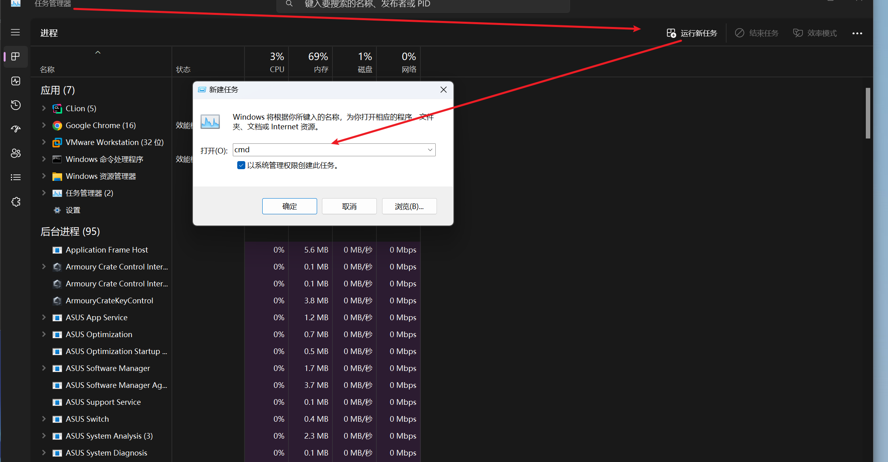


# Windows 11 激活


然后运行：
```bash
slmgr /skms  kms.03k.org
slmgr  /ato
```


# wsl
如果卡死了，直接打开任务管理器结束它即可。

```bash
wsl --list -v # 安装的
wsl --list --online #可以安装的
```

```bash
 wsl -d  kali-linux # 启动子系统
  wsl -unregister kali-linux # 卸载子系统
```
导出子系统
```bash
wsl --export Ubuntu-22.04 ubuntu.tar
```
导入子系统；Ubuntu2    是子系统名称，C:\Users\35925\wsl 是导入镜像的保存位置

```bash
 wsl --import Ubuntu2    C:\Users\35925\wsl  ubuntu.tar
```
## 文件共享
Linux 和 Windows 可以互相访问和操作对方的文件

```bash
wsl: 检测到 localhost 代理配置，但未镜像到 WSL。NAT 模式下的 WSL 不支持 localhost 代理。
llk@LLK:~$ df -h
Filesystem      Size  Used Avail Use% Mounted on
none            3.9G     0  3.9G   0% /usr/lib/modules/5.15.153.1-microsoft-standard-WSL2
none            3.9G  4.0K  3.9G   1% /mnt/wsl
drivers         276G  169G  107G  62% /usr/lib/wsl/drivers
/dev/sdc       1007G  1.2G  955G   1% /
none            3.9G   84K  3.9G   1% /mnt/wslg
none            3.9G     0  3.9G   0% /usr/lib/wsl/lib
rootfs          3.9G  2.2M  3.8G   1% /init
none            3.9G  520K  3.9G   1% /run
none            3.9G     0  3.9G   0% /run/lock
none            3.9G     0  3.9G   0% /run/shm
tmpfs           4.0M     0  4.0M   0% /sys/fs/cgroup
none            3.9G   72K  3.9G   1% /mnt/wslg/versions.txt
none            3.9G   72K  3.9G   1% /mnt/wslg/doc
C:\             276G  169G  107G  62% /mnt/c
D:\             200G  197G  4.0G  99% /mnt/d
llk@LLK:~$ ls /mnt/c
ls: cannot access '/mnt/c/DumpStack.log.tmp': Permission denied
ls: cannot access '/mnt/c/pagefile.sys': Permission denied
ls: cannot access '/mnt/c/swapfile.sys': Permission denied
'$Recycle.Bin'             DumpStack.log       KRECYCLE  'Program Files'         Recovery                     Users        Wooduan
'$SysReset'                DumpStack.log.tmp   KuGou     'Program Files (x86)'  'System Volume Information'   WeGameApps   pagefile.sys
'Documents and Settings'   GameDownload        PerfLogs   ProgramData           'Test Report'                 Windows      swapfile.sys
llk@LLK:~$
```
## 命令互通
可以在任一系统中调用另一个系统的命令

```bash
linux可以调用notepad.exe
```

```bash
windows可以通过wsl 来调用
ls | wsl grep v
```

## wslg
GPU 直通——WSL 也直接使用 Windows 的 GPU
RDP 远程桌面协议使你可以直接打开图形化应用

```bash
 sudo apt install kali-win-kex
```

## 网络
[“wsl: 检测到 localhost 代理配置，但未镜像到 WSL。NAT 模式下的 WSL 不支持 localhost 代理”的解决方法](https://www.cnblogs.com/hg479/p/17869109.html)

[WSLg/WSL2 网络配置终极方案——镜像网络](https://blog.gazer.win/essay/wsl2-mirrored-network.html)
[WSL 2 网络配置](https://blog.csdn.net/Yiang0/article/details/127780263)
```bash
C:\Users\35925下新建.wslconfig

内容为

[wsl2]
networkingMode=mirrored

```

```bash
sudo nano /etc/resolv.conf
添加如下
nameserver 8.8.8.8
nameserver 8.8.4.4
```

#   Hyper-V 
[Windows 上的 Hyper-V 简介](https://learn.microsoft.com/zh-cn/virtualization/hyper-v-on-windows/about/)
# 双系统

# 更多问题遇到再记录……

