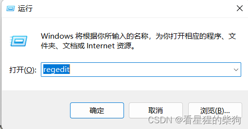
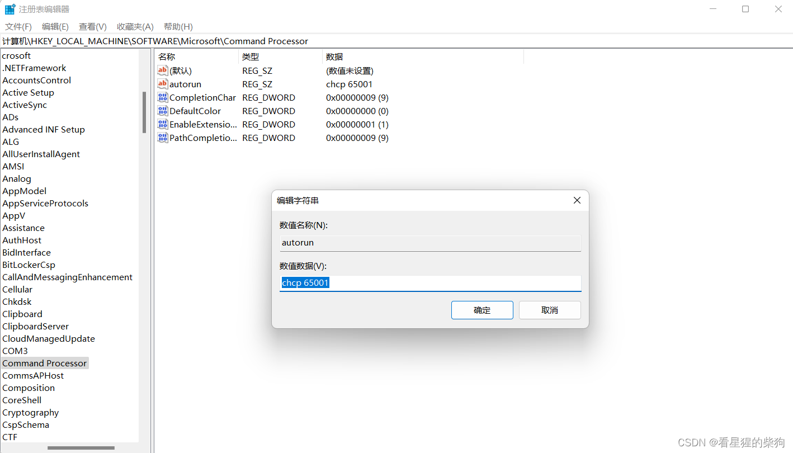
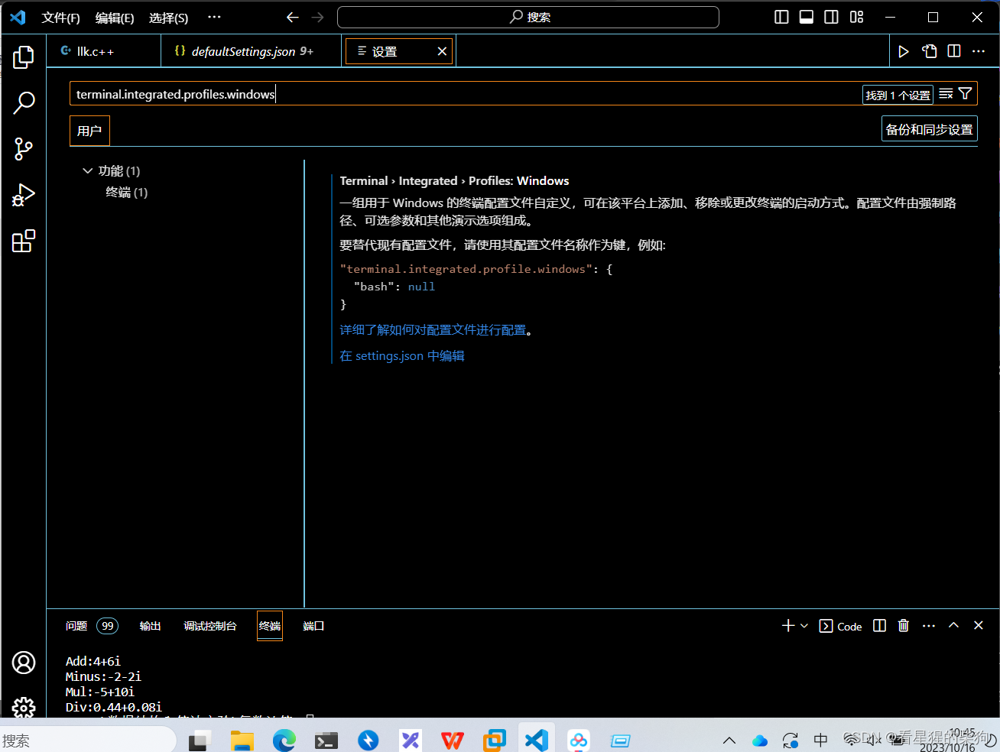
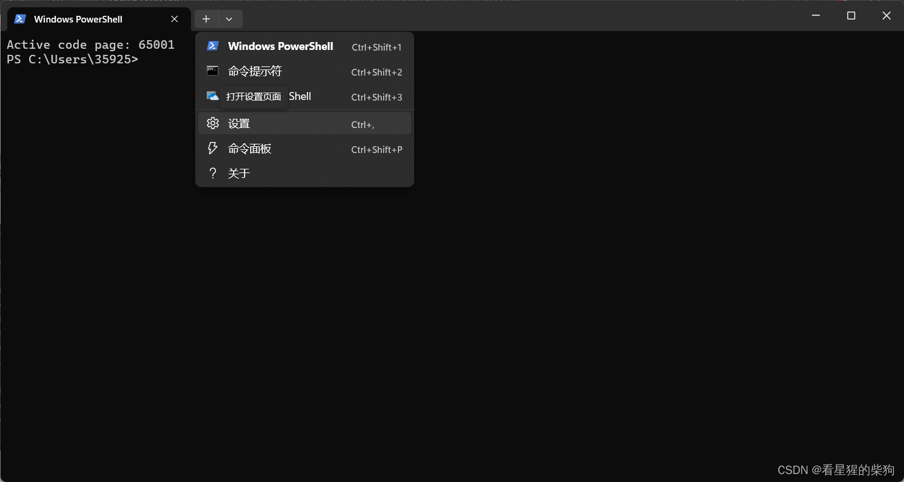
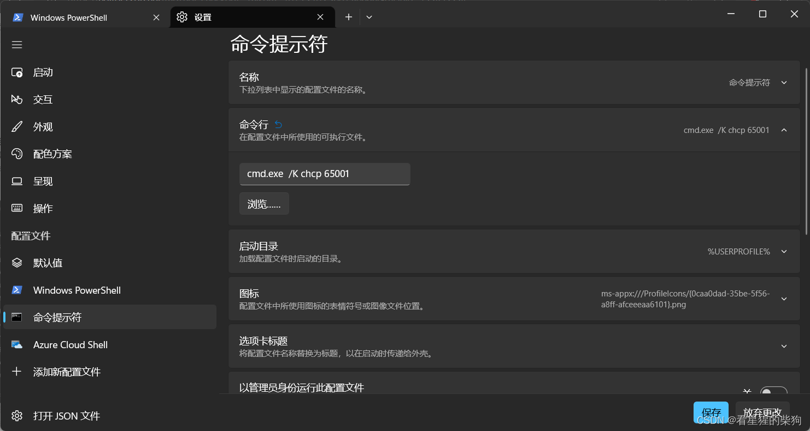
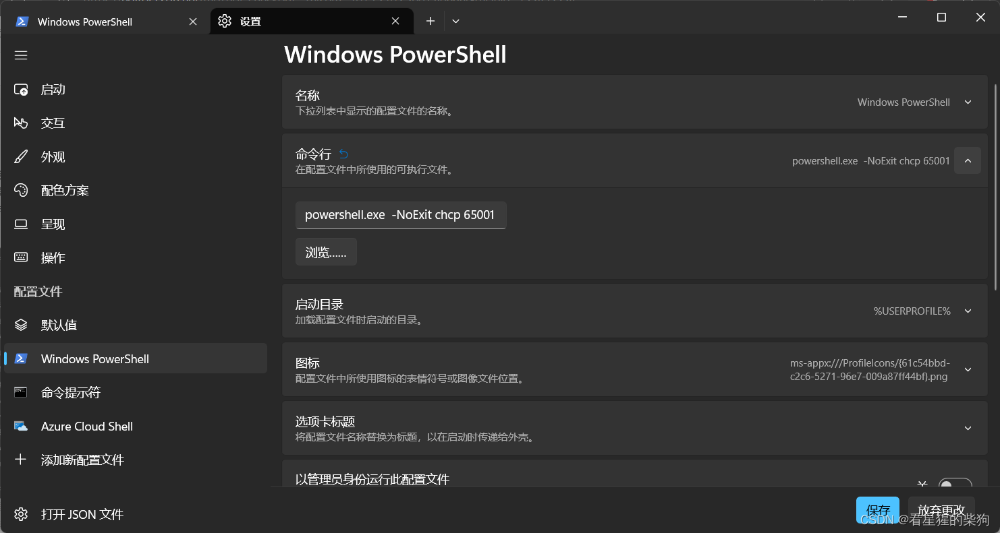
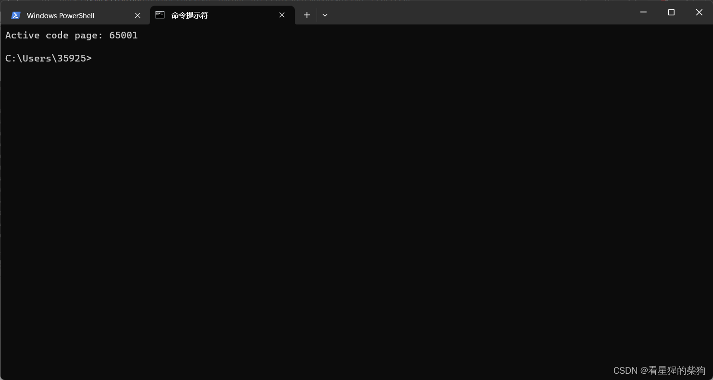
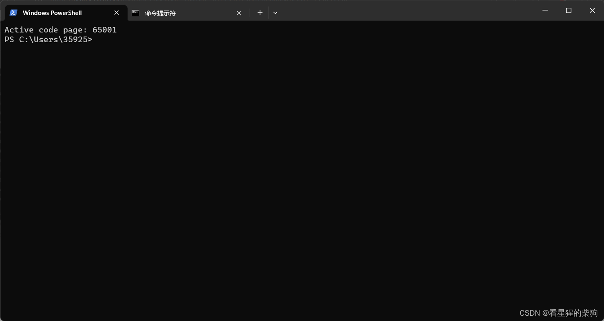


# 彻底解决 VSCode 终端乱码问题
## 方法一：修改注册表编辑器
**安装 Code Runner 并选择在终端中运行后，我发现终端里出现了乱码。我先试了网上找到的修改注册表的方法，发现 cmd 修复成功了，但终端的编码仍然是 GBK。你可以自己试一试——也许只是我电脑的问题**




## 方法二：修改 terminal.integrated.profiles.windows

***打开 VSCode 设置，搜索 terminal.integrated.profiles.windows***

***点击“在 settings.json 中编辑”，然后找到 terminal.integrated.profiles.windows 并开始编辑。一般需要修改的是 args 部分***

```typescript
    "terminal.integrated.profiles.windows": {
        

        "PowerShell": {
            "source": "PowerShell",
            "icon": "terminal-powershell",
            "args": ["-NoExit","chcp 65001"]
        },
        "Command Prompt": {
            "path": [
                "${env:windir}\\Sysnative\\cmd.exe",
                "${env:windir}\\System32\\cmd.exe"
            ],
            "args": ["/K","chcp 65001"],
            "icon": "terminal-cmd"
        }
        }
    }
```
***这样 VSCode 终端就不会再出现乱码了***
***如果希望 PowerShell 或 cmd 在打开时自动使用 UTF-8 编码，可以这样做***


***点击命令行进行修改***





***关闭后重新打开，如果出现下面的内容，就说明修改成功。你可以在最上方看到“Active code page: 65001”***



